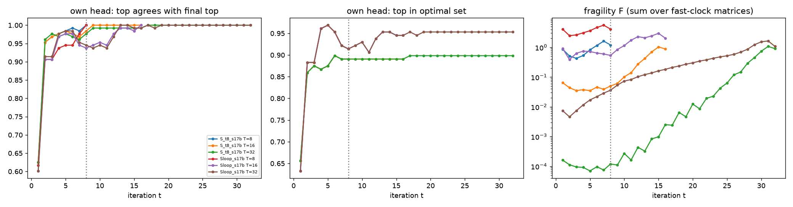

# LOOPSCOPE-01 Q3 (Lean-CGRT) summary

Exploratory, one seed per checkpoint, gold-path states of test_mirror. Own-head decodability uses the model's readout applied to every step (trained only at slow ticks, every 2nd step).

## Decodability

| ckpt | T | agree(final) t=1 | t=T/2 | t=T-1 | top in optimal t=T | p(final) t=T/2 |
|---|---|---|---|---|---|---|
| S_t8_s17b | 8 | 0.625 | 0.977 | 0.984 | 0.891 | 0.952 |
| S_t8_s17b | 16 | 0.625 | 0.984 | 1.000 | 0.891 | 0.955 |
| S_t8_s17b | 32 | 0.625 | 0.992 | 1.000 | 0.898 | 0.954 |
| Sloop_s17b | 8 | 0.617 | 0.938 | 0.977 | 0.914 | 0.943 |
| Sloop_s17b | 16 | 0.602 | 0.938 | 0.984 | 0.945 | 0.941 |
| Sloop_s17b | 32 | 0.602 | 0.992 | 1.000 | 0.953 | 0.987 |

## Fragility F (sum over matrices of mean F), fast clock

| ckpt | T | t=1 | t=4 | t=8 | t=T/2 | t=T |
|---|---|---|---|---|---|---|
| S_t8_s17b | 8 | 0.87 | 0.53 | 1.2 | 0.53 | 1.2 |
| S_t8_s17b | 16 | 0.065 | 0.0376 | 0.0501 | 0.0501 | 0.879 |
| S_t8_s17b | 32 | 0.000161 | 9.2e-05 | 0.000119 | 0.00253 | 0.904 |
| Sloop_s17b | 8 | 4.07 | 3.07 | 4.09 | 3.07 | 4.09 |
| Sloop_s17b | 16 | 0.919 | 0.744 | 0.533 | 0.533 | 2.03 |
| Sloop_s17b | 32 | 0.00741 | 0.0116 | 0.0362 | 0.182 | 1.07 |

## Share of cells with |z_read|>3 (top-32 components), t<=8 vs t>8

| ckpt | T | clock | share t<=8 | share t>8 | top-16 t<=8 | top-16 t>8 |
|---|---|---|---|---|---|---|
| S_t8_s17b | 8 | fast | 0.031 | nan | 0.061 | nan |
| S_t8_s17b | 8 | slow | 0.024 | nan | 0.046 | nan |
| S_t8_s17b | 16 | fast | 0.039 | 0.039 | 0.077 | 0.076 |
| S_t8_s17b | 16 | slow | 0.031 | 0.028 | 0.060 | 0.053 |
| S_t8_s17b | 32 | fast | 0.039 | 0.039 | 0.076 | 0.077 |
| S_t8_s17b | 32 | slow | 0.031 | 0.030 | 0.060 | 0.057 |
| Sloop_s17b | 8 | fast | 0.053 | nan | 0.094 | nan |
| Sloop_s17b | 16 | fast | 0.062 | 0.064 | 0.110 | 0.112 |
| Sloop_s17b | 32 | fast | 0.056 | 0.064 | 0.100 | 0.113 |

Null-rotation baseline for |z|>3 under a Gaussian null is about 0.003.

