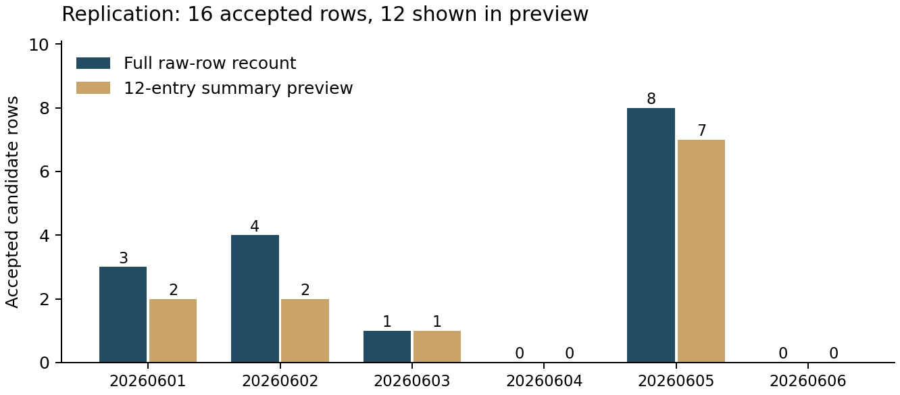
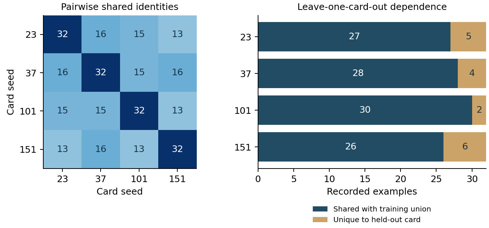
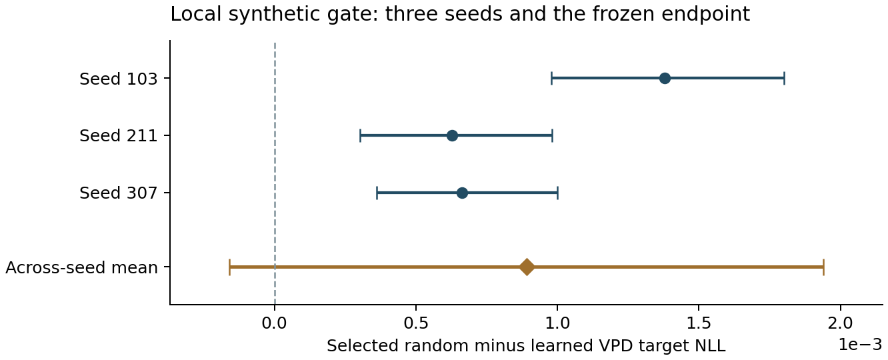

# Not Enough Deuterium to Detonate the Ocean

## Local Control Gains Without Demonstrated Recursive Improvement

Patrick Dugan · MoralityLabAI  
Retrospective audit and local follow-up · 19 November 2026  
Review draft. Historical source preserved at commit `2df0092d5be4d8e4748b3c66ef8325dedef17549`.

## Abstract

This study revisits a sequence of experiments on tiny recursive models, parameter decompositions, and task-specific steering. The June 2026 manuscript combined runtime grafts between small decision gates, policy searches over cached action scores, and later experiments with learned decomposition components. We recover an archive whose SHA-256 matches the supplied digest, preserve its original bytes, and rebuild the evidence ledger from the records available. A streamed recount resolves the discrepancy between 16 accepted replication grafts and a 12-entry summary: the latter was a truncated preview. The six replication seeds contribute unevenly. All 16 accepted rows tie their best guarded random control on task metrics and win through smaller logit movement. The recovered positive result concerns lower output perturbation under a lexicographic acceptance rule. ARC Challenge score cards overlap heavily across nominal validation folds. Wordle supplies a separate constrained-decoding result whose scores and overlap receive their own audit. A governance selector preserves its target gain while worsening the collateral task, and the validated learned-basis adapter reports leave bucket accuracy unchanged. A locally frozen follow-up fits learned VPD components on a new 1,763-parameter recurrent gate and compares matched rank-one steering across three independent seeds. All prerequisite gates pass. The mean target-loss advantage over selected random directions is 0.000890, with an across-seed 95% interval of [-0.000160, 0.001941], leaving the registered positive criterion unmet. The task-gradient baseline has lower target loss in every seed. The recovered 11.2-million-parameter model remains blocked by missing forward and tokenizer provenance. GitHub Actions reproduction awaits repository write access. The evidence supports a limited account of local control and a set of reproducibility requirements for testing broader improvement.

## 1. Scope and evidence standard

The research question is whether an interpretable parameter basis can help a controller improve a task-recursive model while preserving useful behavior elsewhere. An outer loop could select a failure, propose a parameter intervention, measure its effect, and retain successful changes. Establishing that process requires persistent gains across independent evaluation examples and repeated edits. The historical experiments reached several earlier steps along that path.

This revision treats the June manuscript as a research record. Its chronology, discarded attempts, and positive observations remain in an archival copy [R1]. The present text makes each evidential claim at the level supported by a corresponding artifact. A stored summary supports a statement about what a historical run reported. Recomputing counts from raw rows supports a stronger statement about those rows. A new execution adds evidence about the current implementation, model, data, and environment. These levels are recorded alongside results so that a reader can tell which computations have been repeated.

<!-- BEGIN GENERATED:evidence_tiers -->
| Result family | Evidence in this revision |
| --- | --- |
| Earlier full arena | Recovered summary only; sweep outside supplied package |
| Six-seed replication | Complete archived-row recount and acceptance-rule audit |
| ARC and Wordle policies | Recomputed cached-score decisions and source-identity overlap |
| Governance | Preserved report values with source-code audit |
| Component adapters | Recovered result JSON and dataset overlap; exact invocation missing |
| Later basis-search addendum | Recovered manuscript report only |
| New follow-up | local CPU: NO_REGISTERED_ADVANTAGE |
<!-- END GENERATED:evidence_tiers -->

The word *TRM* covered several architectures during this project. The small arena models are recurrent decision gates with a projected input, repeated transition and layer normalization, and an output head. Later work uses a larger recursive classifier. The methods and model identities are kept explicit throughout. “ARC” here means the multiple-choice **ARC Challenge** task; the recovered cards provide answer-label scores. They do not measure performance on ARC-AGI visual reasoning.

Parameter-basis terminology also needs precision. The arena source constructs singular-vector and class-row components of a head. Their historical names include `vdp_or_class_row` and `vdp_graft`. Those labels are preserved in machine-readable outputs for traceability. In this paper they are called **head-component grafts**. Later learned decomposition checkpoints form a separate evidence family. A convenient field name cannot establish that a learned adversarial decomposition was fitted or that its full-model reconstruction is faithful [R2, R3].

## 2. Archive recovery and custody

The recovery input is `VPD_TRM_original_records_202606.zip` from the Hugging Face dataset `AlephFunk/vpd-trm-original-records-202606`. The fetch configuration pins the dataset revision and the complete archive SHA-256. The reproduction script verifies the digest before extracting members, rejects unsafe archive paths, and emits an inventory with a SHA-256 for every member. Derived tables and experiments are written outside the extraction directory. Original checkpoints and large sweeps stay in the dataset host; Git contains their manifests and the analysis needed to verify them [R2].

<!-- BEGIN GENERATED:inventory -->
| Item | Verified value |
| --- | --- |
| Archive bytes | 1,326,795,233 |
| Extracted members | 406 |
| Original source members | 401 |
| Recovery metadata members | 5 |
| Uncompressed bytes | 3,716,109,041 |
| Dataset revision | `b208d547d20e89dc6c221bc640525320cc67a2f8` |
| Digest check | PASS |
<!-- END GENERATED:inventory -->

The archive contains a summary for the earlier run `metta_organelle_arena_full_20260531T180830Z`. Its sweep is absent from this package. The package's own missing-evidence note describes that sweep as “not requested.” This establishes the scope of the supplied recovery, while leaving the wider availability of that earlier sweep unresolved. Consequently, the earlier counts remain summary-only. They are kept separate from the later `metta_organelle_arena_paper_20260601T024147Z` replication, whose sweep is available for a complete recount [R2, R3].

The archive also preserves two earlier export ZIPs. They count as source members, and their contents may duplicate other records. The inventory reports files and bytes rather than treating every contained copy as an independent observation. The archive digest identifies the bytes used in this analysis; it does not recover an unrecorded command line, establish when a model first saw an example, or reconstruct a missing runtime state.

## 3. Historical head-component transfer

### 3.1 Task and intervention

The arena trains small organelles for decisions such as route, repair, verify, commit, and abstain. Related tasks expose compatible decision labels. A source head component is mapped into a target's label space and added at runtime. Candidate scales and component choices are scored against the target's baseline. The later replication uses six seeds, 140 training epochs, hidden width 24, hard slices, and eight random controls according to its recovered configuration [R3].

The primary raw record contains baseline metrics, intervention deltas, source and target identities, and acceptance flags. Its rows represent candidate evaluations, often related through shared models, examples, components, and scales. The resulting denominator measures search volume. It supplies no count of independent statistical trials.

### 3.2 Reconciliation of 16 and 12

The summary has a total `accepted_count` and a bounded `best_grafts` list. The code constructs that list by placing accepted candidates first and then truncating it to `top_grafts`. The paper copied the accepted total from one field and a seed distribution from the preview. The streamed audit counts all sweep rows, checks the acceptance predicate, and compares the resulting totals with the summary and preview [R3].

<!-- BEGIN GENERATED:replication -->
| Seed | Sweep rows | Accepted in full recount | Accepted in preview |
| --- | --- | --- | --- |
| 20260601 | 217,497 | 3 | 2 |
| 20260602 | 217,539 | 4 | 2 |
| 20260603 | 217,546 | 1 | 1 |
| 20260604 | 217,546 | 0 | 0 |
| 20260605 | 217,504 | 8 | 7 |
| 20260606 | 217,539 | 0 | 0 |
| Total | 1,305,171 | 16 | 12 |

| Sweep | Accepted | Stable neutral | Evidence |
| --- | --- | --- | --- |
| Earlier full arena | 23 | 54,295 | Recovered summary; sweep absent from package |
| Six-seed replication | 16 | 110,731 | Streamed raw-row recount |

The replication registry contains 186 organelles. The 16 accepted rows reduce to 14 distinct seed/source/target/component combinations when scale variants are collapsed.
<!-- END GENERATED:replication -->

*Figure 1. Each bar counts accepted candidate rows. The preview is a subset of the same sweep. The difference between the two bars exposes truncation; it carries no independent replication evidence.*

The accepted rows preserve a positive local observation under the historical acceptance rule. Their recurrence depends on seed and task family. Several accepted rows can describe nearby scales or closely related transfers, so a count of accepted rows cannot by itself estimate the probability that a new model or task benefits from a graft. The generated accepted-row file retains identities and line numbers to permit analyses at coarser units.

### 3.3 What the acceptance rule measures

The historical gate requires the designated component family, a guardrail pass, a positive signal, and a rank superior to the best guarded random row for the same seed and target organelle. Random directions are generated in groups of eight for each source-component/target combination, matched to that component's rank and Frobenius norm, then evaluated over the scale grid. The acceptance comparison pools all of those source components and scales for the target. The rank is lexicographic: it orders the task signal first, then false commits, false rejects, accuracy, and finally the negative mean absolute logit change. When all task entries tie, the last quantity rewards the smaller perturbation. A task-metric tie can therefore satisfy acceptance [R3].

<!-- BEGIN GENERATED:acceptance -->
| Diagnostic among accepted replication rows | Count |
| --- | --- |
| Strictly better task-metric rank than best guarded random | 0 |
| Equal task-metric rank; wins on smaller mean absolute logit change | 16 |
| SVD head components | 9 |
| Class-row head components | 7 |
| Repair-step targets | 14 |
| Candidate-verification targets | 2 |

All 16 accepted rows tie the best guarded random control on the first four rank entries. Their winning entry is the smaller output perturbation. The reconciled result records lower output perturbation under the historical rank rule. Strict task superiority over the best guarded random row for the target has count zero.
<!-- END GENERATED:acceptance -->

The guardrail permits some degradation. In the recovered source, accuracy can fall by as much as 0.05 and the false-reject rate can rise by as much as 0.05. The acceptance label therefore describes a bounded tradeoff under that implementation. Describing every accepted graft as preserving all task behavior would exceed the criterion.

A sweep over roughly 1.3 million dependent candidates raises a further selection issue. The target-wide maximum over many random candidates supplies a stringent empirical comparison, while pooling also changes which direction and dose define the winning random row. This rank threshold supplies no calibrated family-wise error rate over the full search. The historical acceptance rule lacks a multiplicity correction and an independently sealed confirmation set. We retain the accepted candidates as findings from an exploratory search and require separate held-out confirmation for a steering advantage.

Stable neutral rows remain a distinct count. They capture interventions that pass the guardrail while producing no positive signal. Their abundance is relevant to the search landscape and has no direct implication for task improvement.

## 4. Cached controllers and task-level claims

### 4.1 ARC Challenge overlap

The ARC experiments work with cached per-action scores. A route rule suppresses a selected answer label under a predicate built from the top choice, runner-up, and score margin. These operations can expose useful structure in the recorded scores. Their relationship to a parameter intervention requires a separate test.

The four ARC cards contain 32 rows each. The audit matches trajectory identities across cards, reports pairwise overlap, and computes the examples unique to each held-out file relative to the other files. The cross-validation source builds its training union and its held-out card separately, deduplicating within each. It does not remove held-out identities from the training union [R4].

<!-- BEGIN GENERATED:arc -->
| Held-out seed | Rows | Seen in other cards | Unique to this card | All-row delta | Unique-row delta |
| --- | --- | --- | --- | --- | --- |
| 23 | 32 | 27 | 5 | 0.0625 | 0.0000 |
| 37 | 32 | 28 | 4 | 0.0625 | 0.0000 |
| 101 | 32 | 30 | 2 | 0.0938 | 0.0000 |
| 151 | 32 | 26 | 6 | 0.0938 | 0.0000 |

The 128 scored appearances contain 62 distinct trajectory identities. Replay of the fixed `top D, runner-up A, margin <= 1.0` condition changes 44/62 correct to 48/62, with 4 rescues and 0 damages. Every fold's examples unique to that card have zero gain under this fixed rule. These post hoc slices describe the previously selected rule; their labels have already entered the research record.
<!-- END GENERATED:arc -->

*Figure 2. Shared trajectory identities quantify overlap in the historical leave-one-score-file-out procedure. Fresh random sampling seeds can still select the same examples from a small pool.*

The reported four accepted folds describe four score-file evaluations with extensive example reuse. Their acceptance cannot estimate performance on four independent sets of unseen tasks. The rule was also selected after inspecting scores and labels during the surrounding research program. Reconstructing a stricter split today would constitute a new retrospective analysis of already explored data. The present audit exposes overlap directly and reserves prospective generalization claims for a new, independently separated endpoint.

Historical ARC reports include a first cached-rule gain and a subsequent failure to pass the stacked-edit control. A broad fixed-label control can match the selective rule's score while touching more examples. That specificity observation remains useful for designing an internal steering target. It gives no evidence that the internal parameter basis already realizes the rule.

### 4.2 Wordle scoring and repeated examples

The Wordle policy penalizes `[crane]` after the first step, while retaining its availability as an opening action. Its live scorer assigns likelihoods to a small legal-action set; later scripts reuse those scores to evaluate the policy. The original reports describe a four-example card, an eight-example card, and two cards of 32 examples. The recovered scores permit arithmetic replay and an overlap audit [R5].

<!-- BEGIN GENERATED:wordle -->
| Card | Rows | Baseline correct | Policy correct | Delta | Best control delta |
| --- | --- | --- | --- | --- | --- |
| 4sample | 4 | 2/4 | 4/4 | 0.5000 | 0.0000 |
| 8sample | 8 | 4/8 | 8/8 | 0.5000 | 0.0000 |
| 32_seed23 | 32 | 11/32 | 17/32 | 0.1875 | 0.0312 |
| 32_seed37 | 32 | 9/32 | 17/32 | 0.2500 | 0.0000 |

The mean card delta is 0.359375. Weighting scored appearances by card size gives 0.263158 across 76 rows. The four-example card is contained in the eight-example card; the two later cards are disjoint from those discovery cards and from each other by recorded trajectory ID. The audit's stated identity rule yields 72 retained records with 24 baseline hits and 42 policy hits. The full audit preserves both identity definitions and repeated-record diagnostics. Identity rule: `env:trajectory_id:step`. These events span 71 recorded episodes; one episode appears at two different steps. All four cards replay their stored per-row decisions exactly.
<!-- END GENERATED:wordle -->

The unit of observation matters. Card totals count scored appearances; shared trajectory identities reduce the number of distinct examples. The headline mean across cards gives a four-row card and a 32-row card equal weight. The generated results state whether an estimate is a card mean, an appearance-weighted mean, or a deduplicated estimate. These quantities answer different questions and remain separately labeled.

This result describes constrained decoding over a specified candidate set. It supplies a positive behavior-level target for later internalization. Token penalties can improve an answer choice without locating a faithful component inside a recurrent model. The archive contains score records for this policy, while a fresh execution of the historical autoregressive model and scorer would require its complete model, adapter, and runtime provenance.

### 4.3 Outer-loop and eval-alignment records

The recovered roundout tables preserve a wider sequence of feedback and search results. The outer-loop experiments combine observed arena candidates with synthetic or estimated effects for some actions. Filtered policy totals also depend on source-family eligibility. A rule that requires an accepted component-family source excludes several controls by construction. Its resulting accepted-gain column describes that filter's behavior; a method comparison needs symmetric eligibility and independently measured task effects [R6].

<!-- BEGIN GENERATED:historical -->
| Historical family | Metric | Value | Evidence |
| --- | --- | --- | --- |
| eval_alignment_boundary | accepted_eval_aligned_count | 0 | Recovered summary/table |
| edit_bootstrap_microcycle | accepted_edit_count | 1 | Recovered summary/table |
| edit_bootstrap_microcycle | stacked_bootstrap_success | False | Recovered summary/table |
| multi_family_bootstrap_sweep | family_count | 15 | Recovered summary/table |
| multi_family_bootstrap_sweep | first_edit_family_count | 3 | Recovered summary/table |
| multi_family_bootstrap_sweep | stacked_bootstrap_family_count | 0 | Recovered summary/table |

| Historical policy | Raw total gain | Filter accepts | Filtered gain |
| --- | --- | --- | --- |
| failure_replay | 0.231252 | 0 | 0 |
| llm_edit_proxy | 0.309252 | 1 | 0.04 |
| mixed_controller | 0.634724 | 1 | 0.04 |
| random_control | 0.660724 | 0 | 0 |
| vpd_greedy | 0.660724 | 5 | 0.2 |

These values reproduce the archived roundout CSVs. The model executions and estimated-effect calculations have not been rerun.
<!-- END GENERATED:historical -->

The eval-aligned search reported zero accepted rows in its initial gate and strict hill climb. A targeted generator then reported 36 accepts before matched controls were available. Adding targeted random controls returned the accepted count to zero. The targeted-search counts remain historical manuscript reports [R1]. The relevant metric was a deterministic estimate of downstream effect. These records describe a failure to establish superiority under that estimated scoring procedure. A live task outcome would require a separate run.

The cached ARC bootstrap likewise reported one accepted edit before its next edit lost to a broad control, and the multi-family search reported zero stacked successes. These results constrain the recursive-improvement thesis. They record where a search stopped and why. Green execution status, empty stderr, or a completed search provides evidence about execution and supplies no scientific acceptance criterion by itself.

### 4.4 Later basis-search report preserved in the recovered manuscript

The archive contains a longer manuscript than the repository snapshot. Its additional sections describe June 9-10 experiments on basis-constrained gated edits. Both manuscript versions are preserved byte-for-byte. This audit has parsed the recovered text; the later experiment's candidate-level sweep and invocation have not been independently reconciled. The following values therefore retain **historical report-only** status [R10].

<!-- BEGIN GENERATED:later_basis -->
| Reported arm | Accepts | Accepts / eval | Evals to first | Accepted delta |
| --- | --- | --- | --- | --- |
| free_rank1 | 61 | 0.0046 | 15.5 | 0.750 |
| basis_constrained | 32 | 0.0024 | 24.0 | 0.953 |
| matched_random_subspace | 116 | 0.0088 | 48.5 | 0.707 |
| attribution_shuffled | 180 | 0.0136 | 7.5 | 0.850 |

Source: the recovered expanded manuscript, parsed without modifying its numbers. Each row is report-only.
<!-- END GENERATED:later_basis -->

The reported rank-three basis search accepts fewer rows than the free-rank-one, random-subspace, and attribution-shuffled arms. Its reported mean delta among accepted rows is higher. The report also describes a rank-one follow-up with 193 basis accepts and zero matched-random accepts, while the attribution-shuffled arm reaches 194. These observations motivated a distinction between useful read directions and unproven read/write pairing. They concern repeated searches over cached answer-score surfaces whose source-task independence requires separate validation.

Other additions preserve both favorable and unfavorable outcomes. A recombination probe reports 37 accepted children at 6.49 evaluations per accept, evaluated only on cells where a parent had already succeeded. A support-overlap predictor loses to a norm-product baseline in all 24 modules, with reported Spearman correlations 0.11 and 0.51. The D=72 organelle search reports zero accepts for every arm because all 2,400 evaluations per arm fail its touch cap. An Intellect-3 lane reports a best guarded estimated delta of 0.087 at edit norm 4.0, alongside zero accepts under the recurrence criterion. The recovered text discloses superseded trigger and dose settings. Those corrections remain part of the historical account.

The same added text reports reconstruction of both earlier arena runs. That statement has manuscript-level support here. It does not change the evidence tier assigned to the earlier full-arena sweep in Section 2, because the present recount uses only the supplied replication sweep.

## 5. Later learned-decomposition experiments

### 5.1 Governance patch removal

The governance experiment uses a feedforward TF-IDF classifier and trains a low-rank “dirty” update intended to improve professional-law answers while damaging ARC Challenge. A selector then subtracts component projections from that update. The report records target accuracy 0.6500 at baseline, 1.0000 after the dirty patch, and 1.0000 after the decomposition-informed cleanup. Collateral accuracy moves from 0.6775 to 0.2975 and then to 0.0100 [R7].

<!-- BEGIN GENERATED:governance -->
| Reported arm | Target accuracy | Collateral accuracy | Evidence |
| --- | --- | --- | --- |
| baseline | 0.6500 | 0.6775 | Historical report + source audit |
| raw_dirty | 1.0000 | 0.2975 | Historical report + source audit |
| decomp_ci_informed | 1.0000 | 0.0100 | Historical report + source audit |
| norm_only | 0.9500 | 0.0100 | Historical report + source audit |
| random | 1.0000 | 0.2675 | Historical report + source audit |
| svd_topk_removed | 0.6500 | 0.6775 | Historical report + source audit |
<!-- END GENERATED:governance -->

The cleanup preserves the target gain and amplifies the collateral failure. The script trains the update on the same target slice later scored and uses both scored slices to select removed components. That design supports a diagnostic about the tested slice. The exact invocation, complete selected row identities, dirty-update checkpoint, and projection coefficients remain absent from the recovered provenance.

The projection method adds another limitation. It computes each coefficient as an independent inner product divided by the component's squared norm, then subtracts the chosen weighted components. An overlapping basis generally requires a joint least-squares projection to represent the same geometric operation. The independent subtraction can change the update outside the intended residual direction. The SVD control removes up to eight directions from a rank-four patch under the script defaults, which restores the baseline by removing the patch. A comparison about selective governance must account for retained target gain and the dose of the residual update.

### 5.2 Gated adapter reports

The adapter evaluates critic reward buckets; solving a logic task requires a separate endpoint. Its code applies parameter changes through selected component directions and trains their scalar coefficients. The validated report uses four selected directions and four randomly selected directions. It reports 64 training rows, 32 validation rows, and 64 evaluation rows. All arms have bucket accuracy 0.515625 after the reported 12 steps. The selected arm's loss is 1.004116, compared with 1.001876 for the frozen model and 1.004754 for the random-component arm [R8].

<!-- BEGIN GENERATED:adapter -->
| Historical experiment | Arm | Eval loss | Bucket accuracy |
| --- | --- | --- | --- |
| SVD static | base_frozen | 1.001876 | 0.515625 |
| SVD static | vpd_static_selected | 0.972768 | 0.531250 |
| SVD static | random_trunk_control | 1.002200 | 0.515625 |
| Learned static | base_frozen | 1.001876 | 0.515625 |
| Learned static | vpd_selected | 1.016567 | 0.500000 |
| Learned static | random_trunk_control | 0.991228 | 0.515625 |
| Learned validated | base_frozen | 1.001876 | 0.515625 |
| Learned validated | vpd_validated | 1.004116 | 0.515625 |
| Learned validated | random_trunk_control | 1.004754 | 0.515625 |
| Learned validated (0 steps) | base_frozen | 1.001876 | 0.515625 |
| Learned validated (0 steps) | vpd_validated | 0.999113 | 0.515625 |
| Learned validated (0 steps) | random_trunk_control | 1.001876 | 0.515625 |

| Identity used for dataset comparison | Shared distinct identities | Evaluation rows sharing a training identity |
| --- | --- | --- |
| exact text | 637 | 666 / 3,270 |
| row id | 0 | 0 / 3,270 |
| task prefix before MODEL ACTION | 2591 | 3,117 / 3,270 |

The archived dataset has disjoint row identifiers. Exact text overlaps remain, and task context before the literal `MODEL_ACTION:` delimiter is shared by most evaluation rows. This source-task identity check exposes a different level of dependence from a row-ID split. It also leaves the historical 64-row evaluation subset unauthenticated because the exact invocation and subset IDs are absent.
<!-- END GENERATED:adapter -->

The static SVD arm records a gain of one correct bucket prediction among 64 rows and lower loss. Its learned-component counterpart falls from 0.515625 to 0.500000 bucket accuracy, while the random-component arm retains 0.515625. These are separate historical experiments with incomplete execution provenance. The zero-step validated report gives a small selected-arm loss decrease. Selected directions start with signed coefficients of magnitude 0.1; the random arm starts at zero. The reported difference therefore combines direction selection and unequal initialization dose. Equality in component count also leaves matrix norm and effective rank unconstrained. The archive recovers model-related artifacts and dataset rows, but the historical invocation and explicit train/validation/evaluation row-ID manifest remain missing. Script defaults cannot fill those gaps.

These experiments motivate a new comparison with a fixed edit budget, symmetric controls, explicit source identities, and a model replay test. The follow-up below uses those requirements as prerequisites.

## 6. Locally frozen follow-up and prerequisite diagnostics

The follow-up is specified in `experiments/deuterium/PROTOCOL.md` and `protocol.json`. Local commit `f1e3e9ba663ea906a6468d76426bb7381a6e23ad` fixed the endpoint, candidate budgets, seed set, controls, and prerequisite gates before held-out scoring. That commit was recorded in the task session before the scoring command; external hosted registration remains unavailable. The prepared Actions workflow records the tested revision, runtime environment, and output artifacts. Calibration and pilot observations remain separate from final scoring [R9].

### 6.1 Recovered-checkpoint prerequisites

The recovered lane audits the powered classifier and its learned decomposition. Safe tensor loading permits a comparison of frozen tensors, component shapes, and residual norms. The original forward class and dataset/tokenization implementation are prerequisites for reproducing predictions. Weight equality alone cannot identify those computations. The recovered model's configuration uses a single reasoning step, which also limits any claim about multi-step recurrence.

The historical dataset's source-task overlap requires a stricter boundary for future testing. Grouping text before the literal `MODEL_ACTION:` field leaves 51 previously unseen evaluation task roots, comprising 153 rows. These remain unscored. A recovered-model steering experiment would first need the pinned original source, reference-logit agreement, and a prospective allocation of those task groups or newly acquired independent tasks. A failed prerequisite records a blocked comparison with its cause.

### 6.2 New synthetic recurrent-gate method

The local comparison uses the repository's `RecursiveGateTRM` on a newly generated commit/veto/repair task. The 16 input coordinates determine labels through fixed linear threshold rules. Model width is 32 and the shared transition runs three times. Each registered seed receives its own training, calibration, and held-out examples, model initialization, learned decomposition, and random bank. This lane tests the steering method on a defined toy distribution. Historical Intellect-3, ARC, Wordle, adapter, and governance outcomes retain their separate evidence status.

Seeds 103, 211, and 307 are reserved for the comparison. Seed 997 serves only the calibration/runtime pilot, which never generates held-out data. The fixed schedule trains a model on 2,048 examples for 500 steps and calibrates on 512. Clean calibration and held-out accuracy must each reach 90%, and every class must supply at least 32 examples per scored split. An unsuccessful seed remains in the report and prevents a completed three-seed verdict.

The learned arm calls the repository's `param_decomp.run_param_decomp.optimize` to fit 32 rank-one head components. Its objective includes the existing adversarial reconstruction term, importance minimality, and weight faithfulness. The fixed schedule performs 200 warmup updates followed by 300 main updates. Head SVD appears only in the explicitly named task-gradient baseline, where it supplies the best rank-one approximation to the training-loss gradient.

Each learned candidate and each of 32 independent Gaussian outer-product controls is normalized to 1% of the original head's Frobenius norm. The selector tests both signs on calibration veto examples with equal candidate budgets and chooses the lowest cross-entropy. The gradient baseline receives the same rank and dose. Clean inference and a zero edit provide baseline and sham. Full-model and cached-head intervention paths must agree within `2e-6` maximum absolute logit error, and restored weights must reproduce clean inference. Components-only fidelity and residual-restored fidelity are recorded separately. The residual's ability to restore a forward pass supplies no conclusion about the usefulness of individual learned directions.

The primary seed effect is target-veto negative log-likelihood for the selected random arm minus that for the learned arm. A positive value favors learned steering. Each seed receives a paired 2,000-resample bootstrap interval; the mean across independent seeds receives a 95% Student t interval with two degrees of freedom. Secondary outcomes include the task-gradient comparison, target accuracy, overall accuracy, commit/repair collateral accuracy, and false commits on veto examples. The complete report retains literal edit matrices, selected directions, per-example scores, runtime, and failed gates.

The frozen positive criterion requires every prerequisite to pass, a positive primary effect in every seed, an across-seed lower interval bound above zero, and at most two percentage points of collateral accuracy loss in each seed. A completed run may produce a negative or inconclusive finding. Execution success remains an engineering status.

<!-- BEGIN GENERATED:followup -->
**Execution status: local CPU: NO_REGISTERED_ADVANTAGE.**

The frozen synthetic recurrent-gate protocol was executed on local CPU. The comparison completion flag is True. Registration commit: `f1e3e9ba663ea906a6468d76426bb7381a6e23ad`. Protocol SHA-256: `c6bd49b7423091f02fd55812a51a24aae8f4f07332b3178e006a64a015f908a9`. GitHub Actions reproduction remains blocked by repository write access; the local freeze was recorded before held-out scoring.

| Prerequisite or pilot | Verdict | Observed evidence |
| --- | --- | --- |
| Recovered checkpoint task/replay gate | BLOCKED_ARCHITECTURE_PROVENANCE | 11,191,328 parameters; 91 frozen tensors checked; exact equality=True; task performance evaluated=False. |
| Recovered residual: bucket_head | MATRIX AUDIT | 16 learned components; residual/weight Frobenius norm=0.203684. |
| Recovered residual: networks.0.layers.0.1.to_out | MATRIX AUDIT | 32 learned components; residual/weight Frobenius norm=0.783704. |
| Recovered residual: networks.0.layers.1.1.ff.2 | MATRIX AUDIT | 32 learned components; residual/weight Frobenius norm=0.798766. |
| Auxiliary pilot seed 997 | PILOT_CALIBRATION_ONLY | Clean calibration accuracy=0.966797; runtime=4.48 s; held-out evaluated=False. |
| Pilot replay diagnostics | CALIBRATION ONLY | Components-only KL=0.000003; argmax agreement=1.000000; residual-restored maximum logit error=0. |
| Retained pilot failure, seed 997 | ENGINEERING_FAILURE | The initial pilot failed Config validation: slow_eval_freq must be a multiple of eval_freq. The failed receipt is retained. |

### 6.3 Local held-out comparison

| Seed | Clean test accuracy | Veto rows | Random minus VPD NLL | 95% paired-row interval | Runtime (s) |
| --- | --- | --- | --- | --- | --- |
| 103 | 0.9771 | 641 | 0.001378 | [0.000978, 0.001800] | 4.17 |
| 211 | 0.9712 | 627 | 0.000629 | [0.000303, 0.000981] | 3.13 |
| 307 | 0.9673 | 669 | 0.000664 | [0.000361, 0.001000] | 3.43 |

The mean primary effect across seeds is 0.000890402, with a 95% t interval [-0.000159859, 0.001940663]. The recorded verdict is `NO_REGISTERED_ADVANTAGE`. Every seed passes its prerequisites. Collateral gate passed: True. The across-seed interval includes zero. Each within-seed interval is positive; those intervals quantify row variation conditional on one trained model. The across-seed interval treats the independently trained model/decomposition as the replication unit.

*Figure 3. Positive values favor learned steering over the selected random arm. Seed intervals use paired-row bootstrap; the bottom interval uses the mean of three independent seed effects and Student t with two degrees of freedom. Both estimate the same contrast at different levels of variation.*

| Seed | Arm | Target NLL | Target accuracy | Collateral delta (pp) | False commits / veto |
| --- | --- | --- | --- | --- | --- |
| 103 | clean | 0.066945 | 0.9704 | 0.0000 | 0.0094 |
| 103 | sham | 0.066945 | 0.9704 | 0.0000 | 0.0094 |
| 103 | vpd | 0.064486 | 0.9750 | 0.0711 | 0.0062 |
| 103 | random | 0.065864 | 0.9704 | 0.0000 | 0.0094 |
| 103 | task_gradient | 0.062824 | 0.9735 | 0.0000 | 0.0094 |
| 211 | clean | 0.033766 | 0.9856 | 0.0000 | 0.0080 |
| 211 | sham | 0.033766 | 0.9856 | 0.0000 | 0.0080 |
| 211 | vpd | 0.032650 | 0.9856 | -0.0704 | 0.0080 |
| 211 | random | 0.033279 | 0.9856 | -0.0704 | 0.0080 |
| 211 | task_gradient | 0.032200 | 0.9872 | -0.1408 | 0.0080 |
| 307 | clean | 0.024806 | 0.9940 | 0.0000 | 0.0030 |
| 307 | sham | 0.024806 | 0.9940 | 0.0000 | 0.0030 |
| 307 | vpd | 0.023592 | 0.9940 | -0.1450 | 0.0030 |
| 307 | random | 0.024256 | 0.9940 | 0.0000 | 0.0030 |
| 307 | task_gradient | 0.023246 | 0.9940 | -0.1450 | 0.0030 |

The task-gradient baseline has lower target NLL than learned VPD in 3 of 3 seeds. Clean and sham outputs agree. VPD collateral accuracy changes in percentage points are 103: +0.0711, 211: -0.0704, 307: -0.1450. Model parameter counts: 1,763. The measured seed runtimes include model training, decomposition, selection, and scoring; environment setup and archive recovery are outside that timing. The CPU was AMD EPYC 9V74 80-Core Processor with 2 PyTorch threads. The frozen source used Python 3.12.14 and PyTorch 2.5.1+cpu. Eleven package versions accompany the result receipt; a contemporaneous full transitive package freeze is absent. The Actions workflow will capture `pip freeze`.

Residual-restored replay has maximum absolute logit error 0.0. Components-only calibration KL ranges from 1.900e-06 to 2.024e-06, with minimum argmax agreement 1.0. The literal edits, checksummed per-example held-out scores, loss traces, and selected candidate receipts remain available for replay.

Recovered-model missing prerequisites: experiments.hermes_skill_gym.train_hrm_hermes.HermesHRMClassifier; experiments.hermes_skill_gym.hermes_dataset.HermesSkillDataset; independent original forward logits for replay validation; historical x-transformers/package versions. These gaps prevent a recovered-task steering comparison.

Positive NLL differences favor VPD. The primary interval uses three independent model/decomposition seeds and two degrees of freedom; within-seed row intervals describe a separate level of variation. Secondary outcomes retain descriptive status.

The new experiment concerns a generated commit/veto/repair distribution with output-head edits. Its evidence is separate from the recovered arena, ARC, Wordle, governance and adapter records.
<!-- END GENERATED:followup -->

## 7. Interpreting local control and testing recursive improvement

Head-only interventions change how a learned state is translated into a decision. The arena and new toy lane use that restricted boundary. A claim about recurrent computation would additionally require per-step traces, interventions inside the shared transition, and a faithful replay of those trajectories. The toy's synthetic threshold task provides a tractable method check; its complexity limits extrapolation to language reasoning or a broad control architecture.

A claim of recursive improvement would require a sequence of retained model updates, measured task gains after each update, a growing evaluation set isolated from the selector, and controls for the increased search budget. Repeated selection over the same scores can increase a researcher's knowledge of the examples while leaving model capability unchanged. A useful next study must track that separation through source-task identities and prospective evaluation. The local method study meets its replay and control prerequisites while its across-seed interval leaves the positive criterion unmet. Its target-loss ordering also gives a reason to retain the task-gradient baseline in larger studies. A repeated training run on an independent host would test numerical portability; a new task distribution would address a different generalization question.

## 8. Reproduction and remaining provenance

The repository's `experiments/deuterium/README.md` gives the supported commands and pinned dependency environment. The pipeline verifies and inventories the archive, streams the retrospective recount, runs the specified follow-up gates and eligible comparisons, and regenerates this paper's tables and figures. The prepared GitHub Actions workflow records the tested revision and runner details when executed. Current model results come from the local CPU run. An independently implemented saved-row verifier passed its checks across all 6,144 held-out examples, reproducing cross-entropy, aggregate metrics, bootstrap intervals, and saved edit rank/dose. Its receipt is `../../experiments/deuterium/results/followup/verification.json`. That check covers arithmetic and stored tensors; a fresh forward execution on an independent host remains a separate step. Reproduction requires the hash-verified dataset archive; it does not require committing that archive to Git.

<!-- BEGIN GENERATED:gaps -->
| Evidence gap | Current boundary |
| --- | --- |
| Earlier full-arena sweep | Absent from supplied package; summary recovered; package says not requested. |
| Historical execution commit | Recovered source and records agree on reviewed logic; exact run-to-commit attestation remains absent. |
| Arena generalization | Fresh confirmation examples and multiplicity-controlled search evidence remain required. |
| ARC independence | Card overlap is measured; a prospective task-disjoint test remains required. |
| Wordle source episodes | Recorded identities support overlap checks; complete upstream puzzle/episode lineage remains incomplete. |
| Governance provenance | Exact invocation, full selected row IDs, dirty-update checkpoint, and projection coefficients remain missing. |
| Adapter provenance | Exact invocation and selected train/validation/evaluation row IDs remain missing. |
| Recovered-model execution | Original forward class, dataset/tokenizer implementation, independent reference logits, and historical x-transformers/package versions remain missing. |
| Later basis-search claims | Preserved expanded-manuscript reports; candidate-level recount and invocation reconciliation remain open. |
| New method scope | One synthetic gate distribution, head-only edits, and three model/decomposition seeds; the frozen positive criterion is unmet in the local run. |
| Local runtime provenance | Eleven package versions were recorded at scoring and match the frozen requirements; a contemporaneous full transitive package freeze is absent. |
| Hosted follow-up | GitHub Actions reproduction and remote review branch/PR remain blocked by repository write access. |
<!-- END GENERATED:gaps -->

The analysis cannot infer a historical command from a script default. A matching record hash establishes which stored values were read. Row identities, model lineage, and exact execution flags require their own records. The earlier full-arena sweep remains outside the supplied package. Future recovery should add those originals with their hashes and update the ledger as a new retrospective revision.

## References and artifact ledger

**[R1] Historical manuscript.** `archive/original_vpd_trm_feature_steering_paper_2df0092.md`, copied byte-for-byte from repository commit `2df0092d5be4d8e4748b3c66ef8325dedef17549`. SHA-256: `45822fdda4460fa36641aac54af5b8a5d828f98d69c07cf8bba5a40e0f3072da`. The adjacent archive manifest records its original path and Git blob. The longer recovered manuscript is preserved separately [R10].

**[R2] Recovered records.** [Hugging Face dataset at the pinned revision](https://huggingface.co/datasets/AlephFunk/vpd-trm-original-records-202606/tree/b208d547d20e89dc6c221bc640525320cc67a2f8). Archive SHA-256: `a45db5ef5e603852efb4f247112655c5572eff5aa85f9ab94674a4ae9dc8f003`. Member paths and hashes: `../../experiments/deuterium/results/archive_manifest.json`. The archive's `MANIFEST.json`, `reconciliation.json`, and `MISSING_FILES.md` retain the recovery author's metadata. `tables/source_ledger.csv` maps the files used in this audit to complete member paths and digests.

**[R3] Arena records and source.** Archive prefix `sources/D/Research_Engine/runs/`; replication directory `metta_organelle_arena_paper_20260601T024147Z`; earlier summary directory `metta_organelle_arena_full_20260531T180830Z`. The recovered implementation is `sources/D/projects/VDP/param_decomp/experiments/metta_organelle_arena.py`. Recomputed counts and line-addressable accepted rows are under `../../experiments/deuterium/results/retrospective/`.

**[R4] ARC score cards and cross-validation.** Four recovered ARC Challenge cards for seeds 23, 37, 101, and 151; raw paths and hashes appear in the retrospective audit. The condition cross-validation source is preserved in the repository. Generated overlap and held-out-identity tables record the comparison used here.

**[R5] Wordle.** Archive run `sources/D/Research_Engine/runs/trm_wordle_vpd_hook_probe_20260603/`, including the four- and eight-example cards and `overnight_validation_32x2_20260604_retry_smallgpu`. Scoring and replay source appear in `sources/D/projects/VDP/param_decomp/experiments/`. The retrospective outputs identify exact card paths and distinguish stored summaries from recomputed policy scores.

**[R6] Historical roundout.** Archive run `sources/D/Research_Engine/runs/vpd_trm_paper_roundout_20260604/`, including `paper_experiment_manifest.csv`, `paper_metric_table.csv`, `paper_policy_comparison.csv`, and `paper_claim_ledger.csv`. Recovered summaries carry historical claim labels that this revision reassesses.

**[R7] Governance.** `../../reports/trm_governance_report.md` and `../../scripts/trm_governance_test.py`, with recovered copies identified by the archive member inventory. Missing execution and intermediate-update provenance is documented in the archive's `MISSING_FILES.md`.

**[R8] Component adapters.** `../../reports/powered_int3_validated_vpd_zero_step_report.md`, `../../reports/powered_int3_validated_vpd_gated_adapter_report.md`, and `../../scripts/run_powered_int3_vpd_gated_adapter.py`; recovered result JSON and dataset paths appear in the retrospective audit.

**[R9] Follow-up and reproducibility.** `../../experiments/deuterium/PROTOCOL.md`, configuration and dependency pins, workflow source, and recorded outputs under `../../experiments/deuterium/results/`. The reproducibility README records the local freeze and hosted-run status.

**[R10] Recovered expanded manuscript.** `archive/recovered_vpd_trm_feature_steering_paper.md`, copied from archive member `sources/D/projects/VDP/papers/VPD_TRM_Feature_Steering/vpd_trm_feature_steering_paper.md`. SHA-256: `0bcfa35bf6f4599ce2b521ee5655bda6370a86cee8529cef9701f7f9dd01dc6b`. This copy contains additional June 9-10 basis-search sections absent from [R1]. A historical Git commit has not been inferred for this version.
