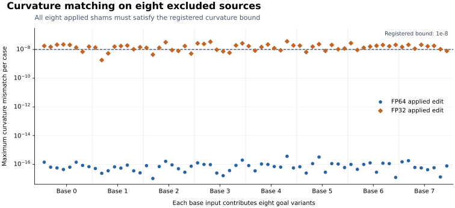

# LGA-10B first excluded-source result

**FAIL_SOURCE_FEASIBILITY: 16/64 cases admitted, with 61/64 required.**

The spectral matcher constructed all eight separated curvature-matched shams
in FP64 for every case. Applying those vectors through FP32 state addition
caused 48 cases to exceed the frozen curvature tolerance. The independent
NumPy audit passed all 64 captured cases.

The implementation was frozen at
[`57cb53c686d2f9e3932614d3ca842dd2091e6e3e`](https://github.com/MoralityLabAI/LoopedTransformers/commit/57cb53c686d2f9e3932614d3ca842dd2091e6e3e)
before the first excluded model initialization or source generation. The
[first CI run](https://github.com/MoralityLabAI/LoopedTransformers/actions/runs/44324813047)
ran on 18 November 2026. Its outcome is preserved unchanged. The
[implementation addendum](IMPLEMENTATION_FREEZE.md) fixes all numerical gates
and narrows the mathematical claims in the original registration.

## Evidence class and release decision

This is **SOURCE_ONLY_UNTRAINED_ENGINEERING**: one untrained 44,001-parameter
initialization and eight independently generated input bases, with eight
correlated goal variants per base. Both model initialization and excluded
inputs use seed 61065. There are 512 shams, all chosen from source labels and
clean frozen derivatives. Edited task correctness was never scored.

| Endpoint | First-run result |
|---|---:|
| Cases with all eight FP64 shams | 64/64 |
| Cases passing FP32 addition accuracy | 16/64 |
| Final case admission | 25.00% |
| Frozen minimum admission | 61/64, or 95.3125% |
| Failed cases attributed to FP32 curvature | 48 |
| Other failed physical constraints | 0 |
| Independent raw-receipt audit | 64/64 passed |
| Automated tests before generation | 27/27 passed |

The engineering gate remains failed. Science seeds **31059, 31064 and 31065**
remain ungenerated; trained teacher and potential bundles remain unopened.
ARG-03-N, AMM and CQ remain outside this work. The 61/64 rule is an engineering
gate over these dependent cases. It provides no independent-binomial
confidence statement or estimate of a trained causal effect.

## What the spectral construction established

For every native case, the clean physical geometry had dimension 75 in K,
future-Jacobian rank 10, dark-space dimension 65 and orthogonal complement
dimension 64. The matcher retained the donor's future-J rowspace component
z0, its natural physical radius and the scalar donor-margin curvature.

At each registered cosine c, it parameterized the dark component by

\[
q=r\left(cu+\sqrt{1-c^2}\,Vv\right),\qquad \|v\|=1,
\]

where u is the donor's dark direction and V spans its orthogonal complement
inside the dark space. Substitution reduces the signed margin quadratic to

\[
Q_c(v)=k_c+2b_c^Tv+v^TA_cv.
\]

Global extrema on each sphere supply the attainable curvature interval.
The equality-constrained multiplier may have either sign. The solver also
handles a nonzero linear term orthogonal to the extreme eigenspace, using
the complementary solution and filling the remaining norm inside that
eigenspace. This follows the sphere optimality characterization in
[Hager (2001), Lemmas 2.1–2.2](https://people.clas.ufl.edu/hager/files/sphere.pdf).
All certificates here use ordinary FP64 arithmetic, with explicit residual
and eigensystem allowances.

The target lay within **447 of the 448 attained slice intervals**. At
c=-0.85, 63/64 cases were feasible. Each of the other six registered cosines
contained the target in all 64 cases. The completed shams used c=-0.85 in
497 instances and c=-0.65 in 15.

Two cases explain every move to the second slice:

| Case | First-slice finding | Frozen search response |
|---|---|---|
| Base 5, goal 30 | Target 0.09457922 exceeded the maximum 0.09354377 | All eight shams used c=-0.65 |
| Base 4, goal 60 | Target -0.18789353 lay near the minimum -0.18956083 | The first sham used c=-0.85; seven later searches exhausted 32 diversity attempts there and succeeded at c=-0.65 |

The second case generated all 224 rejected sampling attempts. Their
pairwise cosines ranged from 0.996981 to 0.998522. After the frozen fallback
to c=-0.65, the completed controls satisfied the diversity rule in every
case. The largest accepted pairwise cosine was 0.97692047, below 0.98.

The dark component retained substantial physical norm. Across cases,
r/rho ranged from 0.92275 to 0.99118. Natural radii ranged from 5.196 to
8.165, with median 6.569. These witnesses establish separated level-set
controls in the sampled FP64 geometries.

The earlier [LGA-10 random-plane pilot](../loopscope13/SOURCE_FEASIBILITY_RESULT_20261118.md)
admitted 28/64 on seed 61064. It used
a different untrained initialization and source cohort. A paired replay on
that archived cohort would measure the change in sampler coverage directly.
The present result describes the newly frozen 61065 pilot.

## Curvature accuracy after physical addition

For each sham, the runner evaluated the vector obtained by adding the edit
to the reached two-token state and subtracting that state. The FP32
calculation was exactly

```python
actual32 = (h.float() + edit.float()).double() - h.float().double()
```

Fresh native HVPs evaluated the applied selected edit and every applied
sham. FP32 curvature parity used its applied selected edit as the reference.
Every intended target had magnitude below one, so the registered curvature
limit was **1e-8 in all 64 cases**.

| Largest sham-versus-donor curvature error within a case | Minimum | Median | Maximum |
|---|---:|---:|---:|
| FP64 applied edits | 1.019e-17 | 6.722e-17 | 3.608e-16 |
| FP32 applied edits | 1.817e-9 | 1.576e-8 | 3.656e-8 |



There were **147 curvature violations among the 512 shams**. They occurred
in 48 cases, each containing between one and six failing shams. Because a
case requires all eight controls, the final admission count was 16.

| Base input | FP64 cases admitted | Final cases admitted |
|---:|---:|---:|
| 0 | 8/8 | 1/8 |
| 1 | 8/8 | 2/8 |
| 2 | 8/8 | 4/8 |
| 3 | 8/8 | 3/8 |
| 4 | 8/8 | 2/8 |
| 5 | 8/8 | 2/8 |
| 6 | 8/8 | 1/8 |
| 7 | 8/8 | 1/8 |

Every other physical check passed its frozen dtype tolerance. FP32 maximum
full-J response error was 1.350e-7, against a 1e-6 limit. Maximum K residual
was 2.957e-7. Dose error reached 1.825e-7. Actual dark angles used the
projector P_N=P_K-RR^T, while the separate K check retained any rounding
component outside K. The complete raw errors and scale-dependent limits
are retained for each case.

## Post-result explanation from the captured arrays

This section uses the archived vectors and Hessian actions. Its calculations
were performed after the first result and involved no model or source
generation. The [derived analysis](results/rounding_analysis.json) is kept
separate from the first-run receipt.

For e=actual32-intended, the applied edit differs from the intended edit
by a median Euclidean norm of **3.584e-7** across the 576 donor/sham vectors.
The range was 2.538e-7 to 5.409e-7, with median ratio ||e||/rho of
5.480e-8. A quadratic form obeys the exact identity

\[
Q(z+e)-Q(z)=2e^THz+e^THe.
\]

Using H actions reconstructed from the stored basis, the first term
explained every sham-versus-donor parity error to a maximum residual of
**2.624e-15**. The largest absolute second term was 3.708e-15. Including
both reproduced the parity drift within 2.162e-15. The reconstructed
intended H actions agreed with fresh FP64 validation HVPs to a maximum
vector residual of 2.085e-15.

The worst case was base 4, goal 60, sham index 5. Its FP32 parity error
was 3.656e-8. The difference between sham and donor linear rounding terms
was 3.655507024e-8. These identities account for the observed failure at
the retained curvature threshold.

The scope of this calculation is FP32 state-plus-edit rounding evaluated
with the clean FP64 native Hessian. Running the recurrent model and its
derivative oracle entirely in FP32 requires a separate accuracy check.
Matching the one signed margin quadratic controls that Taylor coefficient;
higher orders and other class-specific Hessians remain outside the match.

## Verification and provenance

The 27 automated tests covered general sphere hard cases, an independent
two-dimensional polynomial solution, extreme numerical scales, gauge
transport, deterministic replay, feasible and infeasible synthetic forms,
native central finite differences, and the applied-edit gate. Synthetic
counterexamples establish the limited scope of the seven-angle grid and
the possible later crossing returned by sign bisection.

The independent auditor imports neither the matcher nor the sphere solver.
It rechecks the legal source law, physical projectors, curvature equality,
HVP reconstruction and extremizer stationarity/PSD from the saved arrays.
Its [first-run report](results/first_run_audit.json) passed all 64 cases.

The pilot used 4,224 construction HVPs and 1,152 fresh validation HVPs,
for **5,376 total**. Wall time was 59.099 seconds; process CPU time was
59.021 seconds. Peak process RSS was 375,112 KiB, approximately 366.3 MiB.
The environment was Python 3.11.18, CPU Torch 2.7.1 and NumPy 2.2.6, with
one Torch thread and deterministic algorithms enabled.

| Item | Immutable receipt |
|---|---|
| Freeze commit | `57cb53c686d2f9e3932614d3ca842dd2091e6e3e` |
| First workflow run | `44324813047`, attempt 1 |
| Artifact ID | `14436696645` |
| Original artifact ZIP SHA256 | `4dc6ef747372a7bfdc5c578dfe6a79b88acc19ef45d1a16b0b6192d94b9a23b0` |
| Original feasibility JSON SHA256 | `e9b70dfdc640c21010464e621bf07946c3895e1f1adbb3291abc6c5cfb6777f7` |
| Original raw NPZ SHA256 | `dd766c4cf62ebb25d62f330fbde9a015e2fa969b94fa85bd92dce61724c3e5b8` |
| Input tensor SHA256 | `a8c7e328857a6fde10481325a120a6db59a2954a9ce153df69e59b528ff7d73b` |
| Untrained model tensor SHA256 | `a04c36a5e0fd1fd04f5d1665e95600042f933479b395e8497a1721bd0a1d06f0` |

The repository contains the [complete case summary](results/first_run_summary.json),
including all 64 outcomes and implementation hashes. The original CI
artifact contains the full 1,855,298-byte feasibility JSON, compressed raw
NPZ, audit, summary and hash files. Its ZIP was downloaded and verified
against the artifact digest. A durable copy of that original archive was
also saved for the participant.

## Next experiment proposed by these results

The observed error identifies candidate acceptance after physical FP32
addition as the next source-only question. A successor can apply the
round trip to each proposed control and compare its curvature with the
applied donor before accepting it. Candidates that miss the frozen bound
would consume a registered attempt and proceed to the next seeded draw.
The same K/J/dose and angle checks must run on the applied vectors.

That successor needs its own prospective attempt budget, implementation
lock, excluded cohort and full native FP32 derivative check. The 365
individual shams that passed the current curvature bound make this a
concrete development hypothesis. Their shared geometries and donor
references leave the success rate of eight jointly admissible controls
to the next experiment. The current first-run result stays at 16/64 and
the trained-native release remains held.
