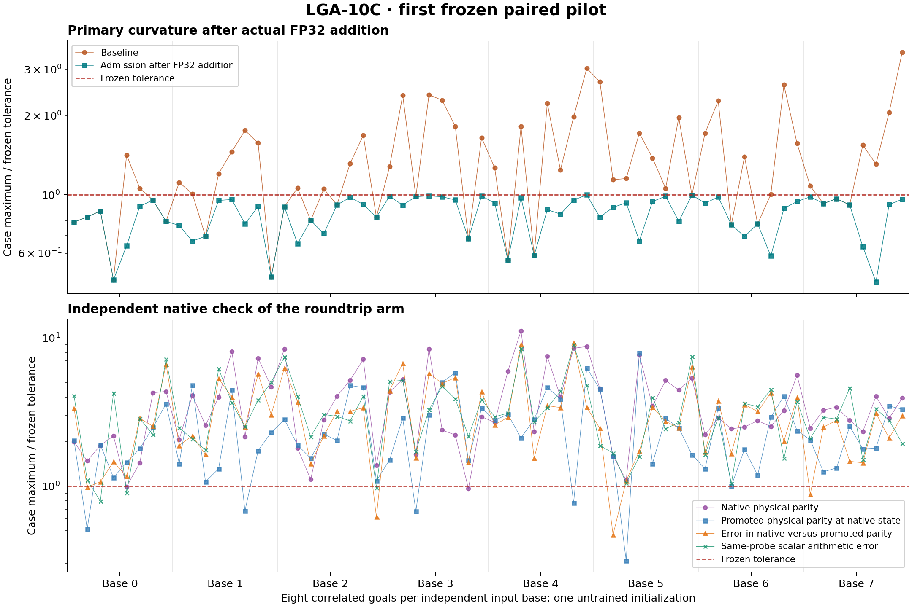

# LGA-10C first paired source-only result

19 November 2026, Singapore. The repository branch and freeze documents use
the UTC experiment date, 18 November.

**Overall readiness: FAIL, 0/64 cases.** The roundtrip matcher reached
64/64 primary admissions. Its independent native FP32 gate passed 0/64,
which keeps the trained-source release closed.

The protocol was committed at
`bcb8def743ab405267ebc5080671eab90b8bfbc2`. Implementation commit
`3f0ef5cdecfd9184531f53c954f1cc2b04821d02` then froze the code, tests,
auditor and workflow before excluded model/input seed 61066 was opened.
This report describes [the first CI run, attempt 1](https://github.com/MoralityLabAI/LoopedTransformers/actions/runs/44346786213).

## Registered results

| Case-level endpoint | Frozen LGA-10B baseline | Admission after FP32 addition |
|---|---:|---:|
| Eight controls constructed | 64/64 | 64/64 |
| Final FP64 physical checks | 64/64 | 64/64 |
| Primary admission after both application checks | 22/64 | **64/64** |
| Independent native FP32 readiness | 0/64 | 0/64 |
| Primary AND native readiness | 0/64 | 0/64 |

Each registered gate requires at least 61/64 cases. A case requires all
eight controls. The primary comparison used the same eight input bases,
the same eight goals per base and one untrained 44,001-parameter model
initialization. FP32 weights were initialized once and copied exactly into
FP64. No edited task correctness was scored.

The independent NumPy audit passed all 64 cases, including all 1,109 new-arm
candidate vectors and 512 shared baseline proposal witnesses. The first
run contained no case exceptions, failed interpolation paths or exhausted
searches. Every one of the 448 registered smooth slices contained the target.

## Paired primary comparison

| Baseline outcome | Roundtrip outcome | Cases |
|---|---|---:|
| Pass | Pass | 22 |
| Fail | Pass | 42 |
| Pass | Fail | 0 |
| Fail | Fail | 0 |

The equal-base macro gain was 0.65625, or 65.625 percentage points. All
eight independent bases gained admissions:

| Input base | Baseline admissions | Roundtrip admissions | Gained cases |
|---|---:|---:|---:|
| 0 | 6/8 | 8/8 | 2 |
| 1 | 2/8 | 8/8 | 6 |
| 2 | 4/8 | 8/8 | 4 |
| 3 | 2/8 | 8/8 | 6 |
| 4 | 2/8 | 8/8 | 6 |
| 5 | 1/8 | 8/8 | 7 |
| 6 | 2/8 | 8/8 | 6 |
| 7 | 3/8 | 8/8 | 5 |

All 22 baseline-passing cases retained bit-identical sets of eight shams.
Across the full 512 controls, 383 stayed identical and 129 were replaced.
Those 129 were precisely the baseline controls whose FP32 curvature error
exceeded the registered bound.

All intended target curvatures had magnitude below 1, so the frozen
`1e-8*max(1,abs(Qtarget))` tolerance was 1e-8 throughout this pilot.
Both arms passed every other primary physical constraint.

| Maximum error within each case | Baseline median | Baseline maximum | Roundtrip median | Roundtrip maximum |
|---|---:|---:|---:|---:|
| FP64 curvature | 5.8981e-17 | 1.6653e-16 | 6.2450e-17 | 1.6653e-16 |
| Curvature after FP32 addition | 1.1803e-8 | 3.4923e-8 | 9.0132e-9 | 9.9991e-9 |

The smallest new-arm margin below the FP32 threshold was 9.4115e-13.
Dense-Hessian and fresh-directional-HVP quadratic values agreed to at most
1.3527e-16 across both arms, well inside the separately registered 1e-10
agreement bound. These margins describe the pinned first-run environment.

Each plotted point is the maximum error within one case, divided by its
frozen tolerance. Vertical separators group the eight goals belonging to
each independent input base. Connecting segments identify case order.

## Search cost and physical admission

The unmodified baseline required 673 proposals: 512 acceptances and 161
intended-diversity rejections. The roundtrip arm evaluated 1,109 proposals,
accepting 512 after recording 436 FP32-curvature rejections and the same
161 diversity rejections. All diversity rejections occurred at base 0,
goal 10. The largest extra rounding search was at base 7, goal 70, which
needed 119 additional proposals and 127 total proposals.

Nine diversity-rejected proposals also failed their physical curvature
diagnostic. Their exclusive rejection label follows the frozen diversity
precedence; the raw receipt retains all 445 proposed curvature violations.

The candidate filter formed the actual FP32 state-plus-edit difference,
then evaluated its curvature and the full frozen physical constraints.
It used a separately measured 96-coordinate Hessian. The original 66 HVPs
and spectral geometry continued to generate both arms' proposals. All final
accepted vectors received fresh directional HVPs, and final failures had
no route back into selection.

The new sampling loop took approximately 1.780 seconds across all 64 cases.
The dense coordinate HVPs accounted for 27.198 seconds. Both arms shared
the original proposal geometry, so the complete paired runtime does not
estimate a baseline-versus-new runtime ratio.

## Native precision endpoint

After both selections were fixed, the native check applied the intended
edits at the actual FP32 reached state `h32`. Its FP64 reference received
the identical promoted state and, for arithmetic comparisons, the identical
representable probe. The raw capture retains the exact physical delta and
the cast required to pass that delta to an FP32 HVP.

| Native case-level component | Baseline passes | Roundtrip passes |
|---|---:|---:|
| Physical constraints using native FP32 derivatives | 1/64 | 2/64 |
| Promoted FP64 curvature parity at the native state | 3/64 | 5/64 |
| Strict scalar curvature resolution | 1/64 | 1/64 |
| Full-J, HVP-vector and forward-logit agreement | 64/64 | 64/64 |
| Conjunction of all components | 0/64 | 0/64 |

Every non-curvature native physical constraint passed. In both arms,
61 cases failed the same-probe scalar arithmetic check and 60 failed the
native-versus-promoted parity check; 58 failed both. Their conjunction
therefore passed one case. The cases passing the individual components
did not supply a case passing the complete native endpoint.

For the roundtrip arm, the median case maximum of same-probe scalar
arithmetic error was 2.9521e-8; the maximum was 9.0125e-8. Native physical
curvature parity had a median case maximum of 3.0969e-8 and a maximum of
1.1182e-7. The scalar bound remained 1e-8.

Across both arms, the broad derivative checks had substantial numerical
margin: the largest normalized errors were 0.1861 of the full-J limit,
0.05300 of the HVP-vector
limit and 0.2807 of the forward-logit limit. Scalar accuracy depends on the
projection of HVP error onto the probe. A vector tolerance can therefore
admit errors larger than this pilot's strict scalar budget.

### Donor-only obstruction

Seventeen selected donor probes already exceeded the same-probe scalar
limit. Their maximum error was 3.0261e-8. The donor probe and native oracle
were fixed before sham selection, so the native gate could admit at most
47/64 cases on this cohort even if every sham passed. That ceiling is below
the required 61. Retrying shams under the unchanged donor/oracle contract
cannot clear this cohort's native gate.

### Capture-only decomposition

The archived dense Hessian at `h64` permits a post-result decomposition
without generating another source or measuring another derivative. For an
edit, let `delta_P` be its physical addition at the primary base and
`delta_N` its physical addition at the native base. The intermediate
quantity is `Qmid=delta_N^T H(h64) delta_N`.

Moving from the primary Q to Qmid changes the applied vector. The next
step substitutes the native reached-state Hessian while retaining delta_N;
the archived promoted native HVP supplies that value. The final step uses
the captured native curvature estimator. Apply each difference to
sham-minus-donor parity, retaining its sign.

In the roundtrip arm, changed physical additions alone caused 41/64 cases
to fail curvature parity under the primary Hessian. Substituting the native
reached-state Hessian produced 59/64 failures, including 19 newly failing
cases and one recovery. The native estimator produced 62/64 failures.
These are ordered algebraic substitutions on the captured controls; their
components can cancel, and the order matters when assigning intermediate
pass/fail labels.

| Signed-parity component, summarized by case maximum absolute value | Median | Maximum |
|---|---:|---:|
| Change in physical addition at fixed primary Hessian | 1.2867e-8 | 3.3051e-8 |
| Change in reached-state Hessian at fixed native physical delta | 1.4070e-8 | 7.4064e-8 |
| Native estimator relative to promoted exact-delta reference | 2.8967e-8 | 9.3127e-8 |

The signed components reconstruct the captured parity change with zero
telescoping residual in the independent NumPy calculation. Splitting the
last component into same-probe arithmetic and direction-cast terms leaves
a maximum residual of 3.42e-17. The largest paired casting contribution is
2.42e-9; the largest paired same-probe HVP arithmetic contribution is
9.35e-8. Component maxima can occur at different shams.

The detailed component values and reconstruction residuals are preserved
in [native_capture_analysis.json](results/native_capture_analysis.json).
This analysis identifies sensitivity to the reached state, the physical
addition and the native derivative arithmetic within the captured cohort.
It supplies no population effect estimate.

## Validation, resource use and provenance

All 61 tests passed locally and in the first CI run: 27 frozen LGA-10B
tests, 12 precision tests, 15 matcher tests and 7 receipt/fault tests. The
receipt tests include altered raw values with recomputed hashes, incomplete
attempt logs and exceptions that must preserve both arms' measurements.
Code review preceded the implementation commit.

The raw audit imports NumPy and numeric receipt helpers only. Its outcome
was **PASS, 64/64 cases**, using NumPy 2.2.6. The original archive's member
hashes matched after download, and all 27 hashed code/protocol/test/workflow
files still matched the frozen receipt after analysis.

| Resource | First-run measurement |
|---|---:|
| Original spectral-construction HVPs | 4,224 |
| Dense primary coordinate HVPs | 6,144 |
| Fresh final primary HVPs, both arms and application dtypes | 2,304 |
| Native/probe/exact-reference HVPs, both arms | 3,456 |
| Total HVPs | **16,128** |
| Pilot elapsed time | 80.482900 seconds |
| Pilot CPU time | 80.377336 seconds |
| Process peak RSS | 460,644 KiB |

The CPU run used Python 3.11.18, Torch 2.7.1+cpu, NumPy 2.2.6, one Torch
thread and deterministic algorithms. Job ID: `134951206297`. Artifact ID:
`14446282272`. The original ZIP contains 91,545,437 bytes.

| Artifact | SHA256 |
|---|---|
| Original first-run ZIP | `9ec1163ef7e5b9d4738ee3896cd02f843f6703525e0bd09566985dae29d508a9` |
| Original feasibility JSON | `5d1f509a6a5f19700117c4da8cdfa139e6cf658bdd1734a0518b75c71ab184de` |
| Original raw NPZ | `e55a58e7c66dbfccd165c7d1391e05788200f14aef8c793586e4cd00cce3a95a` |
| Source inputs | `d5d01d83d47bd92eceedf2bf3683d1ff1fa8eaab5d0791e44a21cd943bdae041` |
| FP32 untrained model tensors | `eb1fb5627c93709a97dcd4907122966c006778a8a57ef55a1afba5d81087e323` |

The [first-run summary](results/first_run_summary.json) and
[independent audit](results/first_run_audit.json) are exact copies from the
original archive. The separate [paired analysis](results/paired_precision_analysis.json),
[primary raw-vector analysis](results/primary_capture_analysis.json) and
native decomposition were computed after the result was exposed. The
[SVG figure](results/paired_precision.svg) retains editable text.

## Evidence limits and next decision

The registered primary comparison supports a repair of physical admission
on this fresh paired engineering cohort. Its independent units are eight
input bases, each with eight correlated goals, under one untrained
initialization. The 512 shams provide controls within those cases. Neither
their count nor the 64 goal variants supplies independent trained-model
replication. No causal effect floor or causal power claim is calibrated here.

The next source-only protocol needs a precision contract that resolves the
donor probes and constructs geometry at the reached state where edits will
be applied. The 61066 capture can guide that design; a prospective test
requires another unopened engineering cohort and an implementation lock.
The current 1e-8 bound and failed native verdict remain part of this result.

Science seeds 31059, 31064 and 31065 remain ungenerated. Trained teacher and
potential tensors, earlier native cohorts, ARG-03-N, AMM and CQ stay closed.
Any later trained-native stage requires its own frozen protocol and source
lock.
