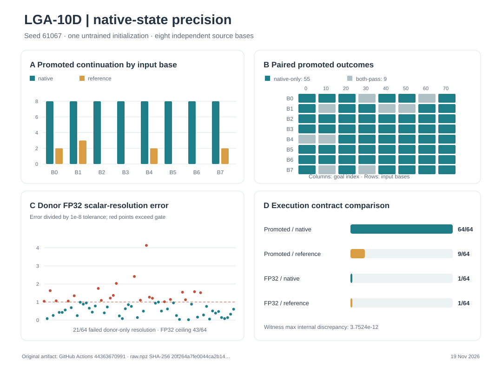

# LGA-10D: reached-state precision, frozen source-only 61067 results

19 November 2026 · Evidence class `SOURCE_ONLY_UNTRAINED_PRECISION_ENGINEERING`.

**Registered primary endpoint:** native-state derivative geometry passes promoted FP64 continuation in **64/64** cases. The reference derivative geometry passes **9/64**. Both arms fail the separate fully native FP32 contract at **1/64** each. The preregistered engineering threshold was 61/64 per contract.

The frozen prospective protocol is `aa0e397c89778ba8c023f7126e5454e71a7d4844`. Source was committed as [`3c3fc364a1e6`](https://github.com/MoralityLabAI/LoopedTransformers/commit/3c3fc364a1e61c088a1b7f89bbc860d5247ddd92) before seed 61067 initialization. The [first GitHub Actions run](https://github.com/MoralityLabAI/LoopedTransformers/actions/runs/44363670991) passed all 90 pre-source tests and the independent 64/64 NumPy audit. Results were computed from the preserved initial source capture; no result-directed source changes or reruns were used.

## Registered construction

The paired arms share the FP32 model, input, common native donor and dose, selected tangent projector and physical FP32 edit application. The **reference** arm constructs derivatives at its all-FP64 reached state. The **native** arm constructs derivatives at the exact FP64 promotion of the actual FP32 reached state. Their spectral geometry and rounded candidate selection use the frozen LGA-10B/C algorithms. Both final arms are assessed against a *common* native-state J/H and shared donor target.

The promoted contract executes the prefix and physical addition in FP32, then exactly promotes the reached state for FP64 continuation. The native contract continues in FP32 with LGA-10C's original precision gates.

| Registered measure | Native derivatives | Reference derivatives |
|---|---:|---:|
| Complete eight-sham sets | 64/64 | 64/64 |
| Selection-space validated | 64/64 | 64/64 |
| **Promoted continuation ready** | **64/64, PASS** | **9/64, FAIL** |
| Native FP32 ready | 1/64, FAIL | 1/64, FAIL |
| Common promoted physical gate | 64/64 | 9/64 |
| Dense/fresh quadratic agreement | 64/64 | 64/64 |
| First-gradient witness (including parity) | 64/64 | 9/64 |
| Native FP32 physical gate | 2/64 | 4/64 |
| Native FP32 curvature-resolution component | 3/64 | 4/64 |
| Native FP32 derivative-agreement component | 64/64 | 64/64 |

For promoted readiness, the paired transitions are **55 native-only**, **nine both-pass**, **zero reference-only**, **zero both-fail**. The native minus reference macro-average across eight bases is **+0.859375**. Native FP32 has one pass per arm, in different cases, with 62 shared failures.

### Independent bases

| Base | Native promoted | Reference promoted | Difference |
|---|---:|---:|---:|
| 0 | 8/8 | 2/8 | +6/8 |
| 1 | 8/8 | 3/8 | +5/8 |
| 2 | 8/8 | 0/8 | +8/8 |
| 3 | 8/8 | 0/8 | +8/8 |
| 4 | 8/8 | 2/8 | +6/8 |
| 5 | 8/8 | 0/8 | +8/8 |
| 6 | 8/8 | 0/8 | +8/8 |
| 7 | 8/8 | 2/8 | +6/8 |

The eight input bases are the independent source units. Their eight within-base goals are correlated; the study uses **one untrained model initialization** with 44,001 parameters. The source-macro effect is descriptive, without a population confirmation claim.

## Failure mechanism and numerical witness

Selection-space validation passes 64/64 in each arm. After physical application at the native state, the reference arm violates the common curvature bound in **55/64** cases, causing every one of its promoted failures. Its largest curvature error is **8.7864e-8** under a `1e-8` budget. For native-state derivatives the maximum is **9.9429e-9**, with 64/64 passes. The reference arm's other final physical components remain within their registered limits. The difference localizes to derivative placement and its curvature target at application.

Fresh HVP and dense Hessian quadratic measurements agree in all 128 arm/case combinations. That internal consistency can coexist with wrong physical curvature after the edit changes states. The first-gradient witness independently uses centered gradients at `2^-8`, `2^-9`, and `2^-10` physical steps, then two Richardson corrections. Its maximal native-state internal error is **3.7524e-12**, within the `1e-9` witness tolerance. Native-state fine-scale sham/donor curvature parity passes 64/64. The reference witness's internal oracle consistency also passes, while its shared reached-state curvature parity fails in 55 cases. These checks establish numerical agreement under the chosen finite steps; they are not rigorous Hessian intervals.

## FP32 boundary and proposed follow-up

The fully native FP32 contract admits **1/64** in either arm. A shared donor-only representable-probe check fails in **21/64** cases, so the donor check itself caps native FP32 admission at **43/64** under this cohort's source and oracle. Curvature rounding and final physical constraints further reduce coverage. The mixed-precision feasibility result therefore applies to the declared FP32 prefix/edit plus promoted FP64 continuation execution path.

For the next *prospective* experiment, retain the common native-state donor and systematically isolate physical addition rounding, HVP-probe representation, and curvature scalar quantization. A quantization-aware FP32 proposal can then be compared with the promoted contract under newly locked trained weights and a separately sealed task-correctness readout. Science seeds 31059, 31064 and 31065 remain closed.

## Preserved evidence

The [first-run Actions artifact](https://github.com/MoralityLabAI/LoopedTransformers/actions/runs/44363670991) contains the unmodified `raw.npz`, `feasibility.json`, `summary.json`, `audit.json`, and `SHA256SUMS`. The artifact workflow specifies 90-day retention. This results directory adds the exact [per-case paired table](paired_cases.csv) and an [editable SVG](paired_precision.svg) without changing frozen source code. Rejected proposals and failed endpoint observations remain within the original raw capture.

| Receipt | Frozen run |
|---|---:|
| CPU HVP calls | 27,712 |
| First-gradient displacement probes | 6,912 |
| Wall / CPU time | 267.554 s / 267.308 s |
| Linux peak RSS | 663.2 MiB |
| Logical / unique NPY arrays | 16,661 / 10,349 |
| Aliased raw archive | 82,218,782 bytes |
| Duplicate NPY bytes avoided | 101,233,384 |
| Complete per-purpose calls | true; unavailable endpoints: 0 |
| Drift reference Jacobian fallbacks | 0 |

SHA-256: `raw.npz` **20f264a7fe0044ca2b142a5d1b70ffb27b6915a914bb91f96c30ccb5de65246d**; `feasibility.json` **223d7a247e1a4e581839017e6f44b1aad11a4ae20004e5de9757616a17a9a44f**; `audit.json` **4b5ddf5bc017881cc8d979131a7ed19759cb000e3feba15879e7d5f940e2b103**; `summary.json` **083e8e102609964df142b00e8641288cf51b85273fec4e57888d0a05ac596976**. The alias-map SHA-256 is `2413bd8de4cc752137a82e79bab4e9c53cd296cbbc90f76fe3148edfbd4d0067`. The auditor reported **64/64**, with no Torch, source-model or matcher import. The receipt pins 39 input, source, protocol, test and workflow hashes.

The promoted numerical contract supports planning an inference implementation. It does not measure task success, causal efficacy, or generalization to trained model roots.
