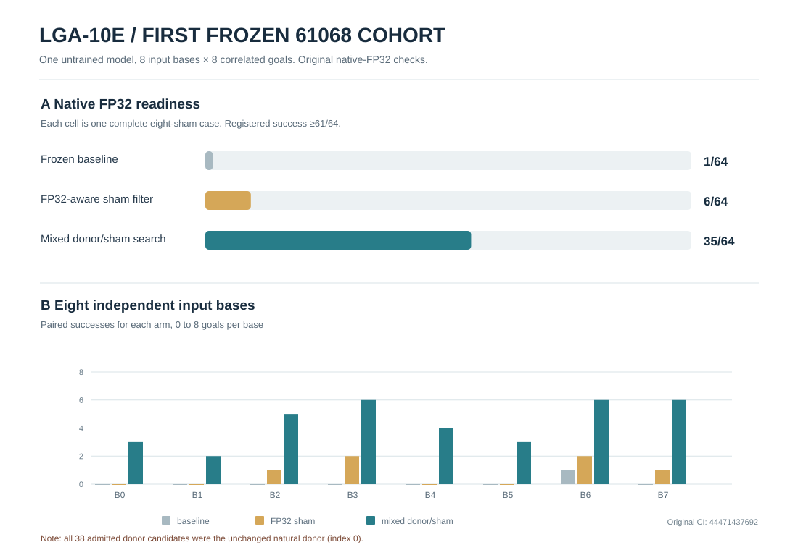

# LGA-10E: frozen 61068 native FP32 engineering first-run result

**19 November 2026** · Evidence class `SOURCE_ONLY_UNTRAINED_FP32_ENGINEERING` · Original fresh excluded seed **61068**.

## Verdict

The registered **61/64** engineering threshold for the `mixed_donor_repair.native_fp32_ready` endpoint **FAILED**: **35/64**. GitHub-hosted CPU Actions finished [run 44471437692](https://github.com/MoralityLabAI/LoopedTransformers/actions/runs/44471437692) with success because all numerical receipts, source guards, 104 pre-source tests, independent checks and the original archive passed. The independent NumPy audit reconstructed **157 complete arm/case endpoint observations**, with **0 integrity failures**.

Prospective protocol was committed at `8de00d66080cc3550efaf962da9387603a2d2eed`; first-run implementation at `fa2932430d4462341bd3cb22afa71bfc4948cfb8`, direct child of protocol and byte-identical to the preflight-tested tree. No edits to source code or validation thresholds have been made after opening 61068.

| Arm | Complete eight-sham sets | Native-FP32 ready | Registered status |
|---|---:|---:|---|
| Frozen LGA-10D natural-donor baseline | 64/64 | **1/64** | FAIL |
| Original donor + FP32-HVP sham filtering (FP64 geometry) | 58/64 | **6/64** | FAIL |
| Oracle-assisted mixed-precision donor/sham search | 35/64 | **35/64** | **FAIL** |

For each arm, the endpoint applies the original LGA-10C native FP32 numerical check to a physically realized donor and eight shams. It includes native physical constraints, promoted curvature parity, both scalar-resolution conditions, and derivative agreement. The 64-case denominator retains every source failure, partial set and search exhaustion. The two new methods use promoted FP64 geometry or HVP oracles **during construction**, so their improved success rate does not imply FP32-only candidate generation. Continuation and physical addition remain native FP32.

### Independent-base breakdown

| Input base | Baseline | FP32 sham filter | Mixed donor/sham |
|---:|---:|---:|---:|
| 0 | 0/8 | 0/8 | 3/8 |
| 1 | 0/8 | 0/8 | 2/8 |
| 2 | 0/8 | 1/8 | 5/8 |
| 3 | 0/8 | 2/8 | 6/8 |
| 4 | 0/8 | 0/8 | 4/8 |
| 5 | 0/8 | 0/8 | 3/8 |
| 6 | 1/8 | 2/8 | 6/8 |
| 7 | 0/8 | 1/8 | 6/8 |
| **Total** | **1/64** | **6/64** | **35/64** |

Compared pairwise to frozen baseline, the mixed arm has 34 native-only passes, one shared pass, zero baseline-only passes and 29 shared failures. The effective source units are the eight independent input bases. Goals within a base are correlated, and all cases share one untrained model initialization; these are engineering counts, not population-level confidence bounds.

## What the donor-repair arm actually did

**All 38 accepted donors were the original natural donor, candidate index 0.** Of 64 source cases, donor selection admitted 38 natural donors. Three subsequently exhausted the sham budget, leaving 35 complete sets. Another 26 exhausted the donor budget after testing 17 registered candidates each. **None of the 416 rotated candidate attempts was accepted.**

For the natural candidate, 15 tests failed original-target curvature and 17 failed FP32 representable-probe resolution (overlapping failures). Every rotated candidate attempt failed the requirement to preserve the natural donor's original curvature target within its registered `1e-8` budget.

Accordingly, the observed increase from **1 to 35 native-FP32 cases** comes from **oracle-assisted sham selection on donor-admissible cases**. The fixed-angle donor-rotation repair did not recover a donor failure. This distinction is decisive for interpreting the new arm's name and for planning a follow-up.

The source-valid parent remained eligible for all 64 cases. Complete sets in the mixed arm all passed the original native-FP32 endpoint. The 29 primary failures partition into **26 donor budget exhausted** and **three rounded-sham budget exhausted**.

## Native-gate component accounting

| Component (among completed sets) | Frozen baseline (64) | FP32 filter (58) | Mixed (35) |
|---|---:|---:|---:|
| Native physical constraints | 2 | 58 | 35 |
| Promoted curvature parity | 64 | 58 | 35 |
| Curvature scalar-resolution conjunction | 3 | 6 | 35 |
| J/forward/HVP derivative agreement | 64 | 58 | 35 |
| Complete native FP32 conjunction | **1** | **6** | **35** |

The fixed-donor FP32 filter admits 58 complete sets, of which six meet the complete numerical precision contract. Its 58 failures comprise 52 failures of the native gate and six sham-budget exhaustion events. The mixed arm rejects sham candidates using FP32 and promoted reference HVPs; selection oracle calls are independent of subsequent endpoint calls, whose original definitions are preserved.

## Resource usage and original evidence

| Item | Frozen source observation |
|---|---:|
| Untrained model parameters | 44,001 |
| Model/source seeds | 61068 / 61068 |
| Total elapsed CPU wall time | 624.847 s |
| CPU process time | 624.346 s |
| Peak Linux RSS | 788,264 KiB (≈ 770 MiB) |
| New filter HVP calls, FP32 filter | 10,254 |
| New filter HVP calls, mixed search | 28,278 |
| Logical / unique recorded NPY arrays | 8,038 / 5,476 |
| Raw archived NPZ bytes | 111,578,521 |
| Capture alias deduplication savings | 52,773,224 bytes |

The original first-run [Actions artifact](https://github.com/MoralityLabAI/LoopedTransformers/actions/runs/44471437692) contains `feasibility.json`, `raw.npz`, `audit.json`, and `SHA256SUMS`. Rejected candidate traces, all incomplete cases, per-arm receipts, code hashes and environment details are retained in the original capture, which should be preserved beyond Actions' configured 90-day retention.

- Raw NPZ SHA-256: `cc3a65797878196de12a549f50fbd716e8a4ee900813b2d897a5a7ca3bb29c58`
- Feasibility JSON SHA-256: `4c85e8ccbe552dd655684153228522ee32abaee4bbf8a81991f036fda48282ec`
- Source input SHA-256: `5ebd72ec4ab3dd8ed47a7097c69039dd128c577249929cfbf3dbe662a3c6b7c4`
- FP32 initialization SHA-256: `78ec9cbfa3fdb8a4da7993432a90b1d40d938cb0e4c199dfb18c5cf7a9ff7e56`

For a reviewable per-case index, see [paired_cases_61068.csv](paired_cases_61068.csv), and for an editable vector figure see [paired_precision_61068.svg](paired_precision_61068.svg). Source and protocol files remain unchanged in this results-only commit.

## Next scientific hypothesis

The donor candidate search is overconstrained by preserving both the source's first-order margin and its original FP64 curvature value while moving on a fixed angular grid. A follow-up should prospectively optimize on the **curvature level set intersected with the source-preserving K/J fiber**, and then search for representable FP32 donor probes inside that manifold. It should preserve the original natural-source direction and dose requirements and report any relaxation as a **new endpoint**. Donor repair, once feasible, may reduce the 26 donor budget failures. Further sham budget exploration addresses a separate set of three cases. This 61068 cohort is now exposed and can guide design but cannot serve as independent confirmation.

The protected science seeds **31059, 31064, 31065** remain unopened. Neither trained weights nor task-correctness or causal transfer were evaluated.
