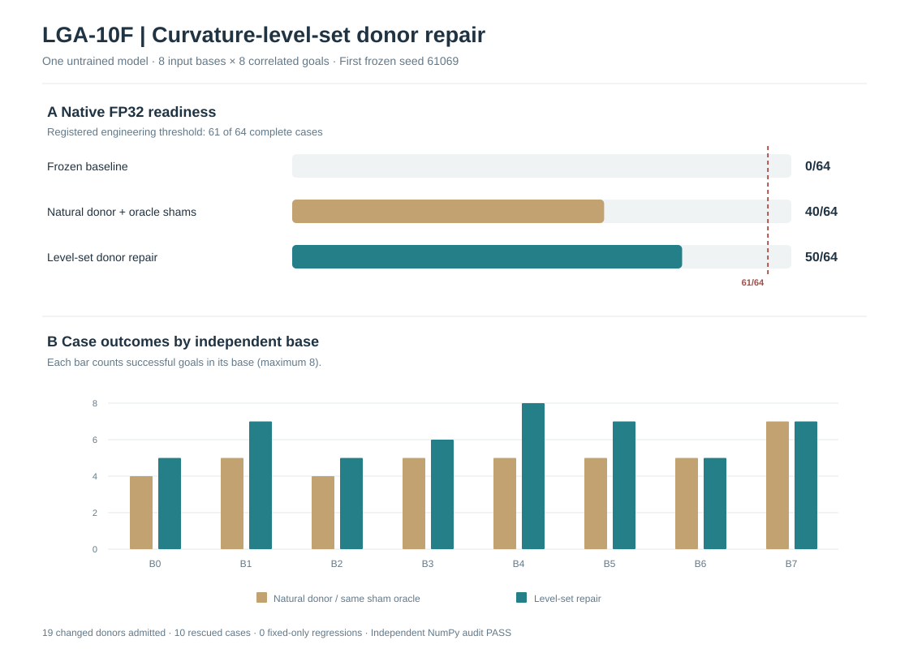

# LGA-10F / LOOPSCOPE-13F: first frozen 61069 curvature-level-set donor result

**19 November 2026 · source-only untrained FP32 engineering · first excluded 61069 model/source · audit verified.**

## Registered endpoint and verdict

The primary engineering target **FAILED**: \`levelset_repair.native_fp32_ready\` reached **50/64**, versus the preregistered minimum **61/64**. The experiment passed CI integrity and independently reproduced the original LGA-10C native FP32 gate from archived numerical arrays.

| Prospective arm | Complete 8-sham sets | Native FP32 ready | Registered verdict |
|---|---:|---:|---|
| Frozen native-state LGA-10D spectral baseline | 64/64 | **0/64** | FAIL |
| Original natural donor, FP32/FP64 oracle-assisted sham filter | 45/64 | **40/64** | FAIL |
| **Curvature-level-set donor repair with identical sham filter** | **50/64** | **50/64** | **FAIL** |

The reference target is the unchanged curvature of the natural donor, measured by a fresh FP64 HVP at the actual lifted FP32 reached state. Each outcome requires an eligible original source, one accepted source-preserving donor and eight shams, with the original native-FP32 physical/curvature/precision/derivative conjunction for **all nine applied edits**. The denominator includes 64 cases regardless of source or numerical failure.

## Actual donor mechanism and paired outcomes

**19/64 cases admitted a genuinely different donor (candidate index greater than zero).** Of these, 15 completed the eight-sham construction, and **10 were newly native-FP32-ready** relative to the same-seed fixed-donor oracle arm. Five changed-donor cases had already passed under the original donor, while four reached the donor gate and then exhausted the sham budget.

| Paired result: fixed donor vs level-set repair | Cases |
|---|---:|
| Both pass | 40 |
| Level-set repair only (rescued) | **10** |
| Fixed-donor only (regressions) | **0** |
| Both fail | 14 |

This yields **+10/64** net newly ready cases on the identical model and source cohort. Within the 64 cases, 42 admitted the unchanged donor, 19 admitted changed donors and three admitted no donor. The level-set method therefore changed the donor outcomes, correcting the previous LGA-10E finding that all admitted candidates were natural donor index 0. The result is an engineering cohort under a **single untrained initialization**, with eight independent source bases and correlated goals. No population-generalization or task-correctness claim follows.

### Eight input bases

| Input base | Frozen baseline | Fixed donor oracle | Level-set repair | Changed donors admitted |
|---:|---:|---:|---:|---:|
| 0 | 0/8 | 4/8 | 5/8 | 3 |
| 1 | 0/8 | 5/8 | 7/8 | 4 |
| 2 | 0/8 | 4/8 | 5/8 | 2 |
| 3 | 0/8 | 5/8 | 6/8 | 2 |
| 4 | 0/8 | 5/8 | 8/8 | 4 |
| 5 | 0/8 | 5/8 | 7/8 | 3 |
| 6 | 0/8 | 5/8 | 5/8 | 0 |
| 7 | 0/8 | 7/8 | 7/8 | 1 |

## Residual failure decomposition

For the level-set repair arm, **3/64** cases exhausted all available donor candidates before admission, and **11/64** admitted a donor but exhausted the eight-sham proposal budget. All **50 complete** level-set sets passed the original native FP32 endpoint.

Donor attempt rejection receipts include **89 physical dense-curvature mismatches** and **103 representable-probe FP32/FP64 mismatches**. These are candidate-attempt events and can overlap; they are not independent case counts.

Under the current donor search, at most **61/64** cases can be admitted because three fail the donor stage. That exactly equals the registered target, leaving no headroom for sham-search failure. Increasing the success of the already admitted donors is therefore the most immediate computational target, while improving the three remaining donor cases would make the acceptance threshold more robust.

The signed-curvature method fixes \`z0=RRᵀz\`, dark radius \`r\`, current-head/energy tangent and future full-J rowspace, and solves

\`\`\`text
z'(s,t) = z0 + r * (u+s*w+t*e) / sqrt(1+s^2+t^2)
z'(s,t)^T H64 z'(s,t) = z^T H64 z
\`\`\`

with a 48-step bracketed root and 32 registered nontrivial proposals. The original dose and first-order margin remain fixed. Every accepted donor is also checked after its actual FP32 state addition. The root is a numerical construction, not a mathematical interval certificate. Both new selection arms use FP64 construction information, with FP32 **execution** as the measured endpoint.

## Resource and preservation receipts

| Measurement | First frozen CI result |
|---|---:|
| GitHub Actions source run | [#44477264182](https://github.com/MoralityLabAI/LoopedTransformers/actions/runs/44477264182) |
| Pre-source tests | **112 passed** |
| Independent NumPy audit | **159 complete arm/case checks, 0 integrity failures** |
| NumPy auditor imports | no Torch/model/matcher/precision oracle |
| Source model | 44,001 parameters, one untrained initialization |
| Wall / CPU time | **1,158.685 s / 1,157.725 s** |
| Peak Linux RSS | **859,624 KiB** (≈839.5 MiB) |
| Additional fixed-donor filter HVP calls | **42,126** |
| Additional level-set filter HVP calls | **48,516** |
| Logical captured NPY arrays | **9,658** |
| Original raw NPZ size | **108,091,641 bytes** |

- Prospective protocol committed **before** seed 61069 opened: \`04893693499bf675f80802826c447ef4e3cf670f\`.
- Frozen implementation commit was its direct child: \`b1a15b5cafb850e3f3d1bfb2e672b304bc6e7a05\`.
- Original source raw SHA-256: \`24fb487e89fff611e0949a2edf65e6fab43016772aadc6b6024a7164b4045d69\`.
- Original feasibility JSON SHA-256: \`59c3b17e7375a9e6e79310e256682f9577fdf59838337f496bb477d1244499c8\`.
- The complete [original GitHub Actions artifact](https://github.com/MoralityLabAI/LoopedTransformers/actions/runs/44477264182) and permanent ChatGPT Library copy \`/lga10f-61069-first-curvature-levelset-donor-source.zip\` retain all numeric attempts, failures, checksums and implementation hashes. The original source archive is kept outside Git history.

The [case-level CSV](paired_cases_61069.csv) identifies each of the ten donor-rescued cases, selected donor index and selection exhaustion reason. The [editable SVG](paired_levelset_61069.svg) plots the paired outcomes.

## Next hypothesis

The first curvature-level-set design has now demonstrated **real repaired-donor admissions** and a paired net gain of ten ready cases. The remaining **11 sham-budget failures** dominate the missed 61/64 target, followed by three donor-budget failures. A separately frozen LGA-10G could test a quantization-aware sham search on the same source-preserving level set, with a fresh seed and an explicit candidate-cost budget. The present 61069 outcomes are exposed and cannot be reused for independent confirmation.

Science seeds **31059, 31064 and 31065 remain unopened**, and no trained weights, edited task correctness, causal influence or generalization were measured.
