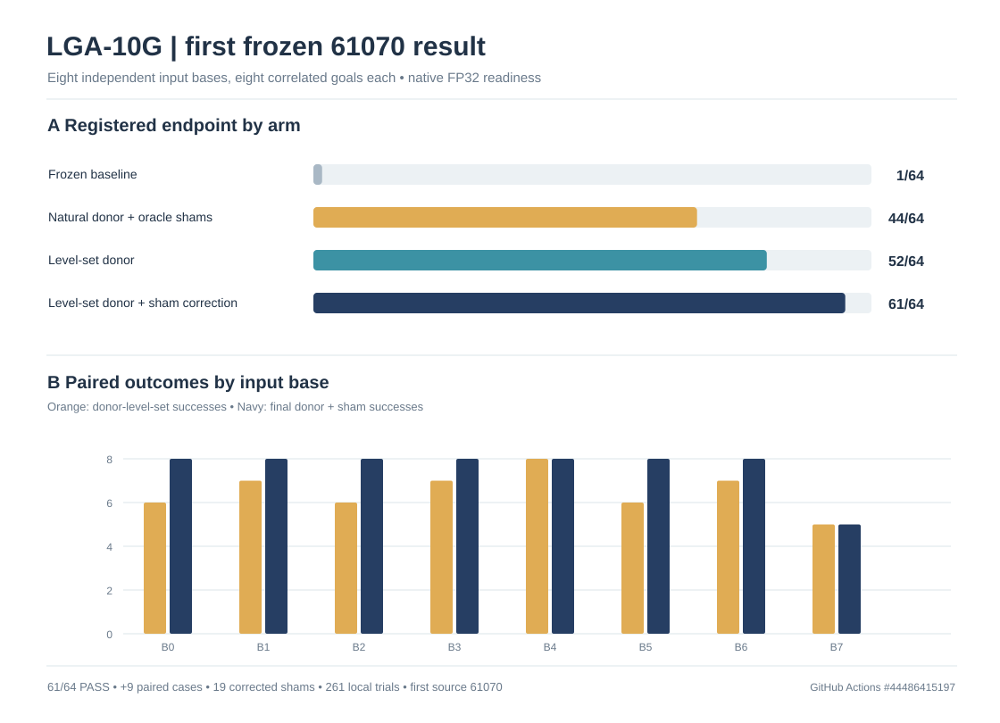

# LGA-10G / LOOPSCOPE-13G: first source-only 61070 sham-level-set result

**19 November 2026 · prospective excluded engineering seed 61070 · one untrained model initialization · independent NumPy audit PASS.**

**Registered primary engineering endpoint: PASS, exactly 61/64 complete native-FP32-ready cases.**

Protocol was frozen at `c5fd486f2daa6bb0ae509833cdb220a9179305aa` before any fresh source initialization. The immutable implementation commit [`c03b2678212b`](https://github.com/MoralityLabAI/LoopedTransformers/commit/c03b2678212b5b01068aea10d91414772d0b88eb) is a direct child of the protocol commit, with the exact tree already tested in [preflight Actions #44486152300](https://github.com/MoralityLabAI/LoopedTransformers/actions/runs/44486152300). The source opened once, in [GitHub-hosted CPU Actions #44486415197](https://github.com/MoralityLabAI/LoopedTransformers/actions/runs/44486415197); no result-directed source changes or scientific reruns were made.



## Registered 61/64 endpoint

For each one of eight independent input bases and eight correlated goals, count a case as one only if the legal source, source-preserving donor and exactly eight selected shams satisfy **every original LGA-10C native-FP32 check** after the actual FP32 edit. The full gate includes FP32 physical K/J/head/energy/dose/dark-angle requirements, promoted curvature sham/donor parity, both scalar-resolution measurements, HVP/J/forward agreement, and complete measurement receipts. Ineligible sources, incomplete controls, exhaustion, exceptions, and nonfinite measurements remain zero in the **fixed denominator 64**.

| Prospectively registered arm | Complete eight-sham sets | Native-FP32 ready | Verdict |
|---|---:|---:|---|
| Frozen LGA-10D baseline | 64/64 | **1/64** | FAIL |
| Natural donor, original mixed-precision oracle sham filtering | 48/64 | **44/64** | FAIL |
| Frozen level-set donor search with original sham filter | 52/64 | **52/64** | FAIL |
| **Same level-set donor with bounded sham repair** | **61/64** | **61/64** | **PASS** |

The new arm uses the identical donor selected for the level-set comparator, and its local curvature correction runs **only after exhaustion of the frozen 7×32 original search for a sham**. The correction's registered maximum is three ranked original parents × two axes × six offsets, or **36 extra local checks per exhausted sham**. The unchanged native-LGA-10C endpoint is measured independently after final candidate selection.

New versus the exact same donor-selection arm: **52 both pass, 9 new-only pass, 0 old-only pass, and 3 both fail**. The net effect is **+9/64 cases**. The corrections selected **19 shams** across the nine rescued cases, from **261 attempted local correction candidates**. **16/64** source cases admitted changed donors, including **4/9** newly rescued cases. Neither selection nor causal task effectiveness was evaluated on a trained model.

## Independent-base and residual-case breakdown

| Independent input base | Frozen baseline | Natural donor filter | Level-set donor | Level-set + sham repair |
|---:|---:|---:|---:|---:|
| 0 | 0/8 | 6/8 | 6/8 | **8/8** |
| 1 | 0/8 | 7/8 | 7/8 | **8/8** |
| 2 | 0/8 | 4/8 | 6/8 | **8/8** |
| 3 | 0/8 | 7/8 | 7/8 | **8/8** |
| 4 | 0/8 | 6/8 | 8/8 | **8/8** |
| 5 | 0/8 | 4/8 | 6/8 | **8/8** |
| 6 | 0/8 | 6/8 | 7/8 | **8/8** |
| 7 | 1/8 | 4/8 | 5/8 | **5/8** |
| **Total** | **1/64** | **44/64** | **52/64** | **61/64** |

Seven of eight independent input bases achieved all eight engineering cases. All three remaining failures are in base 7:

| Base | Goal | Final failure | Details |
|---:|---:|---|---|
| 7 | 20 | `ROUNDED_CANDIDATE_BUDGET_EXHAUSTED` | Donor index 0; 36 fallback trials; 1 donor attempts |
| 7 | 30 | `ROUNDED_CANDIDATE_BUDGET_EXHAUSTED` | Donor index 16; 36 fallback trials; 17 donor attempts |
| 7 | 50 | `DONOR_BUDGET_EXHAUSTED` | Donor index unavailable; 0 fallback trials; 33 donor attempts |

The nine rescued cases are:

| Base | Goal | Changed donor? | Corrected shams | Local correction attempts |
|---:|---:|---|---:|---:|
| 0 | 20 | no | 3 | 34 |
| 0 | 50 | yes | 3 | 24 |
| 1 | 60 | no | 1 | 2 |
| 2 | 30 | yes | 1 | 5 |
| 2 | 40 | yes | 3 | 44 |
| 3 | 30 | no | 1 | 14 |
| 5 | 10 | no | 4 | 55 |
| 5 | 20 | yes | 2 | 10 |
| 6 | 10 | no | 1 | 1 |

### Numerical cost and rejection structure

The local correction evaluated **261 candidate roots/trials**, selected **19 corrected shams**, and rejected **242** measured corrections at the native-precision selection gate. The original search, donor search, and continuation-oracle calls are separately accounted for by the frozen source receipts. The new arm used **26,292 additional selection-stage HVP calls**, while the unchanged-donor filter and level-set donor comparator used **37,377** and **40,569**, respectively. Reusing already-complete sham plans reduces duplicated selection work; the endpoint itself is remeasured independently.

The full original first-run resource receipt reports:

| Measurement | First frozen run |
|---|---:|
| Wall / CPU process time | **860.970 / 860.555 s** |
| Peak Linux RSS | **952,712 KiB (≈930.4 MiB)** |
| Model | One untrained FP32 TRM, 44,001 parameters |
| Independent inputs / correlated goals | 8 / 64 |
| Completed arm/case native endpoints | **225** |
| Independent audit failures | **0** |
| Logical / unique NPY arrays | **12,978 / 6,148** |
| Original raw NPZ bytes | **124,358,033** |
| Aliased-array payload bytes avoided | **170,832,648** |

The independent auditor reconstructed the nine-vector native-LGA-10C gate on every complete arm/case, including physically applied FP32 deltas, and separately audited the recorded correction parents, tangent axes, dense-curvature roots, and accepted replacements. It imports **no Torch, model, matcher, or precision oracle**. The original source is archived in the [first-run GitHub Actions artifact](https://github.com/MoralityLabAI/LoopedTransformers/actions/runs/44486415197), and the compact [64-case CSV](paired_cases_61070.csv) is committed alongside this report.

### SHA-256 preservation receipts

```text
raw.npz          aa4da10fcf640c0de4d751c7361da2fbb427343c610ea424eec5e727a5befefc
feasibility.json 482b9d751c01bf5b76a861c6ae3aad06b5e9e2f978c2d65b239981ac8d5bb60f
audit.json       f5ad6cc4ce80a1a37bf0a041b1080e196f23fe0204f2ea9e9669be4cee786ea8
summary.json     55a3124edf3d1ced353b3ceb3758bf33e370d260d8285d72b834802fd89c2958
```

The original `SHA256SUMS` also contains these exact digests; all were independently checked against the preserved first-run ZIP. GitHub's source artifact has a 90-day Actions retention policy, so retain its immutable original ZIP outside GitHub Actions as well.

## Interpretation and next inference boundary

This is a **source-only numerical engineering** result. It demonstrates that the precommitted donor-plus-sham correction can meet the original 61/64 precision readiness criterion on the independent 61070 engineering seed, under one untrained initialization. The threshold was met **exactly**, and the 64 observations are eight correlated goals within each of eight input bases. The source does not establish a population-level success probability or edited-task correctness.

The construction used FP64 dense geometry and promoted HVP oracles, explicitly making it **mixed-precision selection**; the measured applied-edit and numerical readiness execution contract stays FP32. The study contains no trained weights, no sealed causal evaluations, and no task outcome score. Science seeds 31059, 31064 and 31065 remain closed.

**Next experimental requirement:** run a new prospective multi-initialization confirmation before interpreting 61/64 as reproducible engineering success. Retain original costs and every failure, and separately test source-cluster robustness (especially base 7) and trained-model causal efficacy under a sealed protocol. A future confirmation cohort cannot use exposed 61070 to retune the search or its acceptance threshold.
