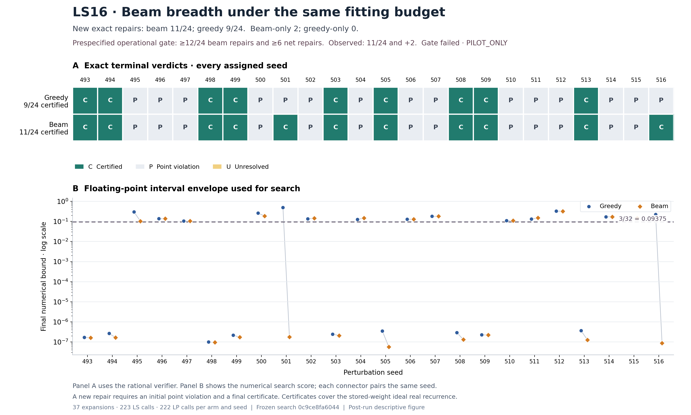

# LS-NEURON-16: retaining alternate codebooks

Beam search repaired **11/24** fresh initializations. Matched-budget greedy search repaired **9/24**. The two additional beam repairs were seeds **501 and 516**; every greedy success also succeeded under beam. The paired gain was **8.33 percentage points**, with exact two-sided McNemar **p = 0.5**.

**The registered operational gate failed.** It required at least 12 beam repairs and at least six net repairs over greedy. The official FSI result is `inconclusive`, and the study remains `PILOT_ONLY`.

The source and protocol were committed at [0c9ce8fa60443d9414a71fbbe7d5c9716ebf6a55](https://github.com/MoralityLabAI/LoopedTransformers/commit/0c9ce8fa60443d9414a71fbbe7d5c9716ebf6a55) before any fresh seed was generated. The 37 locked files retain their hashes. Parent study: [LS15, draft PR #388](https://github.com/MoralityLabAI/LoopedTransformers/pull/388).

## Paired results

The independent unit is a seeded 15-percent perturbation of the fixed eight-GELU mod4 template. The cohort contains seeds 493 through 516. All 24 initial models have exact point violations in their prescribed state regions. Each primary success therefore repairs a proven initial violation.

| Endpoint or diagnostic | Greedy | Beam, width 3 |
|---|---:|---:|
| New exact certificates | 9/24 | 11/24 |
| Certificate rate | 37.50% | 45.83% |
| Marginal 95% Clopper-Pearson interval | 18.80% to 59.41% | 25.55% to 67.18% |
| Final point violations | 15 | 13 |
| Final unresolved cases | 0 | 0 |
| Median numerical interval bound | 0.12671816 | 0.10399283 |
| T8 numerical accuracy | 91.18% | 97.04% |
| T128 numerical accuracy | 78.65% | 82.52% |
| T128 all-prefix accuracy | 72.14% | 77.73% |

The numerical transition threshold is 3/32, or 0.09375. It agrees with the exact verdict on all 48 final models. The 20 certified endpoints have 20 distinct decoded weight sets. There are 46 distinct final weight sets across both arms. Initial and terminal checks resolve every model in this cohort.

| Paired outcome | Seeds |
|---|---|
| Both methods repair | 493, 494, 498, 499, 503, 505, 508, 509, 513 |
| Beam alone repairs | 501, 516 |
| Greedy alone repairs | None |
| Neither repairs | 495, 496, 497, 500, 502, 504, 506, 507, 510, 511, 512, 514, 515 |



The known 32 transition cases guide every search. The fresh information comes from the independent perturbation seeds. Numerical rollout accuracy averages the inherited 256 sequences per seed at each of T8 and T128. Those sequences remain observations within a seed. The exact region guarantee covers a different endpoint from finite numerical accuracy; a region violation can concern a state that a sampled rollout never reaches.

## What retaining alternatives changed

Each expanded state supplies the same candidate proposals, profiler, least-squares fit and conditional LP. Greedy updates one incumbent three times in each round. Beam expands three parents frozen at the round's start, then retains the three best distinct codebooks from the old parents and their children. The common bootstrap supplies both methods with the same initial candidates.

| Search diagnostic, across 24 seeds | Greedy | Beam |
|---|---:|---:|
| Distinct expanded codebooks, summed within seeds | 136 | 368 |
| Median distinct expanded codebooks per seed | 5 | 15 |
| Repeated codebook expansions | 752 | 520 |
| Median final path depth | 5 | 6 |
| Median last best-score update, round | 2 | 5 |
| Retained edges with a worse score than their parent | 0 | 26 |
| Certified final ancestries containing a worsening edge | 0 | 6 |

The two additional repairs follow useful alternate codebooks. On seed 501, the final beam path starts from the bootstrap's second-ranked codebook: its bound was about 1.15837, while greedy started from the best candidate at about 0.95861. That alternate path first crosses the numerical threshold in comparison round 4. The greedy endpoint remains at about 0.49052. Seed 516 first crosses under beam in round 2, while greedy finishes near 0.22222.

An additional inspection of the saved ancestry puts the worsening-edge counts in context. **All 11 certified beam paths first cross the numerical threshold without a preceding worsening edge.** Six final paths contain worsening edges after that crossing. For seed 516, the first crossing is about 3.2163e-7; the later worsening step reaches about 0.013727, which also remains within the numerical threshold. The receipts support the observed yield of the complete beam allocation. They leave the necessity of worsening moves unestablished. This timing inspection is a post-run interpretation check, with no added hypothesis test.

The shared bootstrap has two numerical bound passes, seeds 508 and 513. Every failed final run also lacks a numerical pass among its visited fitted candidates. These diagnostics concern the searched candidates, with no claim about the entire discrete search space.

## Fixed opportunity budget

Both methods use a common initial fit and one common bootstrap expansion. Each then spends 36 further expansions, arranged as 12 rounds of three. A candidate expansion profiles 177 slots at each of two scale anchors, shortlists its no-op plus two distinct edits at each anchor, and runs six least-squares fits followed by six conditional LPs.

| Per-arm budget for one seed | Count |
|---|---:|
| Expansions, including shared bootstrap | 37 |
| Profile slots | 13,098 |
| Least-squares calls, including common initial fit | 223 |
| Conditional LP calls | 222 |

The LS fit has a 40-function-evaluation cap; the LP has a 1,000-iteration cap. Duplicated proposals still consume their assigned calls. Common work executes once per seed and is charged to each arm's opportunity budget. Actual execution across the cohort comprises **1,752 expansions, 620,208 profile slots, 10,536 LS calls and 10,512 LP calls**. Every LP succeeded. The per-arm receipts count the shared bootstrap twice when combined; the physical execution totals account for that reuse.

Solver work varies with each path. Including common work in each arm's accounting, greedy used 84,434 LS function evaluations and beam used 86,290. Search ran in approximately 109 seconds with four CPU workers and one numerical thread per worker. The terminal audit took approximately 57 seconds. These timings describe this runtime. The environment receipt records Python 3.12.14, NumPy 2.3.5, SciPy 1.17.0 and Torch 2.15.0+cpu.

## Evidence and uncertainty

There is one prospective comparison: beam versus greedy. The registered scientific effect floor is 25 percentage points. The primary endpoint uses `initial == POINT_VIOLATION` and `final == CERTIFIED`, with all assigned seeds retained in the denominator. The observed gain is 1/12. Two discordant pairs yield the exact two-sided conditional McNemar value 1/2.

The official paired bootstrap gives a descriptive approximate interval from 0 to 20.83 percentage points. The planner separately reports a one-sided 95% Hoeffding lower bound of -41.63 points and a one-sided 95% upper bound of +58.30 points. Those two bounds are separately valid one-sided statements. The marginal Clopper-Pearson intervals above apply to each arm individually under the declared seed-sampling assumptions.

The strict preflight returned `REDESIGN_OR_PILOT_ONLY`. Direct beam power and calibrated matched-sham variation were unavailable before execution. Historical LS15 bound-LP versus max-LP outcomes were identical on all 24 old seeds. The preflight labels its identity check and universal binary-difference support bound explicitly. The same known template and targets have been used during research design.

FSI fails the significance, descriptive effect-floor and conservative effect-floor gates. The bootstrap upper endpoint alone cannot refute the registered 25-point effect under the frozen procedure, whose conservative upper bound extends beyond that floor. The result establishes the realized repairs for this cohort and leaves population improvement inconclusive. It supplies no equivalence claim.

See [the frozen registration](evidence/registration.json), [official FSI output](evidence/results/fsi_beam_vs_greedy.json), [paired raw outcomes](evidence/results/paired_outcomes.jsonl), and [independent results review](evidence/results_review.json).

## Exact certificate scope

The cell stores 52 integer codes in [-7,7], four positive scales and two FP32 offsets across 54 decoded parameter slots. Its scalar state represents mod4 centers -2,-1,0,1. The target update adds binary inputs a and b modulo four; the third binary input is a nuisance variable.

For every one of the 32 state/input combinations, the inherited rational verifier encloses the real GELU recurrence over the whole source interval of radius 1/8. Certification proves transition error at most 3/32. An additive disturbance of magnitude at most 1/32 then preserves the radius-1/8 invariant region, allowing induction over every finite input sequence from a valid initial region.

The exact calculation interprets the stored FP32 weights as rational constants and uses residual coefficient 1/5. Hardware rounding and a Lean replay remain outside this guarantee. The search's curvature-padded bound and the LP's feasibility checks use floating-point arithmetic; exact terminal verification supplies the certificate.

The audit reconstructs FP32 decoding and the 17-point interval metric independently from the search code. It checks sparse LP dual vectors, all candidate scores, profiles, shortlists, parent IDs, stable ties, codebook deduplication and retention decisions. It performs 73 exact-verifier calls, including the positive control, plus 144 numerical horizon conditions.

Across both arm receipts, the largest LP primal violation is 9.883e-9, stationarity residual 2.095e-10, absolute duality gap 2.998e-15 and complementarity residual 1.217e-10. The numerical audit tolerances and checks are in `audit16.py`; LS solver trajectories are outside its replay scope. Twenty-five focused tests passed before the source lock. The old-seed development run is saved separately from the fresh cohort.

## Reproduction and contents

The full companion archive is `LS-NEURON-16-beam-search.zip`. It contains expanded receipts and the source needed for replay. This directory also carries compressed copies for repository delivery:

| File | Contents | SHA-256 |
|---|---|---|
| `receipts.zip` | All fresh initial states, shared bootstraps, full candidate receipts, development raw receipts, logs and run manifest | `b214e80ace98a82c81fd9c98ec37e3fe50a7c85f66aca617d6f1e9e5cf6a3837` |
| `certificates.json.gz` | Full rational certificates, numerical outcomes and audit diagnostics | `c55b59d3bda5ccfed68d2f788912ed3a145fab8b035e41d31b1a5391f24675f7` |
| `lock.sha256` | Hashes for the 37 files frozen before new data | `6af8f7a91b926cd221bc1ed0536742bbe23ffe710cf7cc9cdfea5031cc23ddce` |

Expanded `certificates.json` has SHA-256 `73a382d216e8f4c6fc23969249a9d8f1b1ecc08a33779c4ea7ae85044157ba98`.

From a repository checkout, extract the data and replay:

```sh
python -m zipfile -e receipts.zip .
python -c 'import gzip,pathlib; pathlib.Path("certificates.json").write_bytes(gzip.decompress(pathlib.Path("certificates.json.gz").read_bytes()))'
sha256sum -c lock.sha256
python -m unittest test_search16.py test_audit16.py
python evidence/test_stats16.py
python audit16.py
python evidence/stats16.py --certificates certificates.json --outdir evidence/results
python report16.py
```

To rerun the frozen search without overwriting saved evidence, use a new output directory with `python search16.py --out /absolute/path/to/new-run`. The source lock and publication receipt remain in the source directory. That repeat reproduces the same assigned cohort; it does not create a fresh independent confirmation.

`report16.py` and the final presentation files were added after execution. Their purpose is to render the saved outcomes and descriptive diagnostics. Figure generation additionally uses Matplotlib 3.10.8, recorded in `reporting_requirements.txt`. The frozen search, audit and statistical procedure remain unchanged. [The full protocol](protocol.md) specifies selection, exposure, failure handling and evidence boundaries.

## Next development question

A matched-budget comparison can isolate the value of later beam management from retaining several bootstrap options. Start three independent greedy paths from the common bootstrap's three codebooks, give each 12 expansions, and compare their best final state with the width-three beam using the same 36-expansion budget. Run that design on exposed development seeds first, then use its measured effect and a suitable control calibration to plan a prospective fresh cohort. LS16 leaves that comparison for the next study.
