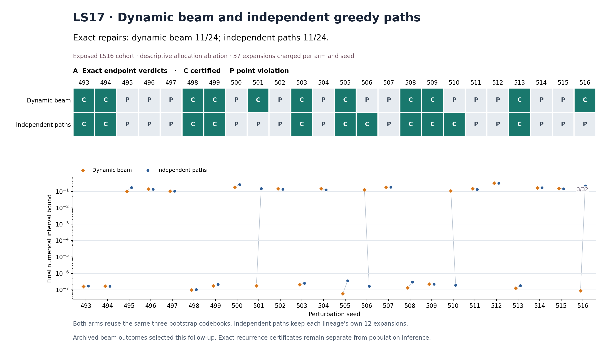

# LS-NEURON-17: independent paths and dynamic beam

**The two allocations each repaired 11 of 24 exposed initializations, with four different seed outcomes.** Dynamic beam alone repaired seeds **501 and 516**. Independent paths alone repaired **506 and 510**. Both succeeded on the nine seeds that LS16's original single greedy path repaired. Every endpoint resolved to an exact certificate or an explicit point violation. [Recorded outcomes](evidence/results/statistics.json)

This is an **EXPOSED_DEVELOPMENT_ONLY** allocation ablation. LS16's complete results had already informed its design. The new sources were frozen before the multistart execution, and the evidence retains the exposed-cohort label throughout.



## What the comparison asks

LS16 added two repairs when it replaced one greedy path with a width-three beam. That experiment left open how much of the change came from keeping several starting codebooks. LS17 continues the same three bootstrap states independently, assigning twelve expansions to every path. The dynamic beam can redistribute its retained slots at each round. This contrast studies how search allocates a fixed fitting budget.

The independent paths reproduced **0 of the 2** earlier beam additions, seeds 501 and 516. They recovered two other seeds, 506 and 510, while keeping all nine previous single-path successes. The earlier additions therefore depend on choices beyond simply preserving the three bootstrap states under this twelve-step rule. Equal repair counts leave substantial seed-level differences.

| Exact paired outcome | Count | Seeds |
|---|---:|---|
| Both certified | 9 | 493, 494, 498, 499, 503, 505, 508, 509, 513 |
| Beam certified alone | 2 | 501, 516 |
| Independent paths certified alone | 2 | 506, 510 |
| Both have a point violation | 11 | 495, 496, 497, 500, 502, 504, 507, 511, 512, 514, 515 |

The post-hoc union covers 13/24 seeds after using both arms' results and their combined budget. Each arm individually remains at 11/24. That union has twice the per-arm opportunity budget and supplies a descriptive coverage observation.

## Allocation and compute accounting

The cohort consists of the already inspected LS16 seeds 493 through 516 at the inherited 15-percent perturbation dose. The initial states, bootstrap records and dynamic-beam search records are byte-identical copies. All 73 parent inputs, including the complete LS16 certificate file, are pinned by [parent_manifest.json](parent_manifest.json).

The shared bootstrap contains three distinct codebooks sorted by numerical bound. Every independent branch expands its own current state once per round, then keeps the best of its parent and six fitted children. Branches retain their own budgets if their trajectories converge. After twelve rounds, the smallest raw numerical bound among the three terminal states selects the output; exact ties use the earlier branch index. The [frozen protocol](protocol.md) defines the complete search and scoring rules.

| Opportunity budget per seed | Dynamic beam | Independent paths |
|---|---:|---:|
| Shared bootstrap expansions | 1 | 1 |
| Later expansions | 36 | 36 |
| Total expansions charged | 37 | 37 |
| Profile slots charged | 13,098 | 13,098 |
| Nonlinear least-squares calls charged | 223 | 223 |
| Conditional minimax LP calls charged | 222 | 222 |

Both arms use the same proposal family and decoder. Each expansion profiles 177 proposals at two scale anchors, retains three fitted candidates per anchor, and applies the inherited least-squares then conditional-LP rule. Every LS call has the same 40-function-evaluation cap. LP settings retain the inherited 1,000-iteration cap and require a decoded-bound improvement exceeding 1e-12 before replacing the LS state.

Actual new execution covered **864 expansions, 305,856 profile slots, 5,184 LS calls and 5,184 LP calls**. The beam and shared bootstrap were reused from LS16. All new LP calls returned success. The run used three CPU workers and one numerical thread per worker. [Run receipt](run_manifest.json)

These budgets equalize optimization opportunities. Function evaluations still depend on the optimization path: charged LS evaluations totaled 86,290 for the archived beam and 94,157 for multistart, including the shared bootstrap in each total. Timing has different provenance for the two arms, so no concurrent speed estimate is reported.

## What the visit records show

The auditor counts unique codebooks within each seed. The totals below sum those within-seed counts, and thus permit a codebook shared by two different seeds to count twice. A fitted codebook has passed through the candidate fitter; the complete proposal profiles have a separate budget.

| Descriptive visit measure | Dynamic beam | Independent paths |
|---|---:|---:|
| Distinct fitted codebooks, sum within seeds | 1,001 | 770 |
| Distinct expanded codebooks, sum within seeds | 368 | 266 |
| Median distinct expanded codebooks per seed | 15 | 10.5 |
| Repeat expansions of a previously expanded codebook | 520 | 622 |
| Median retained final-path depth | 6 | 5 |
| Median final numerical interval bound | 0.103993 | 0.114851 |

Both arms spend 888 charged expansions across the cohort. Dynamic retention traverses more codebooks within that budget. Repeated expansions occupy 58.6% of beam calls and 70.0% of independent-path calls. The independent branches can coalesce while continuing to consume their separate allocations. These records describe a mechanism for differing coverage; determining the causal contribution of any particular retained branch would require another intervention.

Both independent-path-only repairs came from the **second-ranked bootstrap state**, indexed as branch 1 in the raw JSON. For seed 506, that branch reached a final bound of 1.64927e-7, while the other branches each finished at approximately 0.128357. Seed 510 shows the same pattern: the second-ranked branch reached 1.87843e-7, and the other two ended at approximately 0.109224. Its full twelve-expansion allocation preserved a useful continuation.

On seed 501, beam expanded 18 distinct codebooks and independent paths expanded 9; the terminal bounds were 1.76657e-7 and 0.149653. Seed 516 had 14 versus 5 distinct expanded codebooks. All independent branches there ended at 0.222222, while beam reached 8.82383e-8. Across all 24 seeds, the selected multistart branch came from bootstrap ranks 1, 2 and 3 on 17, 5 and 2 seeds, respectively. [Compact diagnostic data](report_data.json)

The visit measures and branch observations were specified as descriptive outputs. They add no hypothesis tests, and this run triggered no additional optimization experiments.

## All 24 outcomes

C means `CERTIFIED`; P means `POINT_VIOLATION`. Every initial model had a point violation. Bounds in this table are the independent numerical interval metric used during search. The rational verifier supplies the C/P verdict separately. Bootstrap ranks are displayed starting at 1.

| Seed | Beam | Independent paths | Beam bound | Independent bound | Selected bootstrap rank |
|---|:---:|:---:|---:|---:|---:|
| 493 | C | C | 1.61137e-07 | 1.68499e-07 | 1 |
| 494 | C | C | 1.6516e-07 | 1.6516e-07 | 3 |
| 495 | P | P | 0.103875 | 0.176481 | 3 |
| 496 | P | P | 0.13684 | 0.13684 | 1 |
| 497 | P | P | 0.10411 | 0.104622 | 1 |
| 498 | C | C | 9.5088e-08 | 1.01311e-07 | 1 |
| 499 | C | C | 1.73163e-07 | 2.16271e-07 | 1 |
| 500 | P | P | 0.187248 | 0.25924 | 1 |
| 501 | C | P | 1.76657e-07 | 0.149653 | 2 |
| 502 | P | P | 0.145038 | 0.135831 | 1 |
| 503 | C | C | 2.09781e-07 | 2.44946e-07 | 1 |
| 504 | P | P | 0.148127 | 0.125079 | 1 |
| 505 | C | C | 5.73184e-08 | 3.52552e-07 | 1 |
| 506 | P | C | 0.129438 | 1.64927e-07 | 2 |
| 507 | P | P | 0.183071 | 0.183071 | 1 |
| 508 | C | C | 1.31452e-07 | 2.95727e-07 | 1 |
| 509 | C | C | 2.22157e-07 | 2.22157e-07 | 2 |
| 510 | P | C | 0.109224 | 1.87843e-07 | 2 |
| 511 | P | P | 0.149693 | 0.131665 | 1 |
| 512 | P | P | 0.324056 | 0.325679 | 1 |
| 513 | C | C | 1.25172e-07 | 1.76261e-07 | 2 |
| 514 | P | P | 0.170033 | 0.170042 | 1 |
| 515 | P | P | 0.148127 | 0.147818 | 1 |
| 516 | C | P | 8.82383e-08 | 0.222222 | 1 |

## Descriptive statistical readout

The primary contrast is beam minus independent paths on the binary proven-repair endpoint. It has a zero observed difference, with two discordances favoring each arm. The official FSI-01 bridge returned exact paired McNemar **p = 1** and the evidence verdict **inconclusive**. Its inputs explicitly set `sealed_readout=false` and `hypothesis_preregistered=false`. [Official FSI output](evidence/results/fsi_beam_vs_multistart.json)

For completeness, the nominal per-arm exact interval is approximately 25.55% to 67.18%; the approximate paired cluster-bootstrap interval spans -16.67 to +16.67 percentage points. These calculations retain the model assumptions supplied to the official routine. Cohort exposure prevents interpreting them as confirmation about a broader perturbation population. Equal observed totals also leave equivalence unestablished.

The 25-percentage-point scientific floor and the operational reference of at least 12 beam repairs with at least 6 net additions are inherited planning values. Beam's 11/24 result was known before LS17, so its failure to reach 12 is historical context. The current analysis introduces no new pass/fail readiness gate. Direct planning power and matched-sham calibration for this contrast remain unavailable. The official strict preflight returned `REDESIGN_OR_PILOT_ONLY`, with its historical LS16 inputs and universal binary-support bound explicitly scoped in [preflight_scope.json](evidence/preflight_scope.json).

## Exact guarantee and audit

The model is an eight-GELU scalar mod-4 recurrence with 52 integer codes in [-7,7], four positive scales and two offsets decoded to stored FP32 coefficients. The verifier treats these coefficients as exact rational constants. It checks the full radius-1/8 state intervals across all 32 state/input transitions, requiring transition error at most 3/32. An additive disturbance bounded by 1/32 preserves those state regions, allowing induction over every finite input sequence from a valid initial region. The exact claim concerns the ideal real recurrence; hardware rounding requires separate analysis.

All 24 new searches completed before exact endpoint evaluation began. The independent auditor replayed every branch's parents and retention decisions, checked its allocation, and verified the terminal selection. It reconstructed candidate shortlists and independently decoded every recorded fitted state. Numerical bounds and LP primal/dual evidence were checked with the unchanged LS16 audit routines. LS optimizer trajectories lie outside that replay scope.

The full audit passed with 73 calls to the exact verifier: the positive construction, 24 initial models, 24 archived beam endpoints, and 24 new multistart endpoints. Initial and beam certificates matched the parent records exactly. Their numerical rollouts also reproduced exactly. Each arm had 11 certified endpoints and 13 point violations, with zero unresolved outcomes. The 48 final endpoints contain 44 distinct stored weight sets, including 20 distinct certified weight sets. [Audit results](audit_results.json)

All 5,328 charged LP records per arm, including shared work, passed the independent checks. Across the multistart records, the largest LP primal residual was 9.88246e-9; the largest duality gap was 2.22045e-15. The auditor checked 10,680 fitted states per arm. It also evaluated 144 horizon conditions using 256 sequences each at lengths 8 and 128, counting each initial endpoint once. Those repeated measurements stay within the original 24 experimental units.

The numerical endpoint accuracies were 97.04% and 94.78% at T8 for beam and independent paths, and 82.52% and 80.66% at T128. These aggregate numerical diagnostics include uncertified endpoints. The exact guarantee remains attached to each certified model.

Before source freeze, 14 audit mutation/coverage tests and four endpoint-statistics tests passed. They cover cross-branch contamination, allocation changes, score and sparse-dual corruption, stable ties, missing endpoints and denominator handling. The engineering smoke test used already exposed seed 469, with both endpoints certified. Its full records are retained separately under `development/469/` and summarized in the locked [development_manifest.json](development_manifest.json).

## Chronology and files

The experiment source freeze is commit [`a709846ffae1fa64d2a334d6b4dc7ee5b2a72cd5`](https://github.com/MoralityLabAI/LoopedTransformers/commit/a709846ffae1fa64d2a334d6b4dc7ee5b2a72cd5). It pins 32 source and protocol files through `lock.sha256`, whose SHA256 is `caa6e6bb2f6eaae15589fac1823b22613f55511fbb76f9d46b75c4d23b162de7`. Parent LS16 is commit [`57b19f8d38a624f6a47b91386e95663d324d0878`](https://github.com/MoralityLabAI/LoopedTransformers/commit/57b19f8d38a624f6a47b91386e95663d324d0878), with its review in [PR389](https://github.com/MoralityLabAI/LoopedTransformers/pull/389).

New searches began at 15:06:29 UTC on 2026-11-25 after the remote freeze. They completed at 15:07:45 UTC. The audit started after completion and finished at 15:08:45 UTC; statistics and report rendering then completed successfully. [Execution receipt](execution_receipt.json)

The report renderer and this README sit outside the experiment source lock. A recorded display-only revision fixed figure margins and added descriptive visit totals to compact reporting. It changed no experiment source, saved search record or statistical procedure.

| File | Contents |
|---|---|
| `protocol.md`, `lock.sha256`, `freeze_receipt.json` | Frozen design and publication provenance |
| `parent_manifest.json` | Hashes for all copied LS16 inputs and inherited source |
| `receipts.zip`, `receipt_manifest.json` | Complete initial/bootstrap/beam/new search records, smoke records, execution logs and byte hashes |
| `certificates.json.gz` | Deterministic gzip of every exact outcome and detailed audit row |
| `audit_results.json` | Compact independent audit summary |
| `evidence/results/` | Paired outcomes and official descriptive statistics |
| `report_data.json` | All outcomes and visit summaries for reuse |
| `figure17.png`, `figure17.svg` | Exact verdict matrix and numerical bound plot |
| `runtime17.json` | Runtime versions used in this execution |

To inspect the complete records from a compact checkout, expand `receipts.zip` and `certificates.json.gz` in this directory. The expanded development folder includes the old-seed smoke data. Rechecking the saved run requires no new search:

```bash
unzip -o receipts.zip
gzip -dk certificates.json.gz
sha256sum -c lock.sha256
python audit17.py --workers 3
python evidence/stats17.py --certificates certificates.json --outdir evidence/results
python report17.py
```

Core runtime dependencies are pinned in `requirements.txt`; the figure uses `reporting_requirements.txt`. Both archives use fixed metadata for deterministic packaging. The uncompressed certificate JSON has SHA256 `a98f533181fb37eac2cbc6dd597555d5301c2e3ff0b745a556b57c9e07ba4e79`.
