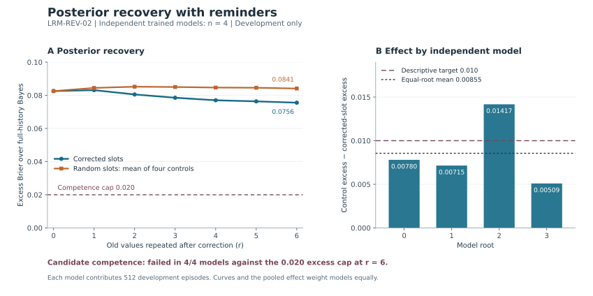

# LRM-REV-02: four-model CPU pilot

**Collection completed on 19 November 2026 (Singapore). All four models failed the registered competence gate after reminders.** Corrected-position reminders had a mean advantage of **0.008553539884 unhalved Brier** over the four random-position controls. The registered descriptive target was 0.01.

Evidence status: `ENGINEERING_PILOT_ONLY`.
Preflight status: `PENDING_MATCHED_SHAM_AND_CONFIRMATION_DESIGN`.

The [raw collection summary](results/lrm_rev02_v1/summary.json) records all four roots as `COMPLETE`, with each root's `engineering_competence_pass=false`. Collection status describes completion of the prescribed work. The competence flags describe the model's posterior error. Both independent integrity checks passed.

## Primary result and competence

The independent unit is one separately initialized and trained model. Each root used 2,048 training episodes and 512 development episodes, giving **four independent model roots** and 2,048 development episodes. Each model has 4,995 parameters and completed the registered 800 Adam steps. Scoring used its final checkpoint.

For each development episode, the candidate repeats the six old values at corrected positions. Four active controls each repeat six old values at uniformly sampled positions. All arms start from the same state after the original observations and accepted replacements. The full-history Bayes posterior `p_H` remains the scoring target throughout the reminder stages.

The registered root effect is the episode mean of `mean_four_controls(excess at r=6) - candidate_excess at r=6`, where `excess = ||forecast - p_H||^2`. Positive values favor corrected-position reminders. Roots receive equal weight.

| Root | Initial posterior error | Candidate error at r=6 | Control mean error at r=6 | Primary advantage | Initial gate <=0.01 | Candidate gate <=0.02 |
|---|---:|---:|---:|---:|---|---|
| 0 | 0.007359393216 | 0.083976915425 | 0.091779044704 | +0.007802129279 | PASS | FAIL |
| 1 | 0.002412097946 | 0.076376719432 | 0.083524504570 | +0.007147785139 | PASS | FAIL |
| 2 | 0.002989203712 | 0.076189855985 | 0.090359170850 | +0.014169314865 | PASS | FAIL |
| 3 | 0.007004439680 | 0.065661377440 | 0.070756307693 | +0.005094930253 | PASS | FAIL |
| Equal-root mean | 0.004941283639 | 0.075551217070 | 0.084104756954 | **+0.008553539884** | 4/4 pass | **0/4 pass** |

The initial gate uses the Bayes target for the twelve old observations before the correction schedule arrives. The later gate uses the full accepted history. Every root passed the initial and numerical checks. Candidate error after six reminders ranged from 0.0656614 to 0.0839769, exceeding the 0.02 cap for every root. Root 2 alone exceeded the descriptive 0.01 effect target. The equal-root effect fell short by 0.001446460116.

Control error supplies 0.084104756954 of mean available headroom relative to full-history Bayes, about 8.41 times the 0.01 target. The residual error therefore leaves room for improvement. The failed competence gates require further development before a scientific confirmation design can use this instrument.

## Complete reminder curve

The table averages within each root and then equally across roots. Each control entry also averages its four registered random reminder policies. All individual control curves and episode forecasts remain in the raw receipts.

| Reminders r | Candidate Bayes excess | Control mean Bayes excess | Control minus candidate |
|---|---:|---:|---:|
| 0 | 0.082570681202 | 0.082570681202 | 0.000000000000 |
| 1 | 0.083122943971 | 0.084456621875 | 0.001333677904 |
| 2 | 0.080509298411 | 0.085194155614 | 0.004684857203 |
| 3 | 0.078538789555 | 0.085013623171 | 0.006474833616 |
| 4 | 0.077012569313 | 0.084674140723 | 0.007661571410 |
| 5 | 0.076348778788 | 0.084565345513 | 0.008216566726 |
| 6 | 0.075551217070 | 0.084104756954 | 0.008553539884 |



Candidate error rose after the first reminder, then declined through the remaining stages. Its six-reminder reduction relative to the common r=0 state was 0.007019464131. The random-control mean rose by 0.001534075753 relative to that state. Both changes contribute to the primary advantage.

Conditional expected Brier averaged 0.177125301709 for the candidate and 0.185678841593 for controls. The mean Bayes risk on these development episodes was 0.101574084639. That last value describes the sampled episodes; the exact population risk belongs to the separate BB-CQ-05 calculation.

At r=6, mean hidden-state displacement was 2.134554814901 for the candidate and 2.125486690627 for controls. The protocol matched input count and input norm. These observed hidden displacements remain diagnostic measurements. Each arm-stage forecast is a repeated observation within a model root; the 71,680 archived arm-stage forecasts retain that dependency.

## Independent verification

The [arithmetic and provenance audit](results/lrm_rev02_v1_audit.json) passed with no failures. It checked all 15 registered source files against frozen Git, verified 21 listed artifact hashes, regenerated the identities of all 8,192 archived training episodes and 2,048 development episodes from frozen source, and independently recalculated the Bayes targets and score aggregates. It reproduced all failed competence flags.

The [checkpoint replay](results/lrm_rev02_v1_replay.json) loaded all four archived final checkpoints and independently rebuilt each complete 24-token arm. Across every development row, its largest probability discrepancy was **1.785079385419e-7**, within the registered 1e-6 gate. The largest root-effect discrepancy was **1.854909792605e-9**, also within 1e-6. The maximum hidden-displacement discrepancy was 1.848398298865e-7 against its separately labelled 1e-5 diagnostic tolerance.

Within collection, resetting and replaying the original prefix produced zero probability, logit and hidden-coordinate discrepancy. All r=0 arms agreed exactly. Maximum probability normalization error was 2.220446049250e-16. No numerical failure or budget stop occurred.

All 33 fixture tests passed before the source freeze. GitHub also passed the [29-test CPU workflow](https://github.com/MoralityLabAI/LoopedTransformers/actions/runs/44348549891) and [four-test original source workflow](https://github.com/MoralityLabAI/LoopedTransformers/actions/runs/44348552935) before collection. The results workflow audits and replays the published receipt on subsequent CI runs.

## Runtime and provenance

Collection took **33.821390417 seconds** on one CPU thread, with peak RSS **297,119,744 bytes (283.355469 MiB)**. The registered caps were 900 seconds and 2 GiB. The process used Python 3.12.14 and PyTorch 2.5.1+cpu, with float32 recurrence, float64 scoring softmax and deterministic Torch execution. Each root was trained once; the first scheduled collection supplies every archived result.

| Record | Identifier |
|---|---|
| Protocol registration commit | `91d5d7e52de07a87dbd0e34fac799ffcabe6f551` |
| Implementation and protocol freeze | `b44734d40b5f1b7009ccc7e07105531f0aefbfa3` |
| Frozen Git tree | `350a8959d2c8785ebdb2eddf7a44b32b530fa79b` |
| Raw summary SHA-256 | `a4c40a7dfa1ac68d7fc1da70dba9fb60a665ad139fca2a7ac27ef00864e004c8` |
| Source manifest SHA-256 | `53851ab6b1196057ca92a38f843b451713e6e33130eccc0c559a775fe26f6bc2` |
| Arithmetic audit SHA-256 | `b16cb27f5c6396a3db4199c1d5ffce485a37a1073c170b4a2d2e483d13ec9bab` |
| Checkpoint replay SHA-256 | `95f848a41ec4e9ebdcaaeb07a9f7d868666ec1dce1c735a11b4fec372f90d888` |

The [source manifest](results/lrm_rev02_v1/source_manifest.json) gives every frozen source hash. The raw summary gives hashes for all four checkpoint files and every episode archive, training trace and root summary. All 22 raw receipt files are preserved, including the raw summary itself. The [publication manifest](results/lrm_rev02_v1_publication_manifest.json) hashes the raw receipts and their accompanying report files. The audit reports and figure sit outside the raw receipt directory.

To verify the archived result from a checkout containing the frozen commit:

```bash
python mechinterp/revision_memory_gym/audit_lrm_rev02.py \
  mechinterp/revision_memory_gym/results/lrm_rev02_v1 --repo-root .
python mechinterp/revision_memory_gym/replay_lrm_rev02.py \
  --out mechinterp/revision_memory_gym/results/lrm_rev02_v1
```

## Scope of the result

This run supplies development observations about a reminder-selection policy in four small GRUs. The model passed the initial posterior task and failed the registered posterior-error cap after corrections and reminders. That distinction guides further instrument development.

The random-position policies are active controls. A future mean-effect gate needs a matched-null experiment for the same paired root-mean statistic, together with a separately reserved confirmation design. The current EvalMath planner's individual-root sham tolerance contract requires its own inputs and cannot establish coverage for this mean from the available active-control observations. The [frozen preflight note](PREFLIGHT_LRM_REV02.md) records the estimator and unit requirements.

`matched_sham_floor`, `planned_confirmation_units` and `estimated_confirmation_power` remain `null`; `strict_preflight_executed=false`. The four model effects support the descriptive tables above. Scientific readiness remains `PENDING_MATCHED_SHAM_AND_CONFIRMATION_DESIGN`, with the evidence verdict fixed at `ENGINEERING_PILOT_ONLY`.
