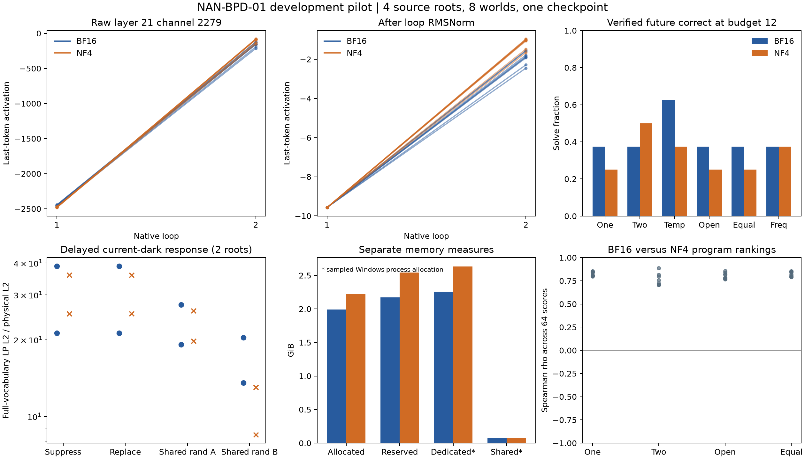

# NAN BPD 01 phase conditioned causal fibers development results

This separate Dark Fibers v015 addendum studies one pinned Nanbeige4.2-3B
checkpoint on four fresh development source roots, with two additional
calibration roots. Native two-loop future@12 is 3/8 for BF16 and 4/8 for NF4;
both fail the registered source-discriminating competence gate. The loop marker
is reproduced, while behavioral prerequisites for native BPD remain unmet.
The study distinguishes a reproducible loop marker, current-dark
continuous causal response, verified task competence and BPD donor transfer.
The proposed BPD primary is **unrun**, rather than a zero effect: native clean
competence must pass before dictionary fitting and behavioral mediation.
The original 168-case ARG-03 test remains sealed and is not regenerated or used
for exclusions. Historical v014/v015 text and ARG-03 criteria are unchanged.

## Clean task competence and controls

Each source pair shares inputs, query, topology, operator multiset and prompt
length, while its verified query targets differ. The model receives public
demonstrations only. Exact EvalMath search checks at most 12 of the original
64 programs. An independent geometric-series/convolution implementation also
verifies all twelve source worlds through degree 32; this is a finite integer
certificate, not an infinite-series identity proof.

The main prompt uses the snapshot's native chat template with thinking disabled.
Bare ARG-02 format is a predeclared source-only instrument control on the first
two recipient roots. Temperatures are fitted on CAL only before DEV grading.
Frequency scores use CAL-only per-position counts; equal compute averages
canonical and swapped-demo one-loop log scores. No model result selects cases.

| Backend | Arm | Cases | Future correct at 12 | Top one future correct | Mean source rank |
|---|---|---|---|---|---|
| BF16 | native1 | 8 | 3/8 | 0/8 | 27.88 |
| NF4 | native1 | 8 | 2/8 | 0/8 | 32.62 |
| BF16 | native2 | 8 | 3/8 | 1/8 | 25.12 |
| NF4 | native2 | 8 | 4/8 | 1/8 | 25.88 |
| BF16 | calibrated | 8 | 5/8 | 1/8 | 22.25 |
| NF4 | calibrated | 8 | 3/8 | 1/8 | 24.62 |
| BF16 | open_loop | 8 | 3/8 | 0/8 | 27.50 |
| NF4 | open_loop | 8 | 2/8 | 0/8 | 33.25 |
| BF16 | equal_compute | 8 | 3/8 | 0/8 | 28.12 |
| NF4 | equal_compute | 8 | 2/8 | 0/8 | 33.00 |
| BF16 | frequency | 8 | 3/8 | 0/8 | 31.50 |
| NF4 | frequency | 8 | 3/8 | 0/8 | 31.50 |
| BF16 | bare_native2 | 2 | 0/2 | 0/2 | 20.50 |
| NF4 | bare_native2 | 2 | 1/2 | 0/2 | 24.00 |

Bare results use two recipient worlds, whereas the main controls use eight
worlds. Each world has sixteen candidate-prefix rows. Those rows, multiple
operators, tokens and backend executions do not increase the independent-root
count. The two backend executions are paired measurements of one checkpoint.

The frozen competence gate requires at least 4/8 native two-loop future@12
successes, at least two both-clean pairs and at least one pair whose two
distinct targets are both top-one correct. An input-blind constant-program
predictor cannot pass that last requirement.

- BF16: native two-loop future@12 3/8; both-clean pairs 1/4; both-top-one pairs 0/4. Clean competence gate **FAIL**. Donor-state closure errors: [0.0, 0.0]; closure gate **PASS**.
- NF4: native two-loop future@12 4/8; both-clean pairs 1/4; both-top-one pairs 0/4. Clean competence gate **FAIL**. Donor-state closure errors: [0.0, 0.0]; closure gate **PASS**.

Source construction used 9
base draws for six admitted pairs. Its rejection-event counters are
`{"ambiguous_future": 2, "length_mismatch": 48, "target_collision": 12}`. These are structural candidate
comparison events, not independent causal trials. All four admitted DEV pairs
and all their model outcomes are retained; no model-based eligibility filtering
or replacement occurs. Target collisions among admitted pairs: zero.

## Phase marker and normalization

The predeclared site is decoder layer index 21, channel 2279. The original
[community observation](https://huggingface.co/Nanbeige/Nanbeige4.2-3B/discussions/20)
is a hypothesis; the values below are independent measurements from the pinned
checkpoint. The last-token measurement averages the sixteen candidate rows.
CAL-only nearest-mean loop classification is evaluated on sixteen DEV
world-loop observations, clustered in four roots.

| Backend | Site | Loop one mean | Loop two mean | Loop classification | Mean pair gap loop one/two |
|---|---|---|---|---|---|
| BF16 | raw | -2452.875 | -158.219 | 16/16 | 3.250/8.500 |
| BF16 | postnorm | -9.569 | -1.917 | 16/16 | 0.001/0.072 |
| NF4 | raw | -2476.875 | -99.375 | 16/16 | 4.250/7.125 |
| NF4 | postnorm | -9.572 | -1.151 | 16/16 | 0.001/0.066 |

The phase gap and paired source-content gap answer different questions.
Successful loop classification alone does not show source-specific reasoning
information. Neighbor/random channels, token-position profiles, whole-token
norms and raw/post-RMSNorm values are retained in the diagnostic receipts.
Backend similarity in these summaries does not establish identical mechanisms.

| Backend | Predeclared channel | Raw loop classification | Postnorm loop classification |
|---|---|---|---|
| BF16 | 2279 | 16/16 | 16/16 |
| BF16 | 2278 | 16/16 | 16/16 |
| BF16 | 2280 | 14/16 | 16/16 |
| BF16 | 173 | 16/16 | 16/16 |
| BF16 | 1531 | 14/16 | 14/16 |
| NF4 | 2279 | 16/16 | 16/16 |
| NF4 | 2278 | 16/16 | 16/16 |
| NF4 | 2280 | 16/16 | 8/16 |
| NF4 | 173 | 16/16 | 16/16 |
| NF4 | 1531 | 14/16 | 14/16 |

These control-channel classifications use the same CAL-only rule and DEV
world-loop denominator; they do not add independent units.

## Physical dose and delayed continuous response

A post-readout audit found a defect in the initial dense random controls:
different noise was assigned to candidate rows with the same prefix. Their
delayed operator-LP prefix spread is 1.47–3.08, whereas native and all other
initial arms have spread exactly zero. Initial dense behavioral scores are
retained as candidate-indexed diagnostics and invalidated as a canonical sham.
Corrected `random_shared_dark` arms broadcast the original seed's first noise
row across candidates. Only these controls are rerun on the same two recipients
per backend, requiring exact native-score repetition and zero hidden/LP prefix
error. The initial grades and CAL choices are independently checked unchanged.
This repair follows initial DEV exposure and is exploratory; see the
[frozen amendment](../../experiments/nan_bpd01/PREFIX_CONTROL_AMENDMENT.md).

Each nonzero edit targets 0.02 times the entire clean first-loop state's L2
norm, measured after BF16 rounding, with maximum relative mismatch 0.005.
Current-dark arms edit eight context positions and leave all three scored
positions byte-identical. Global diagnostic arms edit scored positions too.
The direction called suppression points toward zero; it is a calibrated-radius
edit, not necessarily complete removal of a channel.

BF16: 26 measured edits, 2 dose-ineligible, 0 non-sham zero-dose writes; 16 current-dark writes, of which 12 are prefix-coherent, with maximum current full-vocabulary LP error 0.
NF4: 26 measured edits, 1 dose-ineligible, 0 non-sham zero-dose writes; 16 current-dark writes, of which 12 are prefix-coherent, with maximum current full-vocabulary LP error 0.

| Backend | Edit | Dose eligible | Prefix coherent | Current full-vocab LP max error | Mean delayed LP L2 / physical L2 |
|---|---|---|---|---|---|
| BF16 | phase_global_suppress | 0/2 | 2/2 | 0.1851 | 5.751 |
| NF4 | phase_global_suppress | 1/2 | 2/2 | 0.1722 | 6.460 |
| BF16 | phase_context_suppress | 2/2 | 2/2 | 0 | 30.089 |
| NF4 | phase_context_suppress | 2/2 | 2/2 | 0 | 30.568 |
| BF16 | phase_context_replace | 2/2 | 2/2 | 0 | 30.089 |
| NF4 | phase_context_replace | 2/2 | 2/2 | 0 | 30.568 |
| BF16 | channel2278_global | 2/2 | 2/2 | 0.09472 | 5.910 |
| NF4 | channel2278_global | 2/2 | 2/2 | 0.09472 | 7.454 |
| BF16 | channel2280_global | 2/2 | 2/2 | 0.09892 | 5.947 |
| NF4 | channel2280_global | 2/2 | 2/2 | 0.09888 | 6.699 |
| BF16 | channel173_global | 2/2 | 2/2 | 0.09438 | 5.068 |
| NF4 | channel173_global | 2/2 | 2/2 | 0.09439 | 5.248 |
| BF16 | channel1531_global | 2/2 | 2/2 | 0.1048 | 7.804 |
| NF4 | channel1531_global | 2/2 | 2/2 | 0.1047 | 8.093 |
| BF16 | random_dark_173 | 2/2 | 2/2 | 0 | 14.809 |
| NF4 | random_dark_173 | 2/2 | 2/2 | 0 | 15.129 |
| BF16 | random_dark_1531 | 2/2 | 2/2 | 0 | 53.858 |
| NF4 | random_dark_1531 | 2/2 | 2/2 | 0 | 21.955 |
| BF16 | random_dense_dark_741 | 2/2 | 0/2 | 0 | 20.297 |
| NF4 | random_dense_dark_741 | 2/2 | 0/2 | 0 | 16.617 |
| BF16 | random_dense_dark_947 | 2/2 | 0/2 | 0 | 16.520 |
| NF4 | random_dense_dark_947 | 2/2 | 0/2 | 0 | 15.297 |
| BF16 | random_shared_dark_741 | 2/2 | 2/2 | 0 | 23.277 |
| NF4 | random_shared_dark_741 | 2/2 | 2/2 | 0 | 22.870 |
| BF16 | random_shared_dark_947 | 2/2 | 2/2 | 0 | 16.962 |
| NF4 | random_shared_dark_947 | 2/2 | 2/2 | 0 | 10.761 |

Ineligible edits remain in the receipts and denominators; they cannot support
an equal-dose advantage. Suppression and CAL replacement may round to identical
physical writes and are not independent replications. The delayed norm sums
all full-vocabulary log-probability changes over the sixteen rows and three
positions. Its magnitude is a continuous diagnostic, not verified reasoning.

Full donor-state replacement is a positive state-closure control with its
natural displacement, not a dose-matched dark intervention. Source-input
uses the donor's actual public demonstrations. Their donor-target outcomes
and the clean baseline (zero write) are:

| Backend | Arm | Donor future correct at 12 on two recipients |
|---|---|---|
| BF16 | zero_write | 0/2 |
| NF4 | zero_write | 0/2 |
| BF16 | full_donor_state | 0/2 |
| NF4 | full_donor_state | 0/2 |
| BF16 | source_input | 0/2 |
| NF4 | source_input | 0/2 |
| BF16 | phase_context_suppress | 0/2 |
| NF4 | phase_context_suppress | 1/2 |
| BF16 | phase_context_replace | 0/2 |
| NF4 | phase_context_replace | 1/2 |
| BF16 | random_shared_dark_741 | 0/2 |
| NF4 | random_shared_dark_741 | 0/2 |
| BF16 | random_shared_dark_947 | 0/2 |
| NF4 | random_shared_dark_947 | 0/2 |

These two-root phase/control outcomes are distinct from the unrun BPD primary.
A donor target already present in a clean top-12 verifier search is not a new
causal recovery. Preserving the current readout plus moving future logits does
not establish a necessary reasoning component.

On these two intervention roots, both full-donor and source-input behavioral
controls recover 0/2 donor targets in each backend, despite exact state closure.
The clean donors themselves are unsuccessful there. NF4's CAL phase edit has
a 1/2 donor-target scoring event; it uses a common CAL loop mean, not that
pair's donor information. This event does not establish source-conditioned
transfer or rescue the failed behavioral instrument.

| Backend | Minimum whole-state norm ratio | Maximum whole-state norm ratio |
|---|---|---|
| BF16 | 0.994783 | 1.000325 |
| NF4 | 0.994746 | 1.000398 |

Raw/post-normalization token norms and these edit norm ratios are audited.
Individual context-token radii are not held fixed; an equal physical dose can
therefore have different normalization effects across directions. The phase
diagnostics do not separate that contribution. A later mediation instrument
needs token-radius controls after establishing clean source competence.

## BF16 and NF4 memory and ranking geometry

The 166144 by 3072 BF16 output head stays on CPU. Vocabulary rows stream in
chunks of 8192 with stable full-vocabulary log-sum-exp. Operator logits and
the original sixteen-prefix/64-program scoring contract are preserved.
Before any 3B load, the exact-dimension synthetic GPU fixture gave operator
logit error 0, maximum logprob error 9.54e-6 and program-score error 1.53e-5.
The random-model native two-loop streaming closure error was 0.

| Backend | Minutes including load | CUDA allocated GiB | CUDA reserved GiB | Sampled process dedicated GiB | Sampled process shared GiB |
|---|---|---|---|---|---|
| BF16 | 29.78 | 1.994 | 2.172 | 2.258 | 0.076 |
| NF4 | 45.48 | 2.222 | 2.545 | 2.634 | 0.076 |

Dedicated/shared entries are sampled Windows process allocations. CUDA reserved
and driver usage measure different quantities. Shared allocations are not a
measurement of paging, and completion is not proof of wholly dedicated residency.
The initial BF16 CIM observer was sandbox-blocked; the external permitted
observer supplies its driver figures. NF4 reads counters directly. Other user
applications remain active. Timings include verification, load and telemetry.
BF16 holds all directions eagerly; NF4 uses a byte-validated lazy iterator.
Their observed memory/runtime difference is not an isolated quantization effect.

| Backend | Original cohort minutes | Additional prefix-repair minutes |
|---|---|---|
| BF16 | 24.86 | 4.92 |
| NF4 | 40.05 | 5.42 |

The memory table includes the maximum over both stages, and its elapsed time
includes the additional repair loads. NF4's original cohort itself used one
bounded resume for its four pending cases; no source cases were replaced.

| Program-score arm | Mean BF16/NF4 Spearman rho | Minimum | Maximum |
|---|---|---|---|
| native1 | 0.8252 | 0.7967 | 0.8516 |
| native2 | 0.7624 | 0.7045 | 0.8871 |
| open_loop | 0.8049 | 0.7662 | 0.8569 |
| equal_compute | 0.8239 | 0.7905 | 0.8535 |

These correlations compare 64 correlated program scores within each world.
They do not measure BPD subspace alignment or certify causal fidelity under NF4.
Each backend has a distinct source and quantization manifest. Both share the
same source cohort, head contract, checkpoint revision and native-loop clock.

Native two-loop correctness pairing is
`{"bf16_only": 0, "both_correct": 3, "n_independent_roots": 4, "neither": 4, "nf4_only": 1}`.
The accuracy difference is descriptive. No cross-backend superiority or
equivalence test was registered or claimed.

## BPD engineering and blocked native stages

The actual BPD `TiedComponentLinear` API passes rank-8/16 synthetic two-pass
full-product-plus-residual closure below 5e-7. A GL shear changes a raw hard-mask
operator; canonicalized masked operators agree below 2e-15. Near-degenerate
singular components are grouped. The reached-state routing fixture changes
its mask after an intervention, unlike a static/clean-oracle mask. Synthetic
SVD/PCA/gradient/Gramian/random basis constructors pass orthogonality checks.
These are finite engineering checks, not learned Nanbeige components.

Native final-block o_proj/down_proj fitting, task-gradient and delayed-Gramian
selection, trained read/write factors, BPD donor writes, static/online learned
routing and cross-backend component/subspace alignment require the competence
and state-closure gates. Their exact statuses are in `receipts/results.json`.
Unrun BPD arms are unavailable, never imputed as behavioral failures or zeros.
The effective NF4 operator check uses actual quantization state rather than
the original BF16 matrix; its separate engineering receipt records residual
closure and kernel comparison.

## Statistical resolution and next cohort

Unit: source-generator world/root. Development: four roots/eight cases;
phase interventions: two roots/two recipients; calibration: two other roots.
Proposed primary: selected BPD donor-specific future@12 minus same-dose
random-dark, with scientific minimum 0.15. Physical relative dose: 0.02.
Primary comparisons: two backend-specific contrasts, both unrun.

The original exploratory allocation was 40; before correctness grading the
family expanded to 42 to include both frequency contrasts. After detecting
the prefix defect, four corrected backend/control contrasts bring actual
accounting to 46, retaining four invalid initial dense entries as p=1
placeholders. Corrected hypotheses are marked not prospectively registered.
All controls and unavailable entries are retained. FSI-01 computes
exact paired accounting, root bootstrap descriptions and conservative bounds.
It withholds inferential p-values because exchangeability is unestablished.
Conditional root-sign-flip sensitivity calculations use exact arithmetic and
Holm across 46; minimum adjusted value is `1`. Their symmetry
assumption is unverified and none constitutes confirmation.

The strict pre-data planner refused an empty empirical pilot. Empirical
phase-versus-random preflights (not the unrun BPD contrast) report:

- BF16: `REDESIGN_OR_PILOT_ONLY`, reasons `['sham_quantile_uncalibrated', 'too_few_pilot_worlds', 'target_below_mechanistic_variation_floor', 'confirmation_underpowered']`
- NF4: `REDESIGN_OR_PILOT_ONLY`, reasons `['sham_quantile_uncalibrated', 'too_few_pilot_worlds', 'target_below_mechanistic_variation_floor', 'confirmation_underpowered']`

Those empirical preflights use **recipient** future@12 preservation under CAL
phase replacement versus corrected shared random A; their shams are corrected
shared random A/B
relative to the clean recipient. They do not estimate the donor-specific BPD
primary's power or treat the NF4 donor-target scoring event as confirmation.

The two-root binary mean has 0.5 pilot granularity. A 95th-percentile sham
threshold at 95% confidence cannot be calibrated from two roots; the EvalMath
skill requires at least 59 independent sham worlds for a sample-maximum bound.
Its hard stops include “Fewer than the planned independent roots” and “No sealed
held-out readout”. Evidence remains development-only and power-limited.

Before adding intervention complexity, establish source-dependent clean
competence on a repaired source-only task with independent CAL and DEV roots.
Then obtain at least eight independent development pilot roots, independent
sham calibration, and a genuinely untouched new confirmation readout sized by
the empirical planner and effect-floor bounds. The nominal 60-root plan is
not a power-certified sample size. The original 168-case test remains sealed.

## Reproducibility and preservation

Use the [experiment README](../../experiments/nan_bpd01/README.md) for exact
local commands and [source manifest](../../experiments/nan_bpd01/SOURCE_MANIFEST.json)
for repository/PR pins. Source registration: `18b102e289b340cd002bc96c3d310eb7ebbbc3aa`;
grading/storage lock: `5d21ddb52e0d792d618097c594e088a41cbfa26e`;
pre-grading resolution/multiplicity correction: `238e0d3`.
Checkpoint: `451ed48c3273ecef7ea8faaa43c31ce529763bb1`. Model execution uses
Transformers 4.46.3, PyTorch 2.6.0+cu124 and bitsandbytes 0.50.2.

Compact receipts, paired grades, phase profiles and the figure accompany this
addendum. Full model-only activation tapes stay local and are SHA256-indexed.
Existing PAPER.md/v014 text, historical result receipts and the frozen ARG-03
registration are untouched. See the [research context](../../experiments/nan_bpd01/RESEARCH_CONTEXT.md)
for how CQ/PD/ROC/SCM/LS-SAE evidence constrains the interpretation and the
[EvalMath mechanistic-power skill](https://github.com/MoralityLabAI/EvalMath/blob/accf4d9040bee8daeabc6b07003bb484708996c0/skills/evalmath-mechinterp-power/SKILL.md)
for the confirmation gate.

Fifteen CPU tests pass. The independent stdlib receipt audit verifies 228
diagnostic grade rows (212 prefix-coherent), all 212 original scalar grades
unchanged, unchanged CAL choices, 40 exact conditional root sign-flip
calculations and 46-entry Holm accounting. These are repeated measurements
within the four development roots, not 228 independent replications.
