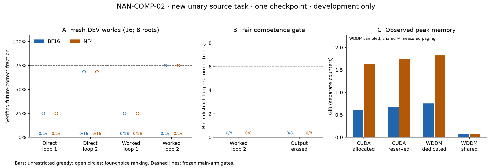

# NAN-COMP-02: fresh source-only BF16/NF4 competence pilot

**2026-11-18 · development evidence · BPD transfer not attempted · original 168-case test sealed.**

Both backends fail the prospectively frozen competence gate on the new unary task. Worked native two-loop unrestricted greedy correctness is **0/16 worlds**, with **0/8 both-correct pairs**, in BF16 and NF4. The immediate failure is the response contract: all 16 main-arm first tokens in each backend are token 1472, `▁**`, a Markdown bold opener rather than an accepted operator letter. No continuation was collected, so this does not establish that a complete generated answer would be wrong.

There is also a task-specific blocker beyond formatting. Four-choice ranking is **12/16** in both backends, but each misses **all four reciprocal (R) worlds** and recovers both targets in only **4/8 pairs**, below the required 6/8. The first-token rule has not been relaxed, and forced-choice scores do not pass the gate. The joint competence prerequisite remains failed; no BPD dictionary, donor transfer, hidden-state intervention or recurrence-geometry measurement was run.

## What was frozen and run

The [prospective registration](https://github.com/MoralityLabAI/LoopedTransformers/commit/2ec61819220d39db2dc3561d59708124e5703cf9) was committed and pushed before reading pretrained outcomes. Its commit time is 04:29:35 UTC; the first case tape was created at 04:37:19 UTC. The [protocol](https://github.com/MoralityLabAI/LoopedTransformers/blob/research/nan-comp02-unary-competence/experiments/nan_comp02/PROTOCOL.md), config, prompt, decoder, scoring head, grader and source files match between backend manifests. Model parameters stayed frozen. CAL and DEV results selected no format, temperature, prompt, case or checkpoint.

This deliberately simpler task identifies one operator from I(f)=f, N(f)=f(-x), S(f)=f(x²), and R(f)=1/f. It is a **new condition**, not a repair or passing readout of NAN-BPD-01's 64-program compound task. The earlier compound competence failure and historical reports are unchanged.

Each fresh generator root supplies two polynomial demonstrations, two counterfactual operator worlds with the same inputs/query, and different exact degree-32 futures. Only coefficients through degree four appear in the demonstrations. The model predicts an executable operator; the verifier computes its future coefficients. The model does not generate the 33 coefficients itself. Query coefficients, case IDs, root IDs, family, split and target labels are not rendered. The tutorial gives balanced generic examples for all four operators, without the current world's answer.

There are **eight DEV roots / 16 worlds**, balanced at four worlds per operator, and **two CAL roots / four worlds**. Dense and sparse degree-four source families alternate. Construction used only the source oracle, independent integer checker, tokenizer and frozen source rules: 11 draws admitted ten roots, with one duplicate-demonstration rejection. No existing roster was called, and no source was replaced using checkpoint results. Every demonstration and future was independently verified.

A source-only audit found one CAL/DEV clean-prompt overlap: CAL 182601 recipient and DEV 182705 recipient. Their erased root prompts also coincide. Public hashes included query coefficients that were not rendered, so those hashes did not enforce prompt uniqueness. All cases were retained. The 16 DEV clean prompts and eight DEV erased root prompts are distinct; CAL was never used for fitting or format selection. Removing the overlapping DEV root only as a disclosed descriptive sensitivity leaves **0/14 greedy and 11/14 forced-choice** in each backend. The registered 16-world gate includes that root.

## Behavioral comparison

The checkpoint is Nanbeige4.2-3B revision `451ed48c3273ecef7ea8faaa43c31ce529763bb1`. Both conditions use the native chat template with thinking disabled and assistant prefix `Operator:`, one prompt at a time, native loops one and two, and no embedding reinjection. A full-vocabulary argmax determines the unrestricted first token. Eight independently round-tripping bare/space-prefixed answer-token aliases define the four operator classes. Alias-marginal ranking is reported separately from generation.

| DEV arm | BF16 greedy | NF4 greedy | BF16 four-choice | NF4 four-choice |
|---|---:|---:|---:|---:|
| Direct, loop 1 | 0/16 | 0/16 | 4/16 | 4/16 |
| Direct, loop 2 | 0/16 | 0/16 | 11/16 | 11/16 |
| Worked, loop 1 | 0/16 | 0/16 | 4/16 | 4/16 |
| **Worked, loop 2 (primary)** | **0/16** | **0/16** | **12/16** | **12/16** |
| Output-erased worked, loop 2 | 0/16 | 0/16 | 4/16 | 5/16 |
| Independently repeated erasure | 0/16 | 0/16 | 4/16 | 5/16 |
| Frozen constant-I prior baseline | 4/16 | 4/16 | 4/16 | 4/16 |

All nonconstant arms have zero accepted first-token formats. The primary forced-choice result is 4/4 each on I, N and S, and 0/4 on R, in both backends. The second loop changes restricted ranking substantially relative to the first; this is a behavioral depth diagnostic, not evidence of a recurrent mechanism or correct unrestricted answers. With four candidates, search@12 would automatically reach every operator and is only a structural ceiling.

| Frozen primary requirement, separately in each backend | Required | BF16 | NF4 |
|---|---:|---:|---:|
| Greedy verified-future correctness | ≥12/16 | 0/16 · FAIL | 0/16 · FAIL |
| Both distinct targets correct within a root | ≥6/8 | 0/8 · FAIL | 0/8 · FAIL |
| Mean greedy accuracy gain over erasure | ≥0.25 | 0 · FAIL | 0 · FAIL |

Erased token IDs and predictions are identical within each pair, so the source-blind both-correct ceiling is exactly zero and the case-accuracy ceiling is 50%. The observed erased both-correct count is zero. Restricted primary predictions change between the two worlds in 6/8 BF16 roots and 7/8 NF4 roots, suggesting source-sensitive ranking under this restricted readout. That observation does not rescue any primary gate.

Primary restricted predictions agree across BF16/NF4 on 15/16 worlds; both miss R on the one disagreement. Mean four-operator conditional total variation is 0.1023. Mean full-vocabulary probability mass assigned to accepted operator aliases is **0.4088 BF16 versus 0.2318 NF4**. Mean source-class NLL is **1.4817 versus 2.1050 nats**. Equal 12/16 counts therefore do not establish quantization equivalence. These diagnostics use the same checkpoint and roots and are not additional independent replications.

CAL remains separate: all greedy scores are 0/4; worked loop-two four-choice is 3/4 in both backends, direct loop-two is 2/4 in both, and erased loop-two is 1/4 BF16 versus 2/4 NF4. No CAL result changed this pilot.

## Resolution, controls and evidence class

The independent sampling unit is the **source root**, not the 240 graded backend/arm/world rows. The primary contrast is worked loop-two minus output-erased loop-two greedy verified accuracy. The intervention removes current demonstration outputs; there is no hidden-state dose. The frozen meaningful floor is **0.25 solve fraction**, with aggregate measurement resolution **1/16**. The observed root-macro primary effect is exactly zero in both backends.

There are **nine planned and nine actual inferential comparisons**: four per backend (primary versus erasure, direct loop two, worked loop one, constant I), plus NF4 versus BF16 primary. All are retained, including zero-effect roots. FSI-01 withholds unconditional p-values because paired-label exchangeability is unestablished. Exact conditional root-sign-flip sensitivity gives p=1 for seven comparisons and p=1/8 for each contrast against constant I; all nine Holm-adjusted values are 1. All FSI verdicts are inconclusive. No inferential tests were selected from the secondary restricted scores.

The strict pre-data planner was given an empty empirical pilot and refused it rather than substituting historical shams. After inference, actual repeated-erasure forwards had exactly zero selected-logit and full-log-normalizer differences, with identical greedy tokens, on all ten roots in both backends. Sham correctness deltas were evaluated against the same labels and averaged within each root; they are zero on the eight DEV roots. This is measured numerical/format repeat noise, not a semantic-intervention tail calibration.

Both post-pilot strict planner decisions are **REDESIGN_OR_PILOT_ONLY**, with an uncalibrated sham quantile. Eight independent sham roots cannot establish a 95th-percentile bound at 95% confidence; the sample-maximum requirement is at least 59. The raw planner's normal approximation reports two worlds for a hypothesized 0.5 effect because observed variance is zero. That degenerate approximation is **not** power for the observed zero effect, a usable root recommendation, or permission to bypass its refusal. The provisional 60-root later plan is not a power guarantee. There is no new sealed confirmation readout, and eight roots also fall below FSI's 20-root confirmation policy.

Evidence class: **observed development failure of the frozen response/competence contract; power-limited task and quantization comparisons**. No model incapacity, quantization equivalence, generalization, causal mediation or BPD-transfer claim follows.

## Engineering and hardware

Both runs completed all 20 worlds without failure, truncation, resume or replacement on an RTX 3050 Laptop GPU (4096 MiB), Windows WDDM, driver 610.62. Locked checkpoint files and the tokenizer template were verified before loading. BF16 streams decoder layers from CPU with one resident layer and one staging layer. NF4 keeps 154 decoder linear modules on CUDA using bitsandbytes NF4, double quantization and BF16 compute. Embeddings and the full 166144×3072 BF16 head stay on CPU in both conditions; vocabulary chunks contain 8192 rows. These are different decoder placement strategies, so the memory values do not mean NF4 intrinsically requires more memory than a GPU-resident BF16 model.

| Observed counter | BF16 | NF4 |
|---|---:|---:|
| Peak CUDA allocated | 0.601 GiB | 1.635 GiB |
| Peak CUDA reserved | 0.666 GiB | 1.738 GiB |
| Sampled process dedicated allocation | 0.753 GiB | 1.825 GiB |
| Sampled process shared allocation | 0.076 GiB | 0.076 GiB |
| Whole-run elapsed, including verification/loading | 736.040 s | 584.972 s |

The Windows sampler obtained 34/30 nonempty process samples. Sampled counters can miss peaks; shared allocation is not measured paging or physical residency. CUDA counters are separate and must not be added to WDDM counters. These single sequential wall times are not a throughput benchmark.

The pre-inference exact-dimension random-head fixture matched selected BF16 logits exactly, full-vocabulary log probabilities within 1.425e-7, and global argmax exactly. Small random native two-loop models matched streamed BF16 and actual NF4 reference hidden states exactly. These fixtures validate the implementation, not full-checkpoint behavioral correctness. Seven CPU contract tests pass. An independent stdlib audit verifies all 20 worlds, all 240 grades, pair erasure closure, source/class scores, gate counts, nine exact root sign flips, Holm accounting and matching frozen inference-file hashes, without importing Torch, the model or EvalMath.

## What must change before BPD

A further **separately registered fresh-source competence pilot** should first validate a bounded multi-token answer parser on engineering/CAL data, accepting specified whitespace/Markdown wrappers without forcing an operator. It should explicitly teach and test the reciprocal coefficient rule, b₀=1 and bₙ=−Σₖ₌₁ⁿ aₖbₙ₋ₖ, with operator-balanced source-only examples and reciprocal counterfactual pairs. Deduplicate actual rendered token sequences across CAL/DEV before inference. Freeze prompts, parser, error gates, budgets and multiplicity before opening new DEV outcomes; retain unrestricted accuracy, source-erasure contrast and both-target pair correctness as prerequisites.

Current DEV worlds must not become a fresh validation set for that revision. A format-only repair cannot infer a pass from these forced-choice scores, since reciprocal accuracy and pair competence still fail. Any later confirmation needs new independent roots and an appropriate calibrated sham distribution. The original 168-case ARG-03 test remains sealed throughout. No BPD transfer is authorized by this failed readout.

## Replay and provenance

The implementation, all model-only tapes, fresh-source fixtures, raw scalar grades, memory samples, failure receipts, prospective/source hashes and independent auditor are under [experiments/nan_comp02](https://github.com/MoralityLabAI/LoopedTransformers/tree/research/nan-comp02-unary-competence/experiments/nan_comp02). The [README](https://github.com/MoralityLabAI/LoopedTransformers/blob/research/nan-comp02-unary-competence/experiments/nan_comp02/README.md) gives weight-free CPU replay and full offline GPU commands. The exact source pins are EvalMath `accf4d9040bee8daeabc6b07003bb484708996c0`, ARG-02 adapter `1ac36353b36581b6a634626bcd55542e53dae456`, and inherited study `beea4163fea8ca20e24152aa48cd3a492160dc25`. Runtime versions and launch arguments are archived. Earlier study files are preserved unchanged; this report is a separate condition.
