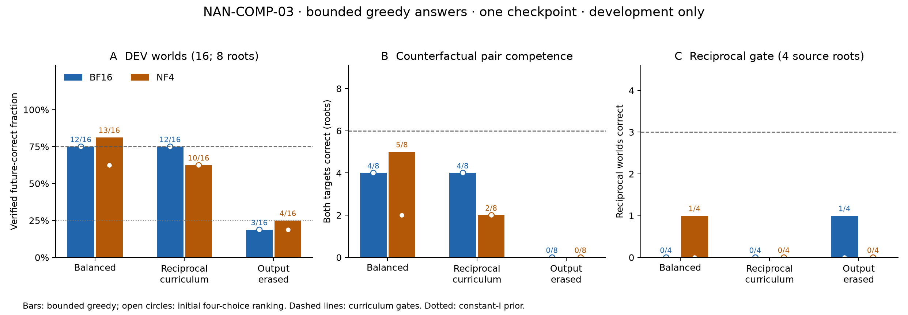

# NAN COMP 03 bounded answers and reciprocal examples

**2026-11-18 · fresh source-only development pilot · both competence gates FAIL.**

The bounded parser removes the earlier format failure: every development generation in both backends produces a valid, three-token Markdown-wrapped operator answer. The frozen reciprocal-curriculum primary scores **BF16 12/16 and NF4 10/16**, but reciprocal correctness remains **0/4 in both**. Both-target pair correctness is **4/8 BF16 and 2/8 NF4**, below the required 6/8. **BPD transfer was not attempted. The original 168-case ARG-03 test remains sealed.**

The additional reciprocal instruction does not improve the measured clean result. On the same fresh worlds with the same bounded decoder, the balanced-example control scores 12/16 BF16 and 13/16 NF4. The curriculum difference is therefore 0 and −3/16 respectively. These are paired development observations on one checkpoint, not evidence of general quantization superiority or systematic curriculum harm. The primary arm was not replaced with the better control.

## Frozen design and source integrity

The [complete registration](https://github.com/MoralityLabAI/LoopedTransformers/commit/fca024e7435b803333f7ee09f02ef53e7125f9ba) was committed and pushed before new pretrained inference. The commit time is **06:53:18 UTC**; the first BF16 case tape was created at **07:01:51 UTC**. Thirteen critical files, including parser, prompts, generator, decoder driver, grader, independent auditor, tests, config and protocol, are hash-bound in SOURCE_MANIFEST.json. The same manifest, inherited decoder/head sources and cohort hashes bind both backend receipts. Later presentation helpers do not participate in inference or change the gates.

The task identifies one operator from I(f)=f, N(f)=f(−x), S(f)=f(x²), and R(f)=1/f using two polynomial demonstrations through degree four. An accepted prediction must execute correctly on both demonstrations and a hidden degree-32 query. The model predicts the operator; an exact verifier computes the future coefficients. This does not test autonomous generation of those coefficients, nor does it rewrite the previous 64-program compound-task failure. With four candidates, search@12 is a trivial structural ceiling and cannot pass this gate.

There are **eight DEV generator roots / 16 worlds**, balanced at four worlds per operator, and **two separate CAL roots / four worlds**. Each root has two distinct target operators/futures with the same inputs, query and source family. Dense and sparse degree-four families alternate. Current target labels, query coefficients, root/case IDs, family and split are not rendered. No CAL fitting, prompt selection, temperature fitting, weight training or case replacement occurs.

Source construction used only EvalMath's unary oracle, an independent finite-series checker, and frozen source/tokenizer constraints. Fourteen draws admitted ten roots: two duplicate-demonstration and two tutorial-input rejections. Every admitted source and tutorial is independently verified. The earlier 20 exposed worlds represent ten root-pair entries but **nine distinct unordered input pairs**, due to the prior disclosed CAL/DEV overlap. All nine distinct pairs were excluded. All ten new unordered input pairs are distinct and disjoint from them; tutorial inputs were also excluded. No other roster was opened or regenerated for exclusions.

Actual rendered token sequences, rather than query-dependent public hashes, enforce uniqueness. Each clean format has **20 distinct prompts**, the erased format has **10 distinct root prompts**, and CAL/DEV do not overlap. Clean lengths match within every counterfactual pair. Prompt lengths are 309 tokens for balanced examples, 586 for the reciprocal curriculum, and 564 for its erased control.

## Reciprocal instruction and bounded generation

The balanced block gives one simple example for each operator on f=1+x. The curriculum retains that block and explicitly distinguishes a **series reciprocal** from reciprocals of individual coefficients. It gives b₀=1 and the coefficient recurrence bₙ=−Σₖ₌₁ⁿ aₖbₙ₋ₖ, expanded through b₄, a worked calculation, and three verified examples:

| Input coefficients | R output through degree four |
|---|---|
| [1, 1, 1, 0, 0] | [1, −1, 0, 1, −1] |
| [1, −1, 0, 1, 0] | [1, 1, 1, 0, −1] |
| [1, 1, −1, 0, 0] | [1, −1, 2, −3, 5] |

The output-erased curriculum keeps these examples and current inputs, replacing only current task outputs with `[redacted]`. The erased prompt is identical within a pair, so it cannot identify both distinct targets. Extra reciprocal examples also add 277 prompt tokens and more R labels. There is no length-matched neutral-example control, so a curriculum difference does not isolate instruction content from length or label-prior effects.

At every generated token, the decoder takes the **unrestricted full-vocabulary greedy argmax**. There is no operator mask, candidate search, forced label, sampling, teacher-forced current answer or fallback. It recomputes the growing prefix through both native loops without KV caching or embedding reinjection. The fixed anchored parser accepts one uppercase operator, bare or inside balanced bold, italic or inline-code markers, with whitespace ignored and an optional period. Explanations, multiple labels and incomplete wrappers fail. Limits are **eight generated tokens and 64 decoded characters**.

Generation stops at the first complete grammar prefix, an impossible prefix, EOS or a bound. Later free-running prose is not generated or measured; this is a bounded stopping-policy endpoint, not an EOS-complete response claim. Every recorded generation, including CAL and erased repeats, terminates after exactly **three tokens** as a bold-wrapped operator. The old strict first-token rule remains 0/16 in both DEV conditions because the first token is the bold opener. The parser's R handling is functional: R answers occur in BF16 erasure and in the NF4 balanced control.

## Matched BF16 and NF4 results

| DEV arm | BF16 bounded/derived correctness | NF4 bounded/derived correctness | BF16 initial four-choice | NF4 initial four-choice |
|---|---:|---:|---:|---:|
| **Reciprocal curriculum, primary** | **12/16** | **10/16** | 12/16 | 10/16 |
| Balanced examples | 12/16 | 13/16 | 12/16 | 10/16 |
| Output-erased curriculum | 3/16 | 4/16 | 3/16 | 3/16 |
| Independently repeated erasure | 3/16 | 4/16 | 3/16 | 3/16 |
| Curriculum strict first-token control | 0/16 | 0/16 | 12/16 | 10/16 |
| Frozen constant-I prior | 4/16 | 4/16 | 4/16 | 4/16 |

Four-choice ranking uses the curriculum's or control's **initial answer-position** alias-marginal scores. It is not the score after the greedy bold opener and is not the likelihood of the whole generated answer. The NF4 balanced arm demonstrates the distinction: actual bounded greedy correctness is 13/16 while initial restricted ranking is 10/16.

| Target operator | BF16 curriculum | NF4 curriculum | BF16 balanced | NF4 balanced |
|---|---:|---:|---:|---:|
| I | 4/4 | 4/4 | 4/4 | 4/4 |
| N | 4/4 | 4/4 | 4/4 | 4/4 |
| S | 4/4 | 2/4 | 4/4 | 4/4 |
| **R** | **0/4** | **0/4** | **0/4** | **1/4** |

Neither clean curriculum emits R on DEV. BF16 predicts I four times, N four times and S eight times; NF4 predicts I four times, N eight times and S four times. The reciprocal block therefore leaves the reciprocal failure unresolved and coincides with two additional NF4 S errors. It does not show that the checkpoint can never represent or compute reciprocals.

| Frozen requirement, independently in each backend | Required | BF16 primary | NF4 primary |
|---|---:|---:|---:|
| Verified bounded-greedy worlds | ≥12/16 | 12/16 · PASS | 10/16 · FAIL |
| Both targets correct within a root | ≥6/8 | 4/8 · FAIL | 2/8 · FAIL |
| Reciprocal worlds correct | ≥3/4 | 0/4 · FAIL | 0/4 · FAIL |
| Mean parsed-accuracy gain over erasure | ≥0.25 | 9/16 · PASS | 3/8 · PASS |

The joint competence gate fails. The balanced control also fails the pair and reciprocal prerequisites: 4/8 pairs and 0/4 R in BF16; 5/8 pairs and 1/4 R in NF4. It cannot supply a post-hoc passing substitute. Erased both-correct counts are exactly 0/8 in each backend, as required by the identical-input counterfactual construction; its case-accuracy ceiling is 50%.

Curriculum predictions agree across backends on **12/16** DEV worlds; balanced predictions agree on **15/16**. The primary NF4-minus-BF16 accuracy difference is −2/16. These finite observations do not establish quantization equivalence or a population accuracy difference. CAL stays separate: curriculum and balanced each score 3/4 in both backends; erased each scores 1/4. CAL changed no decision.

## Resolution and evidence class

The sampling unit is the **source generator root**, not a token, prompt variant, backend or graded row. There are eight DEV roots, 16 DEV worlds and one pretrained checkpoint. Source-only global uniqueness rejection induces dependence; independent-root and paired-label exchangeability assumptions are not asserted. The primary contrast is curriculum minus erased parsed correctness, with no hidden-state physical dose. The frozen meaningful floor is **0.25 solve fraction**, and aggregate measurement resolution is **1/16**. Root-macro effects are **9/16 BF16 and 3/8 NF4**.

There are **nine planned and nine actual statistical contrasts**. All roots, controls and zero effects are retained. FSI-01 withholds unconditional p-values. The following exact sign-flip calculations are only sensitivities under an imposed independent-root signed-symmetry law, not an established inferential null:

| Registered contrast | Root-macro effect | Conditional Holm value |
|---|---:|---:|
| BF16 curriculum − erased | 9/16 | 3/16 |
| BF16 curriculum − balanced | 0 | 1 |
| BF16 curriculum − strict first | 3/4 | 9/128 |
| BF16 curriculum − constant I | 1/2 | 7/64 |
| NF4 curriculum − erased | 3/8 | 1/4 |
| NF4 curriculum − balanced | −3/16 | 3/4 |
| NF4 curriculum − strict first | 5/8 | 9/128 |
| NF4 curriculum − constant I | 3/8 | 3/16 |
| NF4 curriculum − BF16 curriculum | −1/8 | 1 |

No conditional Holm value is below 0.05; the minimum is 9/128≈0.0703. Some internal FSI labels are “suggestive”; none is confirmation. Descriptive cluster bootstraps do not repair the unestablished assumptions or small root count. There is no independently sealed new confirmation readout, and eight roots are below FSI's 20-root confirmation policy. This prospective DEV design was informed by the earlier pilot's exposed failures.

The strict pre-data planner honestly refused an empty empirical pilot for this new endpoint; no historical shams were substituted. Actual repeated erased generations produce identical token IDs, exactly zero selected-logit/log-normalizer differences, and zero same-label root correctness deltas in both backends. This calibrates numerical/format repeat noise only, not a semantic-intervention tail. Eight roots cannot calibrate a 95th-percentile sham bound at 95% confidence; even the sample-maximum method needs at least 59 independent sham worlds.

Both post-pilot planner decisions remain **REDESIGN_OR_PILOT_ONLY**, citing unverified independence and an uncalibrated sham quantile. Conditional normal-approximation planning for a hypothetical 0.5 effect gives 37/27 roots for 80% power and resolvable effects about 0.445/0.415 at a provisional 60 roots. Those figures are not validated power guarantees and do not override either refusal or the failed competence gates.

Evidence class: **measured development improvement in response parsing, persistent reciprocal/pair competence failure, and power-limited prompt/quantization comparisons**. No hidden-state geometry, causal mediation, dictionary fidelity or BPD transfer is claimed.

## Engineering, telemetry and audits

Both backends completed all 20 worlds with no neural inference failure, source replacement or resume, using the existing checkpoint revision `451ed48c3273ecef7ea8faaa43c31ce529763bb1`. Locked weights/code and tokenizer configuration were verified offline before loading. The environment is Python 3.12.5, Torch 2.6.0+cu124, Transformers 4.46.3, bitsandbytes 0.50.2 and NumPy 2.5.5 on an RTX 3050 Laptop GPU, 4096 MiB, Windows WDDM, driver 610.62.

Embeddings and the full 166144×3072 BF16 output head remain on CPU. BF16 streams decoder layers with one resident layer and one staging layer; NF4 keeps quantized decoder weights on CUDA with double quantization and BF16 compute. Six independent B1 contexts share layer loading, without mixing states or batching the head. Small random-model fixtures match serial growing-prefix hidden states, selected logits and global argmax exactly in BF16 and actual NF4 over three steps. The unchanged head previously passed its exact-dimension fixture. These are implementation checks, not a full-checkpoint GPU-reference proof.

| Measured counter | BF16 | NF4 |
|---|---:|---:|
| Peak CUDA allocated | 0.648 GiB | 1.694 GiB |
| Peak CUDA reserved | 0.744 GiB | 1.773 GiB |
| Sampled process dedicated allocation | 0.831 GiB | 1.860 GiB |
| Sampled process shared allocation | 0.076 GiB | 0.076 GiB |
| Worker receipt elapsed, including verification/loading | 934.748 s | 1222.070 s |

Different decoder placement strategies and checkpoint-loading times prevent an intrinsic memory or throughput comparison. CUDA and Windows counters are separate and not additive; shared allocation is not measured paging. Both workers made 60 actual generation paths and 180 token-scoring steps. Stored erased records are reused within each identical pair, yielding 160 stored case/arm generation records and 480 prefix records across backends; strict/prior controls bring the scalar grade table to 240 rows. None are extra independent roots.

**Telemetry interruption:** NF4's background logger raised Windows PermissionError 5 while replacing its memory JSON. The frozen inference code was not edited or restarted. A separate append-only external monitor recovered 37 process-allocation samples; it began about 25 seconds after the pre-case NF4 manifest, so an initial first-pair coverage gap remains. BF16 has 45 nonempty internal samples. The exception, original counters and recovery data are retained. CUDA allocator peaks cover the full worker run; sampled Windows counters can miss peaks and do not certify physical residency.

Ten CPU contract tests pass. The **pre-frozen independent stdlib auditor** verifies all 20 source certificates, 240 grades, 480 recorded prefix/grammar/score checks, nine conditional root tests and nine-entry Holm accounting without importing Torch, EvalMath or the primary parser/grader. Offline tokenizer verification independently matches all **160 prompt bindings and 480 decoded prefixes**, without model weights. Supplemental checks verify all 40 model tape files, actual CAL/DEV token uniqueness, prior-input exclusion and matching backend source hashes.

A supplemental provenance helper initially assumed that ten previous root-pair entries meant ten distinct unordered input pairs. The prior overlap means nine, as the source receipt already recorded before inference. That auxiliary assertion was corrected to the pre-frozen count; its initial code and failure receipt are retained. No sources, predictions, gates or frozen audit/grading code changed.

## Decision and next discriminating work

Retain the bounded parser as a working response contract. Do not treat more reciprocal explanation as a demonstrated competence repair: this fixed curriculum failed all four reciprocal DEV worlds in each backend and did not improve the balanced control. Before BPD, a separately registered source-only diagnostic should distinguish coefficient-recurrence computation from operator-label selection on new inputs, with explicit reciprocal versus sign/substitution counterfactuals and unrestricted bounded outputs. Keep the pair, reciprocal and source-use prerequisites; do not reuse these DEV outcomes as a fresh validation set.

The original compound gate is unchanged, and the 168-case test remains sealed. Any later BPD study needs its own new-source registration and appropriate controls; current source-use accuracy does not establish a causal fiber or transfer mechanism.

The [experiment directory](https://github.com/MoralityLabAI/LoopedTransformers/tree/research/nan-comp03-bounded-reciprocal/experiments/nan_comp03) contains the frozen protocol/source seal, fresh fixtures, all model tapes, transcripts, scores, grades, memory/recovery receipts and replay auditor. The README gives weight-free audit and offline GPU reproduction commands. Source pins are parent study `37117b419bd5c93ebf560aa7d7f6712050e5e218`, EvalMath `accf4d9040bee8daeabc6b07003bb484708996c0`, and ARG-02 adapter `1ac36353b36581b6a634626bcd55542e53dae456`. Prior tracked study files are preserved unchanged.
