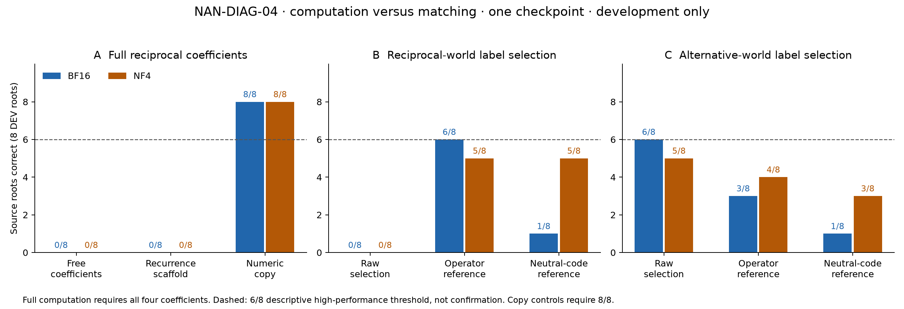

# NAN-DIAG-04: reciprocal computation and operator-label selection

**2026-11-20 · prospective source-only development diagnostic · Nanbeige4.2-3B · BF16 versus NF4**

Both backends fail explicit reciprocal coefficient computation even though they perfectly copy the same verified integers. Full computation is **0/8 DEV roots with and without a recurrence scaffold**, and raw reciprocal-operator selection is **0/8** for both. Supplying exact candidate outputs improves reciprocal-label accuracy to **6/8 BF16 and 5/8 NF4**, but does not produce reliable bounded responses across matching conditions. Every accepted matching answer is correct; the remaining matching responses violate the frozen output grammar. The prespecified interpretation is **mixed_or_unresolved** for both backends, rather than a unique arithmetic or label bottleneck.

All numeric, operator-label and code-copy controls pass **8/8 roots** in each condition. These controls demonstrate the ability to emit these answers in the control contexts; they do not guarantee format compliance in longer matching prompts. The original competence gates remain unchanged, **no BPD transfer runs**, and the **168-case ARG-03 test remains sealed**: not read, regenerated, scored or used for exclusions.

## Registration and population

[Registration commit 10936e4](https://github.com/MoralityLabAI/LoopedTransformers/commit/10936e4caac06115e4a53b600cbab658295cc246) froze and pushed all 14 critical protocol/source/parser/inference/grading/auditing files, public prompts, host labels and engineering evidence before pretrained inference. The source manifest SHA-256 is 37eba00f942ccd2153e749f1689d1eed7cfa397e72cfbd6b77ee26afd6b573a2. Registration was committed at 2026-11-20 03:45:46 UTC; the first BF16 root tape was created at 03:52:36 UTC and the first NF4 tape at 04:07:10 UTC. Execution manifests bind both conditions to the same source seal. All 14 critical and nine reused file hashes still match. Post-freeze analyze.py, postcheck.py, README and publication materials only present or cross-check the fixed experiment.

[Protocol](../../experiments/nan_diag04/PROTOCOL.md) · [source manifest](../../experiments/nan_diag04/SOURCE_MANIFEST.json) · [evidence and weight-free replay instructions](../../experiments/nan_diag04/README.md)

There are two fresh CAL roots (204601–204602) and eight fresh DEV roots (204701–204708), with one checkpoint revision, 451ed48c3273ecef7ea8faaa43c31ce529763bb1. EvalMath is pinned to accf4d9040bee8daeabc6b07003bb484708996c0 and the ARG-02 model adapter to 1ac36353b36581b6a634626bcd55542e53dae456. The parent study is NAN-COMP-03 at 36689f9703c61f65630a8db22059a2ea4fef2b03; its tracked files and all earlier study files are preserved.

Each root contains two degree-four inputs with constant coefficient 1. Dense sources include nonzero higher coefficients of magnitude one or two, with at least one magnitude two; sparse sources have one higher coefficient ±2. All **20 individual inputs** are distinct and disjoint from the **21 distinct exposed inputs** in the explicitly named NAN-COMP-02/03 public fixtures. Only those exposed fixtures were opened for exclusions. There were 28 source draws: four magnitude-two eligibility rejections and 14 duplicate-input rejections. Every source/reference/hidden future was checked against EvalMath and an independent finite-series implementation before inference. No model outcome selected or replaced a case.

Every root has one R world and one alternate world, with alternates N,S,I,N,S,I,N,S on DEV. World order alternates; neutral labels A/B/C/D rotate so each labels R twice. Candidate order is source-randomized and shared between operator-labelled and code-labelled tables. Scientific prompt token sequences are disjoint across CAL/DEV roots within each arm; repeated literal-copy prompts are permitted controls. Global deduplication induces dependence, so iid root sampling is not asserted. This expanded-coefficient population differs from earlier ±1 pilots; cross-study accuracy differences are not paired improvements.

## What was separated

There are 24 fresh, independently embedded generation contexts per root:

| Component | Paths/root | Information supplied |
|---|---:|---|
| Free computation | 4 | Ask b1, b2, b3 and b4 separately for 1/f; no operator labels or answers |
| Scaffolded computation | 4 | Same questions plus the exact coefficient recurrence; no current intermediate answers |
| Numeric copy | 4 | Explicit verified integer; copy only |
| Raw selection | 2 | Two observed examples, I/N/S/R definitions, no reference table |
| Operator table | 2 | Exact outputs of all four candidates with I/N/S/R labels; matching only |
| Neutral-code table | 2 | Same values and matching template, rotated A/B/C/D labels, no operator definitions |
| Label/code copy | 4 | Explicit verified operator or code; copy only |
| Erased and repeat | 2 | Current observed outputs removed; two separate identical source-blind forwards |

Assistance is explicit and local to its arm. The worker reads only rendered public prompts, never host gold. No KV cache, hidden state or assisted context carries between arms. The contexts share decoder loading only. Full reciprocal correctness requires all four independently generated coefficients and an independently checked finite-convolution certificate f*b=[1,0,0,0,0], with b0 fixed to 1. Four coefficients are not four independent roots.

At each generated token the model takes the **full-vocabulary greedy argmax**, without label masks, forced integers, candidate search, fallback, training or embedding reinjection. A first complete anchored prefix ends decoding; operator/code answers have an eight-token cap, integers a twelve-token cap, all with a 64-character limit. Brackets, balanced emphasis and inline-code wrappers are supported. Bare integer digits remain pending until whitespace, period or EOS, allowing 1 to grow into 17. Prose, code fences, split digits, multiple numbers and truncated wrappers fail. The parser was not broadened after seeing the answers; subsequent free-running prose is not measured.

Both conditions run two native loops. BF16 streams decoder layers; NF4 uses CUDA NF4 decoder weights with double quantization and BF16 compute. Both retain CPU BF16 embeddings and the full output head, chunked into 8192 vocabulary rows. Twenty-four B1 contexts share layer loading. Initial prompts reached at most **323 tokens**, below the fixed 768-token limit. Neither run failed or resumed.

## DEV results

All denominators below are eight source roots. R and alternate are separate world endpoints; both-world correctness requires both at the same root.

| Endpoint | BF16 | NF4 |
|---|---:|---:|
| Free reciprocal: all four coefficients | **0/8** | **0/8** |
| Recurrence scaffold: all four | **0/8** | **0/8** |
| Numeric copy: all four | **8/8** | **8/8** |
| Raw selection: R | **0/8** | **0/8** |
| Raw selection: alternate | 6/8 | 5/8 |
| Raw selection: both worlds | 0/8 | 0/8 |
| Operator table: R | 6/8 | 5/8 |
| Operator table: alternate | 3/8 | 4/8 |
| Operator table: both | 1/8 | 3/8 |
| Neutral-code table: R | 1/8 | 5/8 |
| Neutral-code table: alternate | 1/8 | 3/8 |
| Neutral-code table: both | 0/8 | 0/8 |
| Operator-label copy: both | **8/8** | **8/8** |
| Neutral-code copy: both | **8/8** | **8/8** |
| All three copy controls jointly | **8/8** | **8/8** |
| Output-erased macro accuracy | 4/16 worlds | 3/16 worlds |
| Frozen diagnostic pattern | mixed_or_unresolved | mixed_or_unresolved |

The registered lookup prerequisite requires ≥6/8 on R **and** alternate in **both** table variants. Neither backend meets it. The arithmetic-bottleneck pattern therefore cannot be selected even though free/scaffold computation and raw R all score zero. The assistance contrast is +6/8 roots for BF16 and +5/8 for NF4. These are effects of supplied values and context, not hidden-state interventions.

Per-coefficient DEV correctness is descriptive:

| Condition | b1 | b2 | b3 | b4 |
|---|---:|---:|---:|---:|
| BF16 free | 6/8 | 0/8 | 1/8 | 0/8 |
| NF4 free | 4/8 | 0/8 | 1/8 | 0/8 |
| BF16 scaffold | 6/8 | 1/8 | 2/8 | 0/8 |
| NF4 scaffold | 6/8 | 0/8 | 2/8 | 0/8 |
| BF16 and NF4 copy, each | 8/8 | 8/8 | 8/8 | 8/8 |

All **32 free and 32 scaffolded integer answers per backend** are validly formatted, but no complete inverse is correct. All 32 numeric-copy answers per backend are correct, including signed and multi-digit values. For the fixed first DEV root, f=[1,-1,-2,-1,2] has inverse prefix [1,1,3,6,11]. BF16 free replies for b1..b4 are [1,1,1,1], NF4 [0,1,1,2]; both copy b4=11 correctly. This example is the first registered DEV root, not an outcome-selected source.

### Matching format remains context sensitive

| DEV component | BF16 valid | NF4 valid | All recorded accepted answers correct? |
|---|---:|---:|---|
| Free coefficients | 32/32 | 32/32 | No |
| Scaffolded coefficients | 32/32 | 32/32 | No |
| Numeric copy | 32/32 | 32/32 | Yes |
| Raw label selection | 16/16 | 16/16 | No |
| Operator table | **9/16** | **9/16** | **Yes** |
| Neutral-code table | **2/16** | **8/16** | **Yes** |
| Operator-label copy | 16/16 | 16/16 | Yes |
| Neutral-code copy | 16/16 | 16/16 | Yes |

Invalid operator-table prefixes include “Entry”, “**Entry” and “Match”; neutral-code outputs include code fences and “Entry” prefixes. At the first DEV root the BF16 table prefix is “**Entry” and its coded prefix begins a code fence; NF4 emits the correct inline-code D in the coded arm. The grammar deliberately refuses these prefixes rather than scanning later prose for a label.

Thus the complete matching losses are **format failures**, while the coefficient losses are **valid but incorrect numerical replies**. Accuracy conditional on an accepted format is only a descriptive observation, not a replacement endpoint or competence pass. Copy compliance does not isolate the cause of format failures in the matching context. NF4's higher code-table count reflects different bounded responses; it does not establish a quantization benefit, equivalence or an internal label-interference mechanism.

Across CAL+DEV there are 240 generations per backend: **215 accepted BF16 and 222 accepted NF4**, with 588 and 599 scored prefixes respectively. CAL is kept separate: free/scaffold full 0/2 each backend; all copy controls 2/2; raw R 0/2 each, alternate 1/2 each; operator-table R 2/2 BF16 and 1/2 NF4, alternate 2/2 each; coded R/alternate 0/2 BF16 and 1/2 NF4. No CAL case is counted toward the eight-root DEV thresholds.

## Finite-sample and power limits

The frozen family contains **15** contrasts, using the source root as the unit and retaining ties. The meaningful effect floor is 0.25 root-solve fraction, resolution 1/8. Hypotheses were prospectively frozen, but this is an exposed DEV readout, not sealed confirmation. Root independence and paired-label exchangeability are unestablished. Accordingly **unconditional p-values and population accuracy intervals are withheld**. EvalMath's archived bootstrap summaries are approximate sensitivity diagnostics with weak small-root coverage; they do not repair those assumptions.

The following exact two-sided sign-flip values impose an independent-root signed-symmetry law solely for sensitivity analysis; Holm covers all 15 entries. They are not valid unconditional significance claims.

| Frozen contrast | Root-mean effect | Conditional p | Conditional Holm |
|---|---:|---:|---:|
| bf16/scaffold\_full minus bf16/free\_full | 0 | 1 | 1 |
| bf16/table\_R minus bf16/select\_R | 3/4 | 1/32 | 15/32 |
| bf16/coded\_R minus bf16/table\_R | -5/8 | 1/16 | 13/16 |
| bf16/table\_alt minus bf16/select\_alt | -3/8 | 29/64 | 1 |
| bf16/select\_R minus bf16/select\_alt | -3/4 | 1/32 | 15/32 |
| bf16/free\_full minus bf16/select\_R | 0 | 1 | 1 |
| nf4/scaffold\_full minus nf4/free\_full | 0 | 1 | 1 |
| nf4/table\_R minus nf4/select\_R | 5/8 | 1/16 | 13/16 |
| nf4/coded\_R minus nf4/table\_R | 0 | 1 | 1 |
| nf4/table\_alt minus nf4/select\_alt | -1/8 | 1 | 1 |
| nf4/select\_R minus nf4/select\_alt | -5/8 | 1/16 | 13/16 |
| nf4/free\_full minus nf4/select\_R | 0 | 1 | 1 |
| nf4/free\_full minus bf16/free\_full | 0 | 1 | 1 |
| nf4/select\_R minus bf16/select\_R | 0 | 1 | 1 |
| nf4/table\_R minus bf16/table\_R | -1/8 | 1 | 1 |

The smallest actual conditional Holm value is **15/32**, well above 0.05. Even the theoretical minimum with eight roots is 15/128 for the first Holm comparison. FSI's minimum confirmation policy is 20 independent roots, alongside a sealed new confirmation readout and justified assumptions; those requirements are not met.

Pre-data strict planning had no matched empirical pilot for these new endpoints and correctly refused an empty pilot (“pilot worlds required”); no historical noise was substituted. Post-run planning uses the actual eight-root table-minus-raw R effects and actual repeated-erasure deltas. Both backends remain **REDESIGN_OR_PILOT_ONLY** because independence and the sham quantile are unverified. Normal approximations suggest 49 roots for BF16 and 62 for NF4 at the specified 0.50 target and 15-comparison family; the provisional 60-root plan is also flagged underpowered for NF4. These are planning approximations, not an approved next sample size or power guarantee.

Erased and repeated-erased generations have identical IDs and zero selected-logit differences at every root in both conditions. Their eight DEV root deltas are zero. This establishes numerical/format repeatability for those prompts, **not** a semantic-assistance null. A maximum-based 95th-percentile bound at 95% confidence requires at least 59 independent sham worlds; eight repeated-erasure roots cannot calibrate it. The original 168 cases remain untouched and are not a shortcut to confirmation.

## RTX 3050 execution and verification

Hardware: RTX 3050 Laptop GPU, 4096 MiB; driver 610.62. Existing offline Python 3.12 environment, Torch 2.6.0+cu124 and bitsandbytes 0.50.2. No weights were downloaded, trained or updated. The registered allocator cap is 75%, backend soft limit 2400 seconds between roots, with at most one fixed-source resume permitted; both finished in a single launch.

| Execution measure | BF16 | NF4 |
|---|---:|---:|
| Elapsed including load and CPU head work | 813.518 s | 944.764 s |
| Peak CUDA allocated | 0.646 GiB | 1.697 GiB |
| Peak CUDA reserved | 0.717 GiB | 1.768 GiB |
| Sampled process dedicated allocation | 0.803 GiB | 1.854 GiB |
| Sampled process shared allocation | 0.076 GiB | 0.076 GiB |
| Nonempty Windows allocation samples | 48 | 54 |
| Telemetry errors / resumes | 0 / 0 | 0 / 0 |

The append-only telemetry JSONL exactly matches each final JSON summary. CUDA allocator peaks and sampled Windows counters are different measurements. Shared allocation is not measured paging, sampled peaks can miss brief events, and differing decoder placements/loading prevent intrinsic memory or throughput comparisons.

Before pretrained inference, random-weight BF16 and actual NF4 engineering fixtures compared grouped versus serial B1 execution over **24 contexts and three growing-prefix steps**: hidden and selected-logit max errors zero and full-vocabulary argmax exact. The reused 166144×3072 output-head fixture has exact selected logits/argmax and maximum log-probability error 1.4244e-7. Ten frozen CPU contracts pass, including delayed multi-digit acceptance, truncation/prose refusal, local assistance, complete-vector grading, the copy-control guard and telemetry I/O isolation.

Offline tokenizer auditing verifies **480 prompt bindings and 1,187 decoded prefixes**. The independent standard-library audit reconstructs all **480 generation grades**, reciprocal multiplication certificates, root metrics, all **15** exact sensitivities and Holm adjustments without importing Torch, EvalMath or the primary parser/grader. A separate post-freeze provenance check verifies all critical/reused hashes, input exclusion, scientific-arm prompt disjointness, matching token prompts across backends, **30 raw artifact hashes**, and complete append-only telemetry. The CPU workflow repeats contracts and the independent audit without model weights. Publication metadata records its eventual push/PR check results and Git-file replay.

[Primary results](../../experiments/nan_diag04/receipts/results.json) · [all graded transcripts](../../experiments/nan_diag04/receipts/graded_transcripts.csv) · [root metrics](../../experiments/nan_diag04/receipts/root_metrics.csv) · [15 contrasts](../../experiments/nan_diag04/receipts/fsi_contrasts.json) · [independent audit](../../experiments/nan_diag04/receipts/independent_audit.json) · [provenance and raw hashes](../../experiments/nan_diag04/receipts/postcheck.json) · [tokenizer audit](../../experiments/nan_diag04/receipts/tokenizer_audit.json)

No recurrence-geometry, SAE tower or causal transfer evaluation ran in this condition. Existing BF16/NF4 geometry findings are not substituted for measurements on these fresh prompts. Separate wider-suite/Prime and physical-coordinate SAE/VPD/BPD integration work does not change this diagnostic or imply new neural benchmark results.
