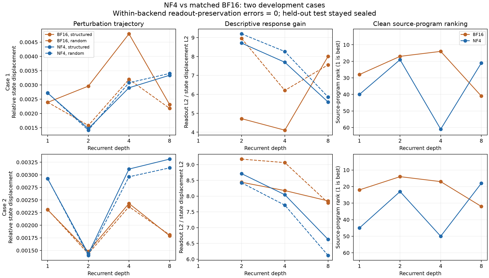

# Nanbeige NF4 vs matched BF16: two-case RTX 3050 development pilot

Date: 2026-11-17. **Development-only; the original 168-case ARG-03 held-out test stayed sealed.**

Both NF4 pilot cases completed on the RTX 3050 Laptop GPU. A fresh BF16 reference was run on the exact same two public case hashes, pinned checkpoint, software, intervention settings, and candidate microbatch 1. All 24 matching checks and both oracle source-program positive controls passed.

**Result:** native task accuracy is at a floor for both backends on this pair, while program rankings and perturbation-response trajectories differ substantially. These results do not establish NF4/BF16 equivalence. A strict 4 GiB device-only memory fit was not established.

## Native accuracy

Both backends have **0/2 top-one future correctness and 0/2 future-correct@12** at depths 1, 2, 4, and 8. No calibration was fitted. Mean source-program rank is lower-is-better and is distinct from task future correctness.

| Depth | BF16 top-one future | NF4 top-one future | BF16 future@12 | NF4 future@12 | BF16 mean source rank | NF4 mean source rank |
|---:|---:|---:|---:|---:|---:|---:|
| 1 | 0/2 | 0/2 | 0/2 | 0/2 | 25.0 | 42.5 |
| 2 | 0/2 | 0/2 | 0/2 | 0/2 | 15.5 | 21.0 |
| 4 | 0/2 | 0/2 | 0/2 | 0/2 | 15.5 | 55.5 |
| 8 | 0/2 | 0/2 | 0/2 | 0/2 | 36.5 | 19.5 |

## Program-ranking agreement

Spearman correlation uses the full 64-program ordering with deterministic program-index tie-breaking. The KL values in the machine-readable comparison concern normalized 64-program scores, not the full vocabulary.

| Depth | Mean BF16/NF4 Spearman | Mean top-12 overlap | Top-one program changed |
|---:|---:|---:|---:|
| 1 | 0.8807 | 10.0/12 | 1/2 |
| 2 | 0.8025 | 9.0/12 | 0/2 |
| 4 | 0.1735 | 4.5/12 | 2/2 |
| 8 | 0.3325 | 3.0/12 | 2/2 |

## Recurrence-response geometry

Within-backend full-vocabulary current-readout preservation error was **exactly 0.0** for the structured, norm-matched random, and self controls in both backends. This is an intervention-preservation check, not equality between NF4 and BF16 outputs.

The following are paired **NF4 / BF16** ratios. Readout response is the full-vocabulary log-probability L2 difference after continuation. Gain is readout-response L2 divided by hidden-state-displacement L2.

| Case | Depth | Structured state-displacement ratio | Structured readout-response ratio | Structured gain ratio | Random gain ratio |
|---|---:|---:|---:|---:|---:|
| 1 | 2 | 0.5007 | 0.9248 | 1.8470 | 1.0272 |
| 1 | 4 | 0.5949 | 1.1148 | 1.8740 | 1.3315 |
| 1 | 8 | 1.0256 | 0.7165 | 0.6986 | 0.7752 |
| 2 | 2 | 0.9912 | 1.0233 | 1.0324 | 0.9182 |
| 2 | 4 | 1.2575 | 1.2373 | 0.9839 | 0.8510 |
| 2 | 8 | 1.3899 | 1.1737 | 0.8444 | 0.7856 |

Case 1 has roughly half the structured state displacement under NF4 at depth 2, despite a similar readout-response norm; its gain is consequently 1.847x BF16. At depth 4 its gain is 1.874x. At depth 8 the structured gain is about 30% lower in Case 1 and 16% lower in Case 2 under NF4. These are descriptive response differences, not a time-local, dose-matched causal estimate.

## Control-arm grading

Values are future-correct@12 counts out of two cases. The full donor-noise arm changes the current readout and is distinct from the readout-preserving context interventions.

| Arm | Depth | BF16 future@12 | NF4 future@12 |
|---|---:|---:|---:|
| `context_swap` | 2 | 0/2 | 0/2 |
| `context_swap` | 4 | 0/2 | 0/2 |
| `context_swap` | 8 | 0/2 | 0/2 |
| `random_context_norm_matched` | 2 | 0/2 | 0/2 |
| `random_context_norm_matched` | 4 | 0/2 | 0/2 |
| `random_context_norm_matched` | 8 | 0/2 | 0/2 |
| `donor_clean_perturbed` | 2 | 1/2 | 0/2 |
| `donor_clean_perturbed` | 4 | 2/2 | 0/2 |
| `donor_clean_perturbed` | 8 | 1/2 | 0/2 |
| `open_loop` | 2 | 0/2 | 0/2 |
| `open_loop` | 4 | 0/2 | 1/2 |
| `open_loop` | 8 | 0/2 | 1/2 |
| `equal_compute` | 2 | 0/2 | 0/2 |
| `equal_compute` | 4 | 0/2 | 0/2 |
| `equal_compute` | 8 | 0/2 | 0/2 |

All available temperature-control/grid grades are included in [comparison.json](comparison.json). No depth, temperature, or calibration parameter was fitted or selected from these two cases.

## Matched design and grading

- Checkpoint: `Nanbeige/Nanbeige4.2-3B`, revision `451ed48c3273ecef7ea8faaa43c31ce529763bb1`; all locked file SHA-256 hashes verified.
- Inference source: PR #151 at `f42d69d3e8f62f40886a54a446368e59429a3827`.
- Software: Python 3.12.5, Torch 2.6.0+cu124, CUDA 12.4, Transformers 4.46.3; NF4 uses bitsandbytes 0.50.2.
- NF4: 154 decoder Linear4bit projections, NF4 double quantization, CPU embeddings, BF16 full-vocabulary GPU head, candidate microbatch 1.
- BF16: original unquantized weights, one resident plus one staged CUDA layer, CPU embeddings, the same BF16 GPU head and candidate microbatch 1. Every decoder operation executes on CUDA.
- RoPE buffers are CPU-initialized before GPU transfer in both paths. A small model using the pinned Nanbeige remote code verified bit-exact resident-versus-streamed BF16 hidden states and full-vocabulary log probabilities through four loops. The full checkpoint was run streamed.
- Fixed settings: seed `20261115`, donor sigma `0.02`, context width `8`, depths `1/2/4/8`, same tokenizer and public roster hash.
- The official development-only generator regenerated the 48-FIT + 48-VALID cohort with seed `2026111617`; only the first two VALID rows were evaluated.
- Historical BF16 dev96 receipts use different case IDs/hashes and were not paired with this pilot. The BF16 data here are a fresh matched reference.
- Grading used the official exact-integer EvalMath search with budget 12 and future verifier in separate CPU processes. The combined ARG-03 development/test generator was disabled. Each true source program passed an oracle positive control.
- No calibration fitting or hidden labels entered either model process. The historical ARG-02 Torch environment differs from this matched runtime; these results are a separate development condition.

## Memory and elapsed time

| Measurement | NF4 | Streamed BF16 reference |
|---|---:|---:|
| Peak Torch allocated | 3.837 GiB | 2.959 GiB |
| Peak Torch reserved | 4.385 GiB | 3.631 GiB |
| Observed peak driver dedicated | 3.862 GiB | 3.718 GiB |
| Wall time including checkpoint loading | 69.24 min | 15.98 min |

Windows reported NF4 shared GPU allocation of 0.686 GiB in the larger recorded sample. Peak reserved CUDA memory exceeded the 4 GiB physical capacity. **A strictly 4 GiB device-only fit was not established.** These allocation/accounting counters do not measure paging traffic. BF16 shared GPU allocation was not sampled.

Layer placement differs between backends; the timing difference is not a controlled quantization-throughput test. Wall times include telemetry and occasional diagnostic stack sampling.

## Limits

- Only two cases from the same signed-family/source-program stratum; no population-level accuracy or geometry claim.
- Equal zero accuracy is not evidence of equivalence.
- Geometry is limited to saved hidden-state norms, perturbation L2 trajectories, and readout responses. NF4 raw hidden tensors were not saved, so cross-backend angles/CKA cannot be computed.
- Structured and random perturbations are matched initially, not at every propagated depth. This is not the separate prospective time-local dose-matched control.
- The original 168-case held-out test was not generated, read, or graded. Overlap against that sealed cohort was not independently certified.
- These findings do not replace the registered BF16 ARG-03 evidence.

## Supporting files

- [Complete compact comparison and matching checks](comparison.json)
- [Paired geometry measurements](geometry.csv)
- [Clean 64-program rank agreement](rank_agreement.csv)
- [Per-case native grades](native_case_grades.csv)
- [Provenance and source fingerprints](provenance.json)
- [Plain-text report](report.txt)
- [Published-file SHA-256 checksums](checksums.sha256)
