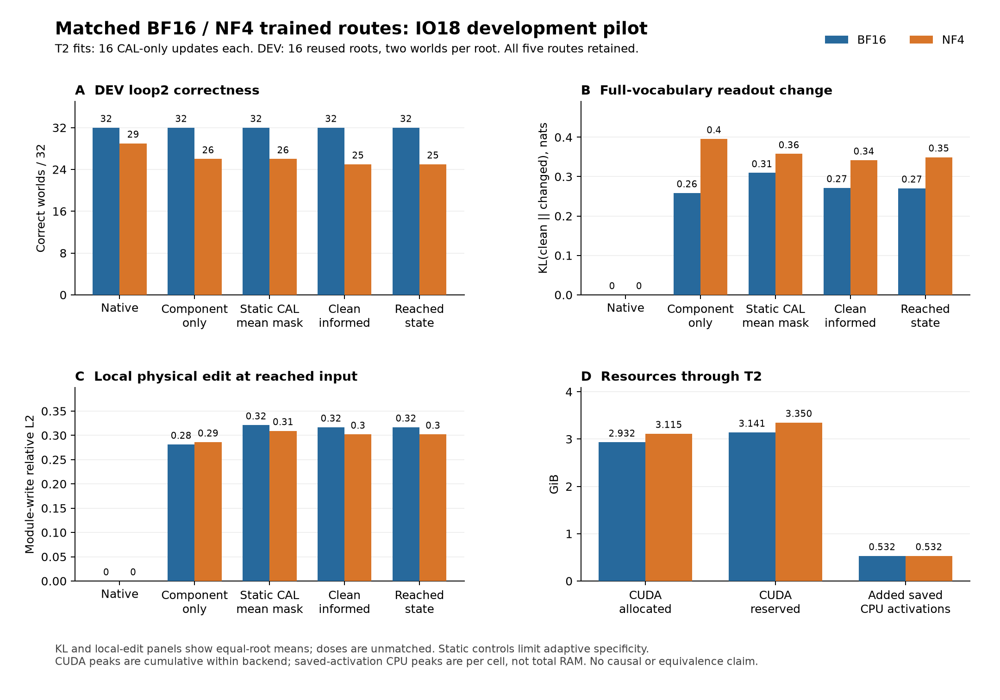

# IO18: audited native factor fitting and routing fidelity

This figure presents the T2 DEV loop2 endpoint with all five routes from the
immutable `f419a7a` audit. All36 unrounded plotted values and artifact hashes
are in the [figure receipt](figures/nan_io18_matched_routes_receipt.json);
[SVG export](figures/nan_io18_matched_routes.svg). The figure was visually
reviewed and every value independently matched to the committed aggregate.
The full CAL/DEV, T1/T2 and control tables remain below.

This is a readable presentation of one immutable published audit snapshot. It introduces no model calls, grades, paired-outcome tests, feature selection or new raw-run analysis. Pending backends remain unknown. The continuous goal remains active and the original168-case test stays sealed.

Snapshot `f419a7a1a75cb16d4cb6c9748a2927c249244dcd`; aggregate SHA256 `67129eba2f7d995638e9a43d35fd1cbcd3eab0a00e6b93274147be18affe321c`; source seal `7bb76c5c895848cf12643312609a584ca0797bc87e9a05e320b8cfa2d04f4830`.

## Execution and training

Each backend/depth starts fresh from its own fixed rank8 SVD at layer21 down_proj and the same controller seed. Sixteen stock optimizer steps use all16 worlds of8 CAL roots;16 DEV roots/32 worlds are diagnostic only. T1 and T2 also differ in registered ablation/rescaling/loss recipes, so depth is not an isolated causal contrast. Only loop2 task competence was qualified; T1 is a depth/recipe control.

| Backend | Published status | Depth | Cell audit | Real optimizer steps | Factor update L2 | Controller update L2 |
|---|---|---:|---|---:|---:|---:|
| nf4 | completed_audited | 1 | passed | 16 | 0.261619 | 0.377924 |
| nf4 | completed_audited | 2 | passed | 16 | 0.157811 | 0.241501 |
| bf16 | completed_audited | 1 | passed | 16 | 0.270391 | 0.301573 |
| bf16 | completed_audited | 2 | passed | 16 | 0.190754 | 0.252381 |

## Native baseline and source controls

These baselines retain the original source-conditioned one-token task, literal-copy control and whole query-graph erasure control. Copy/erasure are not used to train the fibers and are not rerun under the learned routes. Loop1 and loop2 remain distinct.

| Backend | Split | Arm | Loop | Correct worlds | Valid format | Both-correct roots |
|---|---|---|---:|---:|---:|---:|
| nf4 | calibration | copy | 1 | 2/16 | 2/16 | 0/8 |
| nf4 | calibration | copy | 2 | 16/16 | 16/16 | 8/8 |
| nf4 | calibration | focused | 1 | 1/16 | 16/16 | 0/8 |
| nf4 | calibration | focused | 2 | 15/16 | 16/16 | 7/8 |
| nf4 | calibration | focused_erased | 1 | 1/16 | 16/16 | 0/8 |
| nf4 | calibration | focused_erased | 2 | 2/16 | 16/16 | 0/8 |
| nf4 | development | copy | 1 | 4/32 | 4/32 | 0/16 |
| nf4 | development | copy | 2 | 32/32 | 32/32 | 16/16 |
| nf4 | development | focused | 1 | 3/32 | 32/32 | 0/16 |
| nf4 | development | focused | 2 | 29/32 | 32/32 | 13/16 |
| nf4 | development | focused_erased | 1 | 2/32 | 32/32 | 0/16 |
| nf4 | development | focused_erased | 2 | 2/32 | 32/32 | 0/16 |
| bf16 | calibration | copy | 1 | 1/16 | 1/16 | 0/8 |
| bf16 | calibration | copy | 2 | 16/16 | 16/16 | 8/8 |
| bf16 | calibration | focused | 1 | 0/16 | 16/16 | 0/8 |
| bf16 | calibration | focused | 2 | 16/16 | 16/16 | 8/8 |
| bf16 | calibration | focused_erased | 1 | 1/16 | 16/16 | 0/8 |
| bf16 | calibration | focused_erased | 2 | 0/16 | 16/16 | 0/8 |
| bf16 | development | copy | 1 | 2/32 | 2/32 | 0/16 |
| bf16 | development | copy | 2 | 32/32 | 32/32 | 16/16 |
| bf16 | development | focused | 1 | 3/32 | 32/32 | 0/16 |
| bf16 | development | focused | 2 | 32/32 | 32/32 | 16/16 |
| bf16 | development | focused_erased | 1 | 1/32 | 32/32 | 0/16 |
| bf16 | development | focused_erased | 2 | 2/32 | 32/32 | 0/16 |

## Every learned-route score

All-one preserves the complete native module: component and residual masks are both1. Component-only keeps every fitted component with residual mask0. Static CAL mean uses the fixed average CAL controller mask. Clean-informed masks are computed on each clean source trajectory. Reached-state masks are recomputed from the input actually reached under preceding edits. All reduced routes have residual mask0 and use their registered depth-specific mean/rescaling recipe.

| Backend | Fit depth | Split | Loop | Route | Correct worlds | Valid format | Both-correct roots |
|---|---:|---|---:|---|---:|---:|---:|
| nf4 | 1 | calibration | 1 | all_one | 1/16 | 16/16 | 0/8 |
| nf4 | 1 | calibration | 1 | clean_informed | 1/16 | 14/16 | 0/8 |
| nf4 | 1 | calibration | 1 | component_only | 1/16 | 14/16 | 0/8 |
| nf4 | 1 | calibration | 1 | reached_state | 1/16 | 14/16 | 0/8 |
| nf4 | 1 | calibration | 1 | static_CAL_mean | 1/16 | 14/16 | 0/8 |
| nf4 | 1 | development | 1 | all_one | 3/32 | 32/32 | 0/16 |
| nf4 | 1 | development | 1 | clean_informed | 3/32 | 28/32 | 0/16 |
| nf4 | 1 | development | 1 | component_only | 2/32 | 30/32 | 0/16 |
| nf4 | 1 | development | 1 | reached_state | 3/32 | 28/32 | 0/16 |
| nf4 | 1 | development | 1 | static_CAL_mean | 2/32 | 27/32 | 0/16 |
| nf4 | 2 | calibration | 1 | all_one | 1/16 | 16/16 | 0/8 |
| nf4 | 2 | calibration | 2 | all_one | 15/16 | 16/16 | 7/8 |
| nf4 | 2 | calibration | 1 | clean_informed | 1/16 | 16/16 | 0/8 |
| nf4 | 2 | calibration | 2 | clean_informed | 15/16 | 16/16 | 7/8 |
| nf4 | 2 | calibration | 1 | component_only | 1/16 | 16/16 | 0/8 |
| nf4 | 2 | calibration | 2 | component_only | 15/16 | 16/16 | 7/8 |
| nf4 | 2 | calibration | 1 | reached_state | 1/16 | 16/16 | 0/8 |
| nf4 | 2 | calibration | 2 | reached_state | 15/16 | 16/16 | 7/8 |
| nf4 | 2 | calibration | 1 | static_CAL_mean | 1/16 | 16/16 | 0/8 |
| nf4 | 2 | calibration | 2 | static_CAL_mean | 15/16 | 16/16 | 7/8 |
| nf4 | 2 | development | 1 | all_one | 3/32 | 32/32 | 0/16 |
| nf4 | 2 | development | 2 | all_one | 29/32 | 32/32 | 13/16 |
| nf4 | 2 | development | 1 | clean_informed | 2/32 | 32/32 | 0/16 |
| nf4 | 2 | development | 2 | clean_informed | 25/32 | 32/32 | 12/16 |
| nf4 | 2 | development | 1 | component_only | 2/32 | 32/32 | 0/16 |
| nf4 | 2 | development | 2 | component_only | 26/32 | 32/32 | 12/16 |
| nf4 | 2 | development | 1 | reached_state | 2/32 | 32/32 | 0/16 |
| nf4 | 2 | development | 2 | reached_state | 25/32 | 32/32 | 12/16 |
| nf4 | 2 | development | 1 | static_CAL_mean | 2/32 | 32/32 | 0/16 |
| nf4 | 2 | development | 2 | static_CAL_mean | 26/32 | 32/32 | 12/16 |
| bf16 | 1 | calibration | 1 | all_one | 0/16 | 16/16 | 0/8 |
| bf16 | 1 | calibration | 1 | clean_informed | 1/16 | 16/16 | 0/8 |
| bf16 | 1 | calibration | 1 | component_only | 1/16 | 16/16 | 0/8 |
| bf16 | 1 | calibration | 1 | reached_state | 1/16 | 16/16 | 0/8 |
| bf16 | 1 | calibration | 1 | static_CAL_mean | 1/16 | 16/16 | 0/8 |
| bf16 | 1 | development | 1 | all_one | 3/32 | 32/32 | 0/16 |
| bf16 | 1 | development | 1 | clean_informed | 0/32 | 21/32 | 0/16 |
| bf16 | 1 | development | 1 | component_only | 1/32 | 24/32 | 0/16 |
| bf16 | 1 | development | 1 | reached_state | 0/32 | 21/32 | 0/16 |
| bf16 | 1 | development | 1 | static_CAL_mean | 0/32 | 21/32 | 0/16 |
| bf16 | 2 | calibration | 1 | all_one | 0/16 | 16/16 | 0/8 |
| bf16 | 2 | calibration | 2 | all_one | 16/16 | 16/16 | 8/8 |
| bf16 | 2 | calibration | 1 | clean_informed | 1/16 | 16/16 | 0/8 |
| bf16 | 2 | calibration | 2 | clean_informed | 16/16 | 16/16 | 8/8 |
| bf16 | 2 | calibration | 1 | component_only | 1/16 | 16/16 | 0/8 |
| bf16 | 2 | calibration | 2 | component_only | 16/16 | 16/16 | 8/8 |
| bf16 | 2 | calibration | 1 | reached_state | 1/16 | 16/16 | 0/8 |
| bf16 | 2 | calibration | 2 | reached_state | 16/16 | 16/16 | 8/8 |
| bf16 | 2 | calibration | 1 | static_CAL_mean | 1/16 | 16/16 | 0/8 |
| bf16 | 2 | calibration | 2 | static_CAL_mean | 16/16 | 16/16 | 8/8 |
| bf16 | 2 | development | 1 | all_one | 3/32 | 32/32 | 0/16 |
| bf16 | 2 | development | 2 | all_one | 32/32 | 32/32 | 16/16 |
| bf16 | 2 | development | 1 | clean_informed | 3/32 | 32/32 | 0/16 |
| bf16 | 2 | development | 2 | clean_informed | 32/32 | 32/32 | 16/16 |
| bf16 | 2 | development | 1 | component_only | 3/32 | 32/32 | 0/16 |
| bf16 | 2 | development | 2 | component_only | 32/32 | 32/32 | 16/16 |
| bf16 | 2 | development | 1 | reached_state | 3/32 | 32/32 | 0/16 |
| bf16 | 2 | development | 2 | reached_state | 32/32 | 32/32 | 16/16 |
| bf16 | 2 | development | 1 | static_CAL_mean | 3/32 | 32/32 | 0/16 |
| bf16 | 2 | development | 2 | static_CAL_mean | 32/32 | 32/32 | 16/16 |

At T2 DEV loop2, the fixed routes give:

- nf4: all_one 29/32; both-world roots 13/16, component_only 26/32; both-world roots 12/16, static_CAL_mean 26/32; both-world roots 12/16, clean_informed 25/32; both-world roots 12/16, reached_state 25/32; both-world roots 12/16.
- bf16: all_one 32/32; both-world roots 16/16, component_only 32/32; both-world roots 16/16, static_CAL_mean 32/32; both-world roots 16/16, clean_informed 32/32; both-world roots 16/16, reached_state 32/32; both-world roots 16/16.

Identical aggregate counts do not mean identical successful cases or trajectories. No paired discordances are reconstructed from these aggregates. Positive factor/controller updates establish actual fitting, not improved task competence, an isolated adaptive-routing advantage or causal mediation.

### Initial component-only reference

Every registered initial diagnostic is shown; initial/final equal counts alone do not establish operator equivalence.

| Backend | Fit depth | Split | Loop | Correct worlds | Valid format | Both-correct roots |
|---|---:|---|---:|---:|---:|---:|
| nf4 | 1 | calibration | 1 | 1/16 | 14/16 | 0/8 |
| nf4 | 1 | development | 1 | 2/32 | 26/32 | 0/16 |
| nf4 | 2 | calibration | 1 | 1/16 | 16/16 | 0/8 |
| nf4 | 2 | calibration | 2 | 15/16 | 16/16 | 7/8 |
| nf4 | 2 | development | 1 | 2/32 | 32/32 | 0/16 |
| nf4 | 2 | development | 2 | 26/32 | 32/32 | 12/16 |
| bf16 | 1 | calibration | 1 | 1/16 | 16/16 | 0/8 |
| bf16 | 1 | development | 1 | 1/32 | 23/32 | 0/16 |
| bf16 | 2 | calibration | 1 | 1/16 | 16/16 | 0/8 |
| bf16 | 2 | calibration | 2 | 16/16 | 16/16 | 8/8 |
| bf16 | 2 | development | 1 | 3/32 | 32/32 | 0/16 |
| bf16 | 2 | development | 2 | 32/32 | 32/32 | 16/16 |

## Fidelity and physical dose diagnostics

All rows below are equal-root means: two worlds averaged within each root, then roots equally. CAL has8 roots, DEV16. Every defined metric has all those roots; absent mask-gap metrics remain undefined. Full root-mean ranges, defined-root counts and undefined-context counts remain in the immutable JSON; they are not confidence intervals.

KL is the registered float32 full-vocabulary KL(clean || changed), using natural logs at the phase readout. Write/input norms use the last prefix token. “Write vs clean” is ||changed module output at reached input − clean output at clean input|| / ||clean output||. “Local abs/rel” instead compares the changed output with the native module output at that SAME reached input, with the latter as denominator. These quantities differ when prior edits change the input. “Input gap” normalizes reached−clean input by the clean input norm. “Mask gap” is the maximum absolute difference between reached-state and clean-informed masks over all prefix positions/components for that pass. Denominators use the registered1e-12 floor.

| Backend | Depth | Split | Loop | Route | KL(clean‖changed) | Write vs clean | Local abs | Local rel | Input gap | Mask gap |
|---|---:|---|---:|---|---:|---:|---:|---:|---:|---:|
| nf4 | 1 | calibration | 1 | all_one | 0 | 0 | 0 | 0 | 0 | — |
| nf4 | 1 | calibration | 1 | clean_informed | 0.071301 | 0.291804 | 494.215 | 0.291804 | 0 | — |
| nf4 | 1 | calibration | 1 | component_only | 0.0695739 | 0.13263 | 224.637 | 0.13263 | 0 | — |
| nf4 | 1 | calibration | 1 | reached_state | 0.071301 | 0.291804 | 494.215 | 0.291804 | 0 | 0 |
| nf4 | 1 | calibration | 1 | static_CAL_mean | 0.0736937 | 0.309383 | 524.01 | 0.309383 | 0 | — |
| nf4 | 1 | development | 1 | all_one | 0 | 0 | 0 | 0 | 0 | — |
| nf4 | 1 | development | 1 | clean_informed | 0.0706914 | 0.292371 | 492.744 | 0.292371 | 0 | — |
| nf4 | 1 | development | 1 | component_only | 0.0693733 | 0.132701 | 223.646 | 0.132701 | 0 | — |
| nf4 | 1 | development | 1 | reached_state | 0.0706914 | 0.292371 | 492.744 | 0.292371 | 0 | 0 |
| nf4 | 1 | development | 1 | static_CAL_mean | 0.0727228 | 0.309908 | 522.298 | 0.309908 | 0 | — |
| nf4 | 2 | calibration | 1 | all_one | 0 | 0 | 0 | 0 | 0 | — |
| nf4 | 2 | calibration | 2 | all_one | 0 | 0 | 0 | 0 | 0 | — |
| nf4 | 2 | calibration | 1 | clean_informed | 0.005533 | 0.0551752 | 93.7107 | 0.0551752 | 0 | — |
| nf4 | 2 | calibration | 2 | clean_informed | 0.309316 | 0.28786 | 291.125 | 0.304835 | 0.14715 | — |
| nf4 | 2 | calibration | 1 | component_only | 0.00547435 | 0.0365205 | 61.8674 | 0.0365205 | 0 | — |
| nf4 | 2 | calibration | 2 | component_only | 0.355894 | 0.278323 | 262.26 | 0.290573 | 0.130847 | — |
| nf4 | 2 | calibration | 1 | reached_state | 0.005533 | 0.0551752 | 93.7107 | 0.0551752 | 0 | 0 |
| nf4 | 2 | calibration | 2 | reached_state | 0.312276 | 0.28786 | 291.113 | 0.304823 | 0.14715 | 0.136925 |
| nf4 | 2 | calibration | 1 | static_CAL_mean | 0.00552691 | 0.0545563 | 92.6706 | 0.0545563 | 0 | — |
| nf4 | 2 | calibration | 2 | static_CAL_mean | 0.355828 | 0.293 | 296.979 | 0.311823 | 0.135782 | — |
| nf4 | 2 | development | 1 | all_one | 0 | 0 | 0 | 0 | 0 | — |
| nf4 | 2 | development | 2 | all_one | 0 | 0 | 0 | 0 | 0 | — |
| nf4 | 2 | development | 1 | clean_informed | 0.00535546 | 0.053829 | 90.9195 | 0.053829 | 0 | — |
| nf4 | 2 | development | 2 | clean_informed | 0.341626 | 0.283919 | 284.592 | 0.302068 | 0.156018 | — |
| nf4 | 2 | development | 1 | component_only | 0.00530449 | 0.036293 | 61.1762 | 0.036293 | 0 | — |
| nf4 | 2 | development | 2 | component_only | 0.395653 | 0.27519 | 254.623 | 0.285943 | 0.132032 | — |
| nf4 | 2 | development | 1 | reached_state | 0.00535546 | 0.053829 | 90.9195 | 0.053829 | 0 | 0 |
| nf4 | 2 | development | 2 | reached_state | 0.349273 | 0.283984 | 284.612 | 0.30209 | 0.156018 | 0.130147 |
| nf4 | 2 | development | 1 | static_CAL_mean | 0.00535068 | 0.0530345 | 89.5642 | 0.0530345 | 0 | — |
| nf4 | 2 | development | 2 | static_CAL_mean | 0.357624 | 0.28871 | 290.101 | 0.309337 | 0.142879 | — |
| bf16 | 1 | calibration | 1 | all_one | 0 | 0 | 0 | 0 | 0 | — |
| bf16 | 1 | calibration | 1 | clean_informed | 0.109658 | 0.452963 | 694.547 | 0.452963 | 0 | — |
| bf16 | 1 | calibration | 1 | component_only | 0.0638361 | 0.132829 | 203.667 | 0.132829 | 0 | — |
| bf16 | 1 | calibration | 1 | reached_state | 0.109658 | 0.452963 | 694.547 | 0.452963 | 0 | 0 |
| bf16 | 1 | calibration | 1 | static_CAL_mean | 0.101761 | 0.44792 | 686.801 | 0.44792 | 0 | — |
| bf16 | 1 | development | 1 | all_one | 0 | 0 | 0 | 0 | 0 | — |
| bf16 | 1 | development | 1 | clean_informed | 0.109466 | 0.45348 | 696.387 | 0.45348 | 0 | — |
| bf16 | 1 | development | 1 | component_only | 0.06404 | 0.133073 | 204.351 | 0.133073 | 0 | — |
| bf16 | 1 | development | 1 | reached_state | 0.109466 | 0.45348 | 696.387 | 0.45348 | 0 | 0 |
| bf16 | 1 | development | 1 | static_CAL_mean | 0.100983 | 0.448861 | 689.274 | 0.448861 | 0 | — |
| bf16 | 2 | calibration | 1 | all_one | 0 | 0 | 0 | 0 | 0 | — |
| bf16 | 2 | calibration | 2 | all_one | 0 | 0 | 0 | 0 | 0 | — |
| bf16 | 2 | calibration | 1 | clean_informed | 0.00526256 | 0.0428603 | 65.6493 | 0.0428603 | 0 | — |
| bf16 | 2 | calibration | 2 | clean_informed | 0.166496 | 0.307916 | 288.285 | 0.320651 | 0.0816938 | — |
| bf16 | 2 | calibration | 1 | component_only | 0.00534023 | 0.0376731 | 57.7505 | 0.0376731 | 0 | — |
| bf16 | 2 | calibration | 2 | component_only | 0.142976 | 0.288504 | 240.828 | 0.284125 | 0.102628 | — |
| bf16 | 2 | calibration | 1 | reached_state | 0.00526256 | 0.0428603 | 65.6493 | 0.0428603 | 0 | 0 |
| bf16 | 2 | calibration | 2 | reached_state | 0.168637 | 0.308021 | 288.441 | 0.320821 | 0.0816938 | 0.22447 |
| bf16 | 2 | calibration | 1 | static_CAL_mean | 0.00524647 | 0.0434269 | 66.5047 | 0.0434269 | 0 | — |
| bf16 | 2 | calibration | 2 | static_CAL_mean | 0.187044 | 0.316149 | 290.66 | 0.32566 | 0.0744204 | — |
| bf16 | 2 | development | 1 | all_one | 0 | 0 | 0 | 0 | 0 | — |
| bf16 | 2 | development | 2 | all_one | 0 | 0 | 0 | 0 | 0 | — |
| bf16 | 2 | development | 1 | clean_informed | 0.00518538 | 0.042346 | 64.9572 | 0.042346 | 0 | — |
| bf16 | 2 | development | 2 | clean_informed | 0.271555 | 0.304719 | 278.446 | 0.316655 | 0.0823224 | — |
| bf16 | 2 | development | 1 | component_only | 0.00526602 | 0.0374587 | 57.5092 | 0.0374587 | 0 | — |
| bf16 | 2 | development | 2 | component_only | 0.258526 | 0.28432 | 234.882 | 0.281254 | 0.107296 | — |
| bf16 | 2 | development | 1 | reached_state | 0.00518538 | 0.042346 | 64.9572 | 0.042346 | 0 | 0 |
| bf16 | 2 | development | 2 | reached_state | 0.27055 | 0.304771 | 278.507 | 0.316724 | 0.0823224 | 0.222146 |
| bf16 | 2 | development | 1 | static_CAL_mean | 0.00517074 | 0.0426998 | 65.5 | 0.0426998 | 0 | — |
| bf16 | 2 | development | 2 | static_CAL_mean | 0.309397 | 0.314119 | 279.368 | 0.321157 | 0.0736928 | — |

T1 reached-state and clean-informed routing see the same input by construction; this is a closure control. At T2, nonzero mask changes demonstrate state-conditioned execution, not a task-specific causal advantage. Routes have unmatched physical doses and different information availability. No sham-calibrated mechanism floor or population power is established.

## Resources and gauge scope

CUDA peaks below are cumulative within the backend from load through the named cell; they are not isolated cell increments. The saved-tensor CPU peak belongs to that cell’s owner and measures added activation snapshots under the2-GiB cap, not total RAM. Allocator reserved/allocated counters are distinct from driver residency and WDDM shared-memory samples.

| Backend | Through depth | Cumulative allocated GiB | Cumulative reserved GiB | Added saved-tensor CPU peak GiB | CPU cap GiB | Controlled gauge-write rel L2 |
|---|---:|---:|---:|---:|---:|---:|
| nf4 | 1 | 3.088113 | 3.283203 | 0.211011 | 2.0 | 4.56257e-08 |
| nf4 | 2 | 3.115088 | 3.349609 | 0.531747 | 2.0 | 5.04838e-08 |
| bf16 | 1 | 2.907529 | 3.025391 | 0.211011 | 2.0 | 6.5508e-08 |
| bf16 | 2 | 2.932322 | 3.140625 | 0.531747 | 2.0 | 6.47384e-08 |

The finite float32 gauge diagnostic covers coordinated positive diagonal scaling and component permutation; it does not certify arbitrary rotations or hard-mask feature identity. Cross-backend physical V@U comparisons appear only when every required terminal fit audit passes; independent component/SAE indices are never subtracted.

| Reference | Compared | Physical operator relative L2 | Cosine |
|---|---|---:|---:|
| nf4 T1 | nf4 T2 | 0.0243788 | 0.999704 |
| bf16 T1 | bf16 T2 | 0.023925 | 0.999715 |
| bf16 T1 | nf4 T1 | 0.142089 | 0.98991 |
| bf16 T2 | nf4 T2 | 0.141891 | 0.989938 |

Operator comparison status: `completed`. Shared initialization, small updates, backend quantization and joint depth/recipe changes limit interpretation.

## Preserved failures and evidence limits

Original FIT16 NF4 T1/T2 each failed after2 actual updates at the exclusive step-log writer; each log contains1 loss and1 missing loss. Those partial checkpoints are not successes, are never warm-started and supply no reconstructed missing loss. Original BF16 and XREF17 remain unrun under the prospectively pushed supervision amendment. IO18 changes only the repeated step-log writer and retains all numerical/source/gate/optimizer/resource criteria.

Unit:8 reused CAL roots and16 reused DEV roots on one pinned checkpoint. Worlds, routes, depths, loops, features and updates are correlated. Selection exposure: this COMP14 development condition and prior outcomes are already visible. Physical doses are unmatched; scientific causal floor/sham floor and causal power remain uncalibrated. Planned/actual formal comparisons0; resolution class remains pilot/diagnostic only. More untouched roots, prospective causal contrasts and calibrated shams are needed for confirmation. Original algebraic/FIT07 failures remain unchanged; no donor transfer or equivalence claim.

Terminal audits checked target hashes, exact native all-one closure, finite/nonzero factor gradients and updates, optimizer counters, all loss terms, saved-tensor resources, checkpoint/controller arithmetic, gauge diagnostics and every registered grade/route. They did not replay a full neural backward or exact CAL mean computation. Synthetic prompts/oracles are public; generated outputs, checkpoints and per-record grades remain local. NF4 retains all22 decoder layers and the unchanged BF16 head on GPU, BF16 four layers plus a stage; CPU embeddings. One large model at a time, one numerical CPU thread and Below Normal priority protect the separate math process.

[Immutable aggregate](https://github.com/MoralityLabAI/LoopedTransformers/blob/f419a7a1a75cb16d4cb6c9748a2927c249244dcd/reports/nanbeige_bpd_gym/nan_fit16_io18_progress.json) · [Complete fitting stream](NAN_FIT16_IO18_PROGRESS.md) · [Frozen protocol](../../experiments/nan_fit16_io18/PROTOCOL.md) · [XREF19 registration](../../experiments/nan_xref19/PROTOCOL.md) · [Current evidence index](CONTINUATION_INDEX.md)
