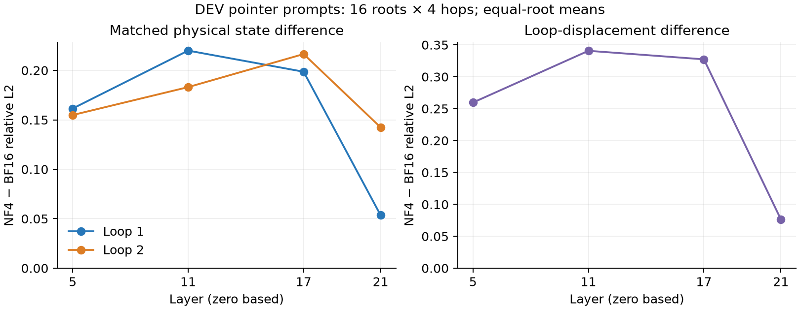

# NAN-GYM-05: complete native BF16/NF4 development pilot

Both backends completed 322 contexts and 89 source-root groups. On the 105 DEV main contexts, BF16 scored **31/105** and NF4 **26/105**. Both scored **57/57** on DEV copy controls. All eight calibration-only SAE dictionaries were fitted, independently checked and probed. The original 168-case test stayed sealed.

Registration: `18fb185dcda884473d51fe9c420654418c6a9f49`; source seal `96294903b1be52021725f2b839a7ad79fa635fd75aa4d5752cb3d53af0d132b0`; checkpoint `451ed48c3273ecef7ea8faaa43c31ce529763bb1`. [Frozen protocol](../../experiments/nan_gym05/PROTOCOL.md), [full aggregate grades and SAE groups](nan_gym05_progress.json), [paired geometry and discordances](nan_gym05_paired_geometry.json).

## Native task performance

| DEV main task | BF16 correct | NF4 correct | BF16 format | NF4 format |
|---|---:|---:|---:|---:|
| arc1 / main | 1/3 | 1/3 | 3/3 | 3/3 |
| arc2 / main | 0/3 | 1/3 | 2/3 | 3/3 |
| pointer / hop1 | 16/16 | 16/16 | 16/16 | 16/16 |
| pointer / hop2 | 2/16 | 1/16 | 16/16 | 16/16 |
| pointer / hop3 | 2/16 | 2/16 | 16/16 | 16/16 |
| pointer / hop4 | 1/16 | 0/16 | 16/16 | 16/16 |
| routing / main | 8/16 | 4/16 | 16/16 | 14/16 |
| storyworld / main | 0/16 | 0/16 | 16/16 | 16/16 |
| sudoku / main | 1/3 | 1/3 | 3/3 | 3/3 |

Sudoku primary grading is the exact upstream reference: both backends also produced 1/3 valid givens-preserving solutions. ARC-1/2 are local synthetic grid microbenches. Storyworld verifies complete plans under the native modeled rival; both scored 0/16 despite valid formatting. Routing classifies eight environment categories; it is not source-benchmark QA accuracy. The bounded anchored parser does not repair answers or scan explanations.

Both pass the prespecified new one-hop pointer readout screen (16/16 main and 16/16 copy). Multi-hop performance remains weak. This nominates a source-dependent retrieval task for a new causal design; it does not pass the original failed algebraic competence gate or establish reasoning transfer.

## Paired recurrence geometry

States are physical residual_after_layer outputs before the end-of-loop final RMSNorm. They are not normalized loop-boundary states; a boundary transfer additionally requires the actual normalization map. Equal accuracy can also hide different successes: both backends score 2/16 at three hops, but only one success is shared.

The table includes all 16 DEV pointer roots and all four non-copy hop prompts per root. Values are equal-root means, with each phase paired at the identical first prompt prefix. NF4 relative distance is ||h_NF4-h_BF16|| / ||h_BF16||. Sparse feature indices from separately fitted dictionaries are not equated.

| Layer (zero based) | Phase 1 cosine | Phase 1 relative L2 | Phase 2 cosine | Phase 2 relative L2 | Loop-displacement cosine | Loop-displacement relative L2 |
|---|---:|---:|---:|---:|---:|---:|
| 5 | 0.987128 | 0.1614 | 0.988050 | 0.1549 | 0.966100 | 0.2596 |
| 11 | 0.975513 | 0.2200 | 0.983162 | 0.1831 | 0.942528 | 0.3407 |
| 17 | 0.980097 | 0.1986 | 0.976205 | 0.2165 | 0.946253 | 0.3273 |
| 21 | 0.999233 | 0.0536 | 0.991345 | 0.1424 | 0.998300 | 0.0764 |

Layer-21/channel-2279 remains a large phase-associated coordinate on these exposed DEV pointer prompts:
BF16 phase 1 -2163.125, phase 2 -134.938.
NF4 phase 1 -2237.000, phase 2 -117.219.

A dominant phase coordinate can inflate whole-vector cosine. High cosine and matching one-hop answers do not establish identical recurrence mechanisms. No channel intervention or causal mediation is measured in this pilot. All-suite physical drift, cross-dictionary reconstruction and both module-output SVD subspaces are retained in the paired JSON; SVD is a weight baseline, not trained VPD/BPD.

## SAE towers

The weight-only rank-8/16 SVD residual Frobenius ratios range from 0.9808 to 0.9961 across these matrices, so the residual retains most operator magnitude. These algebraic baselines do not substitute for learned VPD/BPD.

Each backend/layer has one 128-feature, top-4 dictionary shared by both loops, fitted on exactly 256 vectors from 32 CAL pointer roots. No DEV or copy-control vector was used in fitting or checkpoint selection.

| Layer | BF16 CAL normalized MSE | NF4 CAL normalized MSE | BF16 active / 128 | NF4 active / 128 |
|---|---:|---:|---:|---:|
| 5 | 0.098648 | 0.100781 | 27 | 31 |
| 11 | 0.108568 | 0.120473 | 35 | 30 |
| 17 | 0.176215 | 0.201052 | 52 | 52 |
| 21 | 0.165952 | 0.179816 | 43 | 45 |

Normalized MSE uses each dictionary’s own CAL scale; compare cross-backend reconstruction using the reported physical relative errors. Random initial dictionaries, all features and all registered source/loop groups were retained. These small dictionaries are observational bottlenecks, not evidence that their feature identities mediate correct reasoning.

## Memory and execution

| Backend | Elapsed minutes | CUDA allocated peak GiB | CUDA reserved peak GiB | Sampled process dedicated MiB | Sampled process shared MiB | Sampled driver global MiB |
|---|---:|---:|---:|---:|---:|---:|
| BF16 | 66.50 | 1.041 | 1.051 | 1064.7 | 78.0 | 1065 |
| NF4 | 51.28 | 2.032 | 2.229 | 1910.7 | 78.0 | 1968 |

The full 166,144 × 3,072 BF16 head and embeddings stayed on CPU; vocabulary chunks were 8192 rows. CUDA allocator peaks are per process; driver counters are sampled and can miss short spikes. Shared usage is reported rather than assumed zero. Device-global samples include small overlapping BF16 SAE fitting / random-weight engineering checks; native BF16 and NF4 large model workers never overlapped. Elapsed time includes loading, baselines and scoring, and is not an isolated throughput benchmark. [Memory aggregates](nan_gym05_memory.json).

## Evidence boundary and next stages

Unit: source-generator/root group, with prompts/hops/loops/features repeated within it; one checkpoint and two quantization conditions. Counts: 32 CAL roots, 57 DEV roots, 322 total contexts/backend. Independence across all fixture roots is not asserted. Primary causal contrast, physical dose, scientific causal-effect floor and matched-sham tolerance floor: not calibrated here. Planned and actual formal inferential comparisons: zero. Resolution/power: no causal or equivalence test. Readout exposure: development sources and BF16 results were visible during post-registration analysis-helper design. Causal controls: none applied; copy/random-dictionary/Haar controls address instrument diagnostics only. Verdict: suggestive observational development evidence.

Each backend audit checked 322 final answers, all 12,880 captured physical state/module vectors, source bindings, full-vocabulary greedy score tapes and effective-operator closure. Paired analysis matched 2576 residual states, eight SAE fits and all 16 module/rank subspace cells. Local routing text, per-record predictions, identifiers, tokens, states and codes remain outside publication.

Actual local Prime full-reply rollouts are a separate frozen condition (NAN-PRIME-06). NF4 is producing fresh model replies through the official CLI/null harness on the local GPU; BF16 is queued next. Their scores must not be pooled with native first-complete-prefix results. The native-kernel BPD engineering bridge now has genuine-framework CPU checks and random-model GPU gradient/closure checks. Trained Nanbeige VPD/BPD fits, reached-state causal routing and donor-specific behavioral transfer remain pending their own prospective protocols. Further causal evidence requires independent sham calibration and a new untouched readout, preserving the original protected 168 cases.
