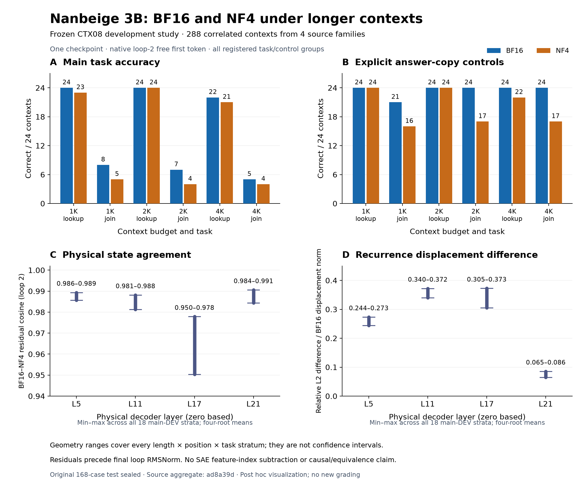

# Nanbeige development gym: accuracy, recurrence and learned components

The continuous local RTX 3050 goal remains active. The original 168-case
ARG-03 test stays sealed. This synthesis separates current audited results
from the earlier nine-study analysis below; it introduces no model calls,
grades, fits, selected endpoints or formal comparisons.

The [current requirements and execution roadmap](ROADMAP.md) gives one
status per stage. The [report collection](README.md) links every detailed
result, failure, source seal and current frozen continuation. Earlier live
status notes remain in the [previous committed report](https://github.com/MoralityLabAI/LoopedTransformers/blob/a9872ad246fe0eae4fdfd5e1c9a5de55ace31af7/reports/nanbeige_bpd_gym/NAN_GYM_RESEARCH_REPORT.md).

| Current audited comparison | BF16 | NF4 | Evidence |
|---|---|---|---|
| COMP14 DEV loop2, each recipe | 32/32 | 29/32 | [Competence and recurrence](NAN_COMP14_RESULTS.md) |
| Prime20 official main/copy/erased | 32/32;32/32;2/32 | 29/32;32/32;2/32 | [Both 96-episode terminal audits](NAN_PRIME20_RESULTS.md) |
| IO18 T1/T2 fitted updates | 16/16 at each depth | 16/16 at each depth | [Matched routes, fidelity and memory](NAN_FIT16_IO18_RESULTS.md) |
| IO18 T2 DEV native / reached / static | 32/32;32/32;32/32 | 29/32;25/32;26/32 | [All five route controls](NAN_FIT16_IO18_RESULTS.md) |
| Fixed SAE/factor cache audit | Both depth cells passed | Both depth cells passed | [All 48 ranges and 3528 scalar strata](NAN_XREF25_RESULTS.md) |

Prime20 is complete in both precisions: 96 official grades and 3840 byte-exact
physical vectors/backend, no missing/orphan grades. Its success does not
rescue older partial SDK runs. IO18 independently passed 16 real updates in
all four cells; original FIT16 writer failures remain separate. XREF25 is a
separately frozen three-transpose/one-float64-cast auditor with unchanged
tolerances; original XREF19/XREF24 failures remain failed. Full SAE tables
retain negative reconstruction improvements and nullable correlations.
These results are exposed development on one checkpoint, with repeated
worlds/routes/features. They show no isolated adaptive-routing advantage,
donor transfer, mechanism equivalence or faithful internal reasoning.

CTX21's fresh 4K/8K NF4 condition is running, with matched BF16 queued.
STORY23's 144 bounded state/path trajectories/backend and FULL26's 1,549
full-trace contexts plus 216 batched A/B pairs/backend are frozen and queued.
Their registration and engineering checks are not model scores. See the
[storyworld report](NAN_STORY23_PROGRESS.md), [full-gym report](NAN_FULL26_PROGRESS.md)
and [actual pinned-BPD engineering check](NAN_FULL26_ENGINEERING.md).
One resident model and one serialized substantial CPU analysis protect the
separate math workload. No original test case is opened for these stages.

## Earlier nine-study evidence: historical source snapshot

The remaining analysis is retained from audited snapshot
`38db7591f09a50b254d5fc0f048c9e28f1f75af1`, with its original registrations,
conditional failures and numerical endpoints. Statements that FIT07 NF4
learned assets are unrun apply to that original screen; later COMP14/IO18
success is a separate condition described above. Do not pool the cohorts
or replace missing historical replies with newer outputs. Use the
[historical benchmark index](BENCHMARK_INDEX.md) for its exact source hashes.

## Competence depends on task and scoring endpoint

The original NAN-BPD-01 algebraic task has four DEV source roots/eight
donor/recipient worlds and two separate CAL roots. Its native two-loop gate
requires at least 4/8 future-correct@12 worlds, two pairs whose members are both
future-correct@12, and one pair with both distinct targets top-one correct.

| Original algebraic gate | BF16 | NF4 |
|---|---:|---:|
| Native two-loop future-correct@12 | 3/8 | 4/8 |
| Pairs with both future-correct@12 | 1/4 | 1/4 |
| Pairs with both top-one correct | 0/4 | 0/4 |
| State closure / clean competence | pass / fail | pass / fail |
| Proposed BPD donor-transfer primary | unrun | unrun |

Here @12 means the fixed search/readout budget within the original 64-program
contract, not twelve recurrent loops. The [separate Dark Fibers v015 addendum](../../papers/shared_weights_dark_fibers/NAN_BPD01_ADDENDUM.md)
retains phase-channel controls, current-dark continuous responses, the original
prefix-control failure/amendment and power-limited statistical accounting.
The subsequent gym below uses new tasks and separate registrations.

The intervening [frozen reciprocal-component diagnostic](../../papers/shared_weights_dark_fibers/NAN_DIAG04_RECIPROCAL_COMPONENTS_REPORT.md)
separated coefficient computation from operator-label selection on eight fresh
DEV roots. Both backends scored 0/8 on complete free and scaffolded reciprocal
computation, 8/8 on all numeric/label/code copy controls, and 0/8 on raw
reciprocal-operator selection. Supplying exact candidate outputs gave 6/8 BF16
and 5/8 NF4 reciprocal-label answers; remaining matching losses were bounded
format failures. The frozen interpretation was mixed_or_unresolved, not a
unique arithmetic or label bottleneck. Its 15-contrast accounting remains
separate from the nine later gym studies. Earlier [source-only competence](../../papers/shared_weights_dark_fibers/NAN_COMP02_COMPETENCE_REPORT.md)
and [bounded reciprocal-example](../../papers/shared_weights_dark_fibers/NAN_COMP03_BOUNDED_RECIPROCAL_REPORT.md)
pilots are preserved too. Native task-gradient/Gramian selection and donor
transfer on the original algebraic task remain gated and unrun; the later
pointer fits are separate development instruments.

| Development endpoint | BF16 main / copy correct | NF4 main / copy correct | Coverage |
|---|---|---|---|
| GYM05 native wider suite | 31/105; 57/57 | 26/105; 57/57 | Both complete |
| PRIME06 official SDK, complete final reply | 13/70; 11/22 | 22/105; 55/57 | BF16 70 missing grades; NF4 complete |
| CTX08 native loop-2 first token | 90/144; 141/144 | 81/144; 120/144 | Both complete |
| PRIME-CTX10 official SDK, one-token final reply | 90/144; 141/144 | 14/25; 20/25 | BF16 complete; NF4 238 missing grades |

Each fraction uses its own registered denominator. Invalid/wrong answers stay
in scored counts; absent SDK grades remain missing. Native bounded-prefix
stopping and official complete-final-reply scoring are distinct endpoints.
The partial Prime conditions are not matched backend accuracy comparisons.
PRIME-CTX10 reuses CTX08 sources and supplies endpoint/transport evidence,
rather than independent task families.

On the native pointer task, both backends achieved 16/16 one-hop DEV answers
and 16/16 copy controls. At hops two/three/four, BF16 scored 2/16, 2/16, 1/16;
NF4 scored 1/16, 2/16, 0/16. Both produced 0/16 valid storyworld solutions
despite valid answer formatting. The new retrieval task improves the
instrument; it does not repair the original algebraic gate or demonstrate
general multi-hop competence.

Heavier contexts exposed the same distinction. At the 4K budget, lookup was
BF16 22/24 versus NF4 21/24; two-record joins were 5/24 versus 4/24. The 288
CTX08 DEV contexts span only four source families, repeated across lengths,
positions, tasks, worlds and copy controls. All length/task/control counts and
paired successes are in the [matched context report](NAN_CTX08_COMPARISON.md).
The [native report](NAN_GYM05_NATIVE_REPORT.md) retains every wider-suite task.

## Similar states can have different recurrence displacements

The following ranges retain every main-DEV length/position/task stratum of
CTX08. Each stratum averages within source root and then equally over its
four roots. They are descriptive ranges, not confidence intervals.

| Layer, zero based | BF16/NF4 loop-2 state cosine | Relative difference in loop displacement |
|---|---:|---:|
| 5 | .986–.989 | .244–.273 |
| 11 | .981–.988 | .340–.372 |
| 17 | .950–.978 | .305–.373 |
| 21 | .984–.991 | .065–.086 |

States are physical residual outputs before final loop RMSNorm. Displacements
are loop 2 minus loop 1, with differences normalized by the BF16 displacement
norm. These values do not compare independently fitted sparse-feature indices.
The native pointer comparison also preserves a large layer-21/channel-2279
phase coordinate in both backends; that coordinate can inflate whole-state
cosines. High cosine or matching labels therefore does not establish an
identical recurrent mechanism. No channel-specific causal conclusion follows.

The figure and its [receipt](figures/nan_ctx08_figure_receipt.json) bind plotted
values and immutable aggregate hashes. The [tower report](NAN_CTX08_TOWER_PROBES.md)
retains all loop, position, copy and outcome groups.

## Learned instruments and SAE cross-references

Eight 128-feature/top-4 dictionaries were fitted: one per backend at layers
5/11/17/21, shared across the two loops. Each used 256 vectors from 32 CAL
pointer roots, with no DEV/copy fitting. All features and random initial
dictionaries remain in the reports. These small dictionaries are observational
bottlenecks; their reconstruction and correlations are not semantic mediation.

FIT07 BF16 passed its fixed screen and produced a real rank-8 down_proj T1
VPD fit. The original T2 attempt reached its saved-tensor CPU cap before any
optimizer step. A separately frozen RECOMP09 condition completed the T2 BPD
fit under the same cap. Both performed eight genuine stock BPD optimizer
steps, updated factors and controller, passed independent audits, and received
all 28 cached-suite SAE/SVD/Haar probe groups. The
[learned-fit comparison](NAN_LEARNED_VPD_BPD_COMPARISON.md) retains every route.

NF4 passed CAL 7/8 and copy 16/16 but scored DEV 5/8 against the fixed 6/8
screen; its learned fits remain unrun. No threshold was relaxed and no
favorable subset was substituted.

RANKSITE13 extends BF16 to down_proj rank16 and o_proj ranks8/16 at T1/T2.
All six cells are fully completed/audited in the cited snapshot. The final
model exited successfully, and the finite host follower audited and published
its cached probes before exiting. Each cell has eight optimizer
steps, all 644 cached vectors/28 groups, and complete native finite-write
probes: 9216 signed writes at rank16 or 4608 at rank8, 72 feature groups and
36 derivative groups. The [readable results](NAN_RANKSITE13_RESULTS.md) retain
all CAL/DEV routing controls, updates, memory, coverage and operator comparisons.

The o_proj probe uses the actual residual/norm/MLP bridge to the layer-output
SAE; it has no identity-coordinate geometry cells. Native BF16 rounding and
finite-write/derivative discrepancies remain visible. These are local
module-output writes, not donor transfer or a next-loop causal intervention.

The key behavioral limitation survives the added ranks/sites: every completed
RANKSITE13 T1 cell scores 2/8 DEV at loop1 under all five routes. Every completed
T2 cell scores 7/8 at loop2 under all five routes, including static CAL-mean
replacement. Preserved correctness therefore does not show learned-component
specificity. T1/T2 also differ in training depth, ablation and adversary rules;
their comparisons do not isolate a BPD advantage. High physical operator
alignment is consistent with shared initialization and small updates.

The [HOST01 amendment](../../experiments/nan_ranksite13_host01/PROTOCOL.md)
preserves the original cached-analysis Python scope failures and repairs only
identifier bindings in a separately registered host analysis. Frozen neural
sources and inference outcomes are unchanged; no neural replay is involved.

## Cache execution is a separate numerical condition

All three conditions below completed 130 public contexts/41 source families
and passed their terminal audits. Every registered last-token prefill was
bit-exact within its own cache/full-prefix comparison.

| Condition | Reference-history positions | Loop-2 argmax disagreements | Maximum full-vocabulary logit difference | Maximum normalized-boundary relative L2 |
|---|---:|---:|---:|---:|
| KV11 BF16 | 821 | 12 | 2.1875 | .035932 |
| KV11 default NF4 | 671 | 3 | 3.5 | .076402 |
| KV12 explicit-effective NF4 | 671 | 0 | 1.75 | .074452 |

Zero token-choice disagreements do not mean identical logits or states. KV12
changes full-prefix NF4 arithmetic too. Each condition supplies its own natural
reference history, so later trajectories are not paired BF16/NF4 task outcomes.
These are eight-token/EOS fragments, not complete-task accuracy. Both
historical KV12 comparisons cover all 130 common initial prefixes; partial
streaming denominators and all errors remain in the
[completed cache comparison](NAN_CACHE_EXECUTION_COMPARISON.md).

## Hardware use and evidence limits

Current NF4 execution keeps all 22 decoder layers and the unchanged BF16
output head on GPU. CPU embedding lookup preserves about .951 GiB for
contexts/cache. Full BF16 weights exceed the 4-GB device; the registered
BF16 execution retains four decoder layers plus a reusable stage and the
head on GPU. CTX08 allocated/reserved peaks were 2.694/3.010 GiB for BF16
and 2.875/3.201 GiB for NF4. Dedicated/shared driver samples and whole-process
RAM are different measurements from CUDA peaks or saved-tensor CPU caps.
Shared-machine timings are not isolated throughput benchmarks.

One large model, one numerical CPU thread and Below Normal priority preserve
capacity for the user's separate math process. That process is untouched.
Raw prompts/routing text, replies, tokens, vectors, codes and per-record
derivatives stay local; public reports contain aggregates and hashes.

| Research handoff field | Scope |
|---|---|
| Unit and counts | One checkpoint. GYM05: 32 CAL/57 DEV root groups, 322 contexts per backend; independence across all fixture roots is not asserted. CTX08: four DEV families/288 correlated variants plus one CAL family/three profiles. Fits: eight CAL/eight DEV roots reused from FIT07. Cached fit probes: 644 vectors/89 older source groups. SDK/cache counts remain endpoint-specific. |
| Primary contrast | Descriptive matched native BF16/NF4 outcomes and physical geometry; learned fit/depth/site comparisons are exposed and method-confounded. |
| Physical dose | RANKSITE13 local module-output relative L2 requests .001/.01/.1, both signs, all components and bases; actual rounded doses/zero writes retained. No donor-transfer dose was executed. |
| Scientific causal floor and matched-sham floor | Not calibrated. Initial dictionaries, SVD/Haar, static and routing controls diagnose the instrument; they do not supply a calibrated sham tail for future correctness. |
| Planned / actual formal comparisons and power | 0 / 0 for the nine GYM05–RANKSITE13 studies; original NAN-BPD-01 and DIAG04 statistical accounting remains separate. No confirmatory or equivalence power claim. Repeated loops/features/doses are not additional independent roots. |
| Readout exposure | Source-only CAL/DEV, repeated development readouts; this synthesis follows the observed reports. The original 168-case readout remains sealed. |
| Causal controls and verdict | Clean/all-one, component-only, static-CAL-mean, clean-informed and reached-state routes; finite native bridge and gauge controls. Observational development and engineering evidence; specificity, donor mediation and backend equivalence unestablished. |
| What could change the conclusion | A prospectively frozen competence-qualified causal task, independent source families, meaningful effect and matched-sham floors, fixed actual doses, donor/static/random controls, adequate root-level resolution and a new independent sealed readout. The protected original 168 cases are not that readout. |

Original algebraic donor transfer remains gated and unrun. Missing Prime
coverage and historical failures remain in the record; no extra tail, orphan
rescue or neural retry was used to fill them. The source-sealed protocols,
independent audits and exact report hashes are linked from the
[benchmark index](BENCHMARK_INDEX.md) and [draft PR #235](https://github.com/MoralityLabAI/LoopedTransformers/pull/235).

The [static source-seal audit](nan_gym_source_seal_audit.json) records 321
matching file-hash bindings across all nine study manifests at commit
`083bcfc9aed5f6f40eecf3a32cd29b4d71c3907a`. It checks current source/protocol
and dependency bytes; it does not independently certify weights, runtime
outcomes or scientific conclusions.
