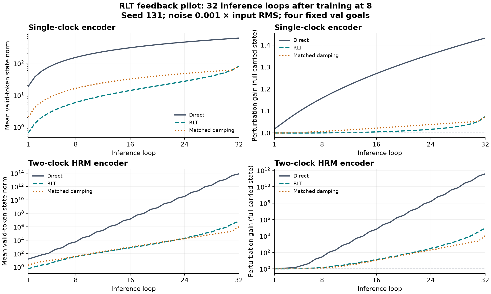
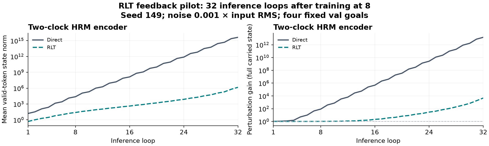

# RLT: two-lane small-model comparison

Eight XS Mathlib tactic models completed: loop/HRM × direct/RLT/matched damping at seed 131, plus a fresh HRM direct/RLT pair at seed 149. Each received 1,000 updates, batch 16, and training encoder K=8.

RLT closed exactly the same goals as direct feedback in every tested pair at both inference budgets. No Lean completion edge was observed in this pilot.

Both seeds use the same 24 requested validation goals and 23 certifiable goals. This is one cohort, not 46 independent goals. One scored goal changes the rate by 4.35 percentage points. No registered test split was scored.

## Lean-certified completion

close@8 means at least one of up to eight proposed tactics closes the goal, passes the Lean kernel, and uses only the permitted axioms. Model+automation interleaves model and automation tactics within the same eight-attempt budget.

| Seed | Arm | Model K=8 | Model K=32 | Model+auto K=8 | Model+auto K=32 |
|---|---|---:|---:|---:|---:|
| 131 | loop_direct | 3/23 | 3/23 | 8/23 | 8/23 |
| 131 | loop_rlt | 3/23 | 3/23 | 8/23 | 8/23 |
| 131 | loop_matched_damping | 3/23 | 3/23 | 8/23 | 8/23 |
| 131 | hrm_direct | 3/23 | 3/23 | 8/23 | 8/23 |
| 131 | hrm_rlt | 3/23 | 3/23 | 8/23 | 8/23 |
| 131 | hrm_matched_damping | 3/23 | 3/23 | 8/23 | 8/23 |
| 149 | hrm_direct | 4/23 | 4/23 | 8/23 | 8/23 |
| 149 | hrm_rlt | 4/23 | 4/23 | 8/23 | 8/23 |

Seed 131: automation alone 8/23; human-source tactic check 23/23; zero failed files.
Seed 149: automation alone 8/23; human-source tactic check 23/23; zero failed files.

Every model's primary-budget first proposal is plain `simp` on all 24 requested goals. This tactic-prior behavior limits what the short pilot can tell us about learned proof reasoning.

| Seed | RLT versus direct | K=8 wins/losses | K=32 wins/losses |
|---|---|---:|---:|
| 131 | loop | 0/0 | 0/0 |
| 131 | hrm | 0/0 | 0/0 |
| 149 | hrm | 0/0 | 0/0 |

The seed-131 matched-damping comparisons and every per-goal outcome are retained in the individual receipts. The second seed has no damping arm.

## Byte loss and loop diagnostics

FP32 bits per tactic byte on the same 128 validation states; lower is better. Each budget is a separate trajectory. Teacher-forced exact tactic match is reported separately from proof completion in the seed reports.

| Seed | Arm | Bits/byte K=8 | Bits/byte K=32 |
|---|---|---:|---:|
| 131 | loop_direct | 3.059806 | 3.064623 |
| 131 | loop_rlt | 3.056849 | 3.058921 |
| 131 | loop_matched_damping | 3.056626 | 3.058842 |
| 131 | hrm_direct | 3.093985 | 3.095674 |
| 131 | hrm_rlt | 3.095835 | 3.095127 |
| 131 | hrm_matched_damping | 3.094109 | 3.096403 |
| 149 | hrm_direct | 3.100015 | 3.100036 |
| 149 | hrm_rlt | 3.096158 | 3.096906 |

At the trained budget, HRM RLT minus direct bits/byte is +0.001851 at seed 131 and -0.003857 at seed 149; these small changes need a fresh cohort and more seeds.

All eight models have zero teacher-forced reference-tactic exact matches on the 128-state sample at every measured budget. This metric is distinct from the nonzero certified completions above.

Raw state norms precede readout normalization. Noise enters the initially zero fast state with RMS 0.001 times valid-token input-embedding RMS. Gain includes fast and HRM slow-state differences and divides by the initial noise norm. Four fixed goals and one noise direction do not estimate a worst-case bound.

| Seed | Arm | Final norm K=32 | Final update norm K=32 | Full gain K=8 | Full gain K=32 |
|---|---|---:|---:|---:|---:|
| 131 | loop_direct | 614.8 | 19.28 | 1.159 | 1.432 |
| 131 | loop_rlt | 80.59 | 19.64 | 1.051 | 1.075 |
| 131 | loop_matched_damping | 80.88 | 19.72 | 1.051 | 1.075 |
| 131 | hrm_direct | 7.726e+13 | 3.309e+13 | 27.9 | 3.653e+11 |
| 131 | hrm_rlt | 6.477e+06 | 3.82e+06 | 43.92 | 9.12e+04 |
| 131 | hrm_matched_damping | 9.993e+05 | 7.777e+05 | 2.254 | 1.058e+04 |
| 149 | hrm_direct | 4.15e+15 | 1.834e+15 | 86.48 | 1.477e+13 |
| 149 | hrm_rlt | 1.445e+06 | 8.291e+05 | 5.169 | 4622 |

The figures show K=32 trajectories throughout; their loop-8 points are not independently run K=8 endpoints. RLT's smaller raw state scale does not by itself establish contraction or better reasoning. At seed 131, matched damping tracks the loop encoder's RLT loss/norm behavior and gives lower HRM K=32 norm and gain than RLT. The paper's assumptions are not guaranteed in this hybrid.

## Resources and verification

| Lane | Arms | Training elapsed hours | Peak training commit GiB | Proposal+Lean minutes | Peak evaluation commit GiB |
|---|---:|---:|---:|---:|---:|
| 131 | 6 | 2.35 | 4.30 | 35.3 | 4.08 |
| 149 | 2 | 0.93 | 3.89 | 35.6 | 4.07 |

Summed training-lane elapsed time, including pauses/restarts: 3.28 hours, below the four-hour limit. Seed-149 GPU training overlapped seed-131 CPU Lean checking. The shared host and different resource segments prevent a fair feedback-overhead timing comparison. The second lane resumed at checkpoint 200; its exact discarded unsaved-update count was not captured.

CUDA training used bf16; diagnostics/proposals used fp32 with TF32 off, and Lean checking used one CPU worker. Each GPU phase held its own 4 GiB lease and process-tree memory cap. All eight one-goal K=8 CPU/CUDA reference checks passed; largest logit difference 6.2e-06. These reference checks do not validate every K=32 internal state numerically.

The feedback/checkpoint/cache checks passed (13 distinct tests). Receipt generation verified checkpoint SHA256, matched within-family parameter/configuration identities, exact completion counts, and common evaluation coverage. Loop models have 1,488,227 parameters; HRM models have 1,473,419; feedback adds no parameters or block calls within a family.

## Limits and next decision

This is a short, exploratory validation pilot: two HRM seeds, one loop seed, and 23 unique certifiable goals. Repeated evaluation on this cohort cannot establish a held-out advantage. It transfers only the feedback schedule, without the paper's time/step embeddings or uniform all-step endpoint loss. Compute-depth mismatch is not task-length extrapolation. Q5 F1/F8, its false-negative question, the graph HRM transfer and the 400M model were not evaluated here; the original Q5 threshold and 400M no-go remain unchanged.

Before scaling this line of work, train a small baseline that adds certified completions beyond automation, then compare RLT with direct feedback and damping across fresh seeds and a fresh cohort. The present scale-control effect alone does not justify a larger run.

## Reproducible receipts

- Seed 131, experiment source `ed97c95`: [report](seed131/RLT-pilot-report.md), [full diagnostics and provenance](seed131/RLT-pilot-receipts.json), [raw Lean item results](seed131/RLT-Lean-item-results.jsonl.gz).
- Seed 149, experiment source `8163b81`: [report](seed149/RLT-pilot-report.md), [full diagnostics and provenance](seed149/RLT-pilot-receipts.json), [raw Lean item results](seed149/RLT-Lean-item-results.jsonl.gz).

Regenerate each seed report with `python audit/rlt_report.py <pilot-root> <report-dir> --commit <experiment-source>`, plot with `python audit/rlt_plot.py <report-dir>` (matplotlib), then combine with `python audit/rlt_compare.py <reports-root>`.
