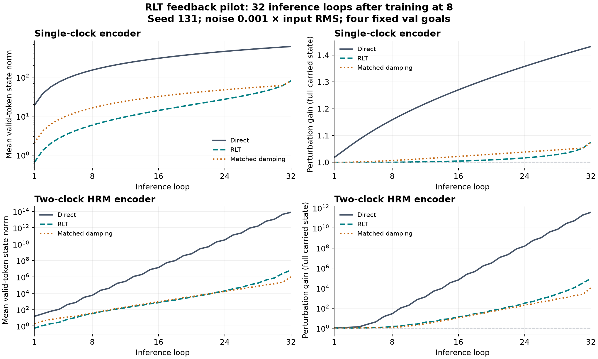

# RLT small-model pilot

Exploratory Mathlib validation comparison: seed 131, 6 feedback arms.

Diagnostic device: cuda, fp32. Lean kernel checking runs on CPU. Largest CPU/CUDA reference logit difference: 6.2e-06.

Source commit: `ed97c95`. All arms trained for 1,000 steps, batch 16, K=8.

## Lean-certified completion

Shared validation sample: 24 requested, 24 reached, 23 certifiable; 0 failed files.

| Arm | Parameters | close@1 | close@8 | model+automation close@8 | wins/losses vs direct |
|---|---:|---:|---:|---:|---:|
| loop_direct_s131 | 1,488,227 | 3/23 (13.0%) | 3/23 (13.0%) | 8/23 (34.8%) | reference |
| loop_rlt_s131 | 1,488,227 | 3/23 (13.0%) | 3/23 (13.0%) | 8/23 (34.8%) | 0/0 |
| loop_matched_damping_s131 | 1,488,227 | 3/23 (13.0%) | 3/23 (13.0%) | 8/23 (34.8%) | 0/0 |
| hrm_direct_s131 | 1,473,419 | 3/23 (13.0%) | 3/23 (13.0%) | 8/23 (34.8%) | reference |
| hrm_rlt_s131 | 1,473,419 | 3/23 (13.0%) | 3/23 (13.0%) | 8/23 (34.8%) | 0/0 |
| hrm_matched_damping_s131 | 1,473,419 | 3/23 (13.0%) | 3/23 (13.0%) | 8/23 (34.8%) | 0/0 |

Automation alone close@8: 8/23 (34.8%). Human-source tactic check close@1: 23/23 (100.0%).

Every model's primary-budget first proposal is plain `simp` on all 24 requested goals.

## Lean completion with extra inference loops

Same validation goals and eight tactic attempts, with encoder K=8 versus K=32. K=32 uses additional recurrent computation.

| Arm | close@8, K=8 | close@8, K=32 | Difference | K=32 wins/losses vs direct |
|---|---:|---:|---:|---:|
| loop_direct_s131 | 3/23 (13.0%) | 3/23 (13.0%) | +0.0 pp | reference |
| loop_rlt_s131 | 3/23 (13.0%) | 3/23 (13.0%) | +0.0 pp | 0/0 |
| loop_matched_damping_s131 | 3/23 (13.0%) | 3/23 (13.0%) | +0.0 pp | 0/0 |
| hrm_direct_s131 | 3/23 (13.0%) | 3/23 (13.0%) | +0.0 pp | reference |
| hrm_rlt_s131 | 3/23 (13.0%) | 3/23 (13.0%) | +0.0 pp | 0/0 |
| hrm_matched_damping_s131 | 3/23 (13.0%) | 3/23 (13.0%) | +0.0 pp | 0/0 |

Paired RLT wins/losses against matched damping (model close@8):

- loop: K=8: 0/0; K=32: 0/0.
- hrm: K=8: 0/0; K=32: 0/0.

## Inference-depth robustness

Bits per tactic byte on the same 128 validation states; lower is better. These are separate trajectories at each requested budget.

| Arm | K=4 | K=8 (trained) | K=16 | K=32 |
|---|---:|---:|---:|---:|
| loop_direct_s131 | 3.0588 | 3.0598 | 3.0620 | 3.0646 |
| loop_rlt_s131 | 3.0557 | 3.0568 | 3.0580 | 3.0589 |
| loop_matched_damping_s131 | 3.0556 | 3.0566 | 3.0578 | 3.0588 |
| hrm_direct_s131 | 3.1041 | 3.0940 | 3.0957 | 3.0957 |
| hrm_rlt_s131 | 3.0962 | 3.0958 | 3.0954 | 3.0951 |
| hrm_matched_damping_s131 | 3.0974 | 3.0941 | 3.0963 | 3.0964 |

Teacher-forced tactic exact match on those same 128 states:

| Arm | K=4 | K=8 | K=16 | K=32 |
|---|---:|---:|---:|---:|
| loop_direct_s131 | 0.0% | 0.0% | 0.0% | 0.0% |
| loop_rlt_s131 | 0.0% | 0.0% | 0.0% | 0.0% |
| loop_matched_damping_s131 | 0.0% | 0.0% | 0.0% | 0.0% |
| hrm_direct_s131 | 0.0% | 0.0% | 0.0% | 0.0% |
| hrm_rlt_s131 | 0.0% | 0.0% | 0.0% | 0.0% |
| hrm_matched_damping_s131 | 0.0% | 0.0% | 0.0% | 0.0% |

## Per-loop diagnostics

At K=32, valid-token norms are measured before readout normalization. Noise is added to the initially zero fast state with RMS 0.001 times the valid-token input-embedding RMS. Gains divide the resulting state difference by the initial noise norm; they are finite-direction measurements, not worst-case bounds.

| Arm | Final mean state norm | Final mean update norm | Terminal fast gain | Terminal fast+slow gain |
|---|---:|---:|---:|---:|
| loop_direct_s131 | 614.8 | 19.28 | 1.432 | 1.432 |
| loop_rlt_s131 | 80.59 | 19.64 | 1.075 | 1.075 |
| loop_matched_damping_s131 | 80.88 | 19.72 | 1.075 | 1.075 |
| hrm_direct_s131 | 7.726e+13 | 3.309e+13 | 3.333e+11 | 3.653e+11 |
| hrm_rlt_s131 | 6.477e+06 | 3.82e+06 | 7.529e+04 | 9.12e+04 |
| hrm_matched_damping_s131 | 9.993e+05 | 7.777e+05 | 8973 | 1.058e+04 |

Every plotted curve uses the K=32 schedule throughout. Its loop-8 point is not the endpoint of an independently run K=8 trajectory.

Full per-loop traces for budgets 4/8/16/32 and all three noise magnitudes, interval training throughput/loss, and resource segments are in [the receipts](RLT-pilot-receipts.json). [Raw Lean item results](RLT-Lean-item-results.jsonl.gz) retain proposals and kernel-check outcomes.

## Limits

- One training seed; exploratory val evaluation, not a registered test result.
- Teacher-forced exact match is not proof completion.
- Changing inference budget is not task-length extrapolation.
- This transfers the feedback schedule to a final-loss tactic model; it does not reproduce the paper's time conditioning or uniform all-step endpoint supervision.
- Shared-host scheduling and checkpoint restarts affect wall time; per-arm wall_s records the final segment, not comparable feedback overhead.
- The 400M no-go and original Q5 threshold remain unchanged.

Small differences on this sample need replication across seeds and a fresh evaluation cohort. Smaller norms alone are not evidence of better reasoning.
