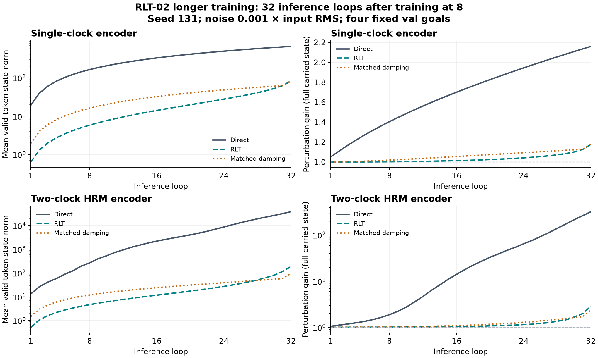

# RLT-02: longer models on fresh Lean goals

Longer training produced some basic completions beyond plain `simp`, but this one-seed comparison found no consistent RLT advantage. On 62 certifiable fresh goals at K=8, direct/RLT/damping closed 17/16/15 for loop-XS and 15/16/15 for HRM-XS. The paired RLT-versus-direct differences were one win/two losses for loop-XS and two wins/one loss for HRM-XS.

Only loop-XS direct added a fresh solve beyond the eight-attempt automation baseline, using `infer_instance`. Its interleaved model+auto policy still tied automation at 37/62: it gained that goal and lost a different goal solved by `tauto` after automation candidates were displaced. RLT and damping added no fresh solves beyond automation.

At K=32, HRM-XS direct closed 20/62 versus RLT 16/62 and damping 15/62; all 20 direct closures were achievable by its proposed plain `simp`. RLT sharply reduced raw state and perturbation growth, with damping giving comparable or stronger control. Lower growth did not identify the best completion policy in this cohort. This does not rerun or change the Q5 contraction rule.

Two parallel lanes continued loop-XS and HRM-XS, each with direct, RLT and matched damping. The comparison uses exact completed common milestones within each architecture. Partial later training is retained but excluded from these scores.

Each trial proposes up to eight one-step tactics at a frozen Lean goal. close@k counts goals closed by at least one of the first k tactics, with a standalone kernel certificate using only permitted axioms. valid@1 counts an accepted first tactic, even when goals remain. Model+auto interleaves model and automation candidates within the same eight-attempt budget. These are goal completions rather than complete theorem-search rollouts.

## Training received

| Architecture | Parameters per arm | Total updates per arm | Training presentations per arm | Budgeted lane hours |
|---|---:|---:|---:|---:|
| loop | 1,488,227 | 3,400 | 323,200 | 3.84 |
| hrm | 1,473,419 | 2,314 | 184,192 | 3.84 |

The new phase used batch 128, activation checkpointing, retained AdamW moments and a common re-warmup/cosine recipe. The original checkpoint supplied 1,000 batch-16 updates. Architectures may have reached different milestones; feedback arms within an architecture received matched training.

## Fresh file-held-out goals (primary)

Requested 64, reached 64, certifiable 62; zero failed files. Automation close@8: 37/62. Human-source close@1: 62/62.

| Arm | close@1 | close@8 | valid@1 | Goals closed without a simplifier | Added solves beyond auto | Model+auto close@8 |
|---|---:|---:|---:|---:|---:|---:|
| loop_direct_s131 | 15/62 | 17/62 | 22/62 | 4 | 1 | 37/62 |
| loop_rlt_s131 | 14/62 | 16/62 | 18/62 | 1 | 0 | 36/62 |
| loop_matched_damping_s131 | 14/62 | 15/62 | 19/62 | 2 | 0 | 36/62 |
| hrm_direct_s131 | 14/62 | 15/62 | 24/62 | 1 | 0 | 36/62 |
| hrm_rlt_s131 | 16/62 | 16/62 | 22/62 | 2 | 0 | 36/62 |
| hrm_matched_damping_s131 | 11/62 | 15/62 | 15/62 | 3 | 0 | 36/62 |

Simplifier tactics here include `simp`, `simp_all`, `simpa` and `dsimp`, including supplied-lemma variants. The remaining counts still include basic tactics such as `rfl`; added solves beyond automation are the stronger test. These are counts of goals, not tactic strings. Full proposal and closing-text distributions are retained in the receipts.

| Arm | Plain simp first / requested | Distinct first proposals | Certified non-simplifier closing texts (frequency) |
|---|---:|---:|---|
| loop_direct_s131 | 25/64 | 29 | {"infer_instance": 1, "rfl": 3} |
| loop_rlt_s131 | 25/64 | 25 | {"rfl": 1} |
| loop_matched_damping_s131 | 25/64 | 24 | {"rfl": 2} |
| hrm_direct_s131 | 32/64 | 12 | {"rfl": 1} |
| hrm_rlt_s131 | 34/64 | 11 | {"rfl": 2} |
| hrm_matched_damping_s131 | 21/64 | 22 | {"rfl": 3} |

Excluded reached goals: `Mathlib/Analysis/ODE/Gronwall.lean:106:6` (statement depends on unresolved metavariables); `Mathlib/Data/Nat/Squarefree.lean:288:8` (statement depends on unresolved metavariables).

## Old calibration goals (readiness check)

Requested 24, reached 24, certifiable 23; zero failed files. Automation close@8: 8/23. Human-source close@1: 23/23.

| Arm | close@1 | close@8 | valid@1 | Goals closed without a simplifier | Added solves beyond auto | Model+auto close@8 |
|---|---:|---:|---:|---:|---:|---:|
| loop_direct_s131 | 4/23 | 5/23 | 13/23 | 1 | 0 | 8/23 |
| loop_rlt_s131 | 3/23 | 6/23 | 13/23 | 2 | 0 | 8/23 |
| loop_matched_damping_s131 | 3/23 | 6/23 | 14/23 | 2 | 0 | 8/23 |
| hrm_direct_s131 | 2/23 | 3/23 | 14/23 | 1 | 0 | 8/23 |
| hrm_rlt_s131 | 3/23 | 3/23 | 16/23 | 0 | 0 | 8/23 |
| hrm_matched_damping_s131 | 2/23 | 5/23 | 11/23 | 2 | 1 | 9/23 |

Simplifier tactics here include `simp`, `simp_all`, `simpa` and `dsimp`, including supplied-lemma variants. The remaining counts still include basic tactics such as `rfl`; added solves beyond automation are the stronger test. These are counts of goals, not tactic strings. Full proposal and closing-text distributions are retained in the receipts.

| Arm | Plain simp first / requested | Distinct first proposals | Certified non-simplifier closing texts (frequency) |
|---|---:|---:|---|
| loop_direct_s131 | 13/24 | 9 | {"rfl": 1} |
| loop_rlt_s131 | 14/24 | 9 | {"omega": 1, "rfl": 1} |
| loop_matched_damping_s131 | 15/24 | 8 | {"omega": 1, "rfl": 1} |
| hrm_direct_s131 | 17/24 | 6 | {"rfl": 1} |
| hrm_rlt_s131 | 23/24 | 2 | {} |
| hrm_matched_damping_s131 | 18/24 | 7 | {"omega": 1, "rfl": 1} |

Excluded reached goals: `Mathlib/CategoryTheory/Limits/Opposites.lean:836:49` (non-proposition).

## Paired fresh-goal differences

Eight tactic attempts per model; wins/losses count discordant goals.

| Comparison | Wins | Losses | Ties |
|---|---:|---:|---:|
| loop_K8_rlt_vs_direct | 1 | 2 | 59 |
| loop_K8_matched_damping_vs_direct | 0 | 2 | 60 |
| loop_K8_rlt_vs_matched_damping | 1 | 0 | 61 |
| loop_K32_rlt_vs_direct | 1 | 1 | 60 |
| loop_K32_matched_damping_vs_direct | 0 | 1 | 61 |
| loop_K32_rlt_vs_matched_damping | 1 | 0 | 61 |
| hrm_K8_rlt_vs_direct | 2 | 1 | 59 |
| hrm_K8_matched_damping_vs_direct | 0 | 0 | 62 |
| hrm_K8_rlt_vs_matched_damping | 2 | 1 | 59 |
| hrm_K32_rlt_vs_direct | 0 | 4 | 58 |
| hrm_K32_matched_damping_vs_direct | 0 | 5 | 57 |
| hrm_K32_rlt_vs_matched_damping | 2 | 1 | 59 |

## Extra inference loops

Changing encoder compute is distinct from task-length extrapolation.

| Arm | Fresh close@8, K=8 | Fresh close@8, K=32 |
|---|---:|---:|
| loop_direct_s131 | 17/62 | 16/62 |
| loop_rlt_s131 | 16/62 | 16/62 |
| loop_matched_damping_s131 | 15/62 | 15/62 |
| hrm_direct_s131 | 15/62 | 20/62 |
| hrm_rlt_s131 | 16/62 | 16/62 |
| hrm_matched_damping_s131 | 15/62 | 15/62 |

## Loop diagnostics

FP32 teacher-forced bits per byte on the same 128 validation states; this is separate from fresh Lean completion. Each K starts its own trajectory.

| Arm | K=4 | K=8 | K=16 | K=32 |
|---|---:|---:|---:|---:|
| loop_direct_s131 | 1.83751 | 1.83402 | 1.83817 | 1.84465 |
| loop_rlt_s131 | 1.84052 | 1.84054 | 1.84252 | 1.84464 |
| loop_matched_damping_s131 | 1.84159 | 1.84172 | 1.84390 | 1.84630 |
| hrm_direct_s131 | 2.15142 | 2.06442 | 2.23116 | 2.31010 |
| hrm_rlt_s131 | 2.10118 | 2.07247 | 2.11220 | 2.24450 |
| hrm_matched_damping_s131 | 2.09201 | 2.04476 | 2.10487 | 2.28073 |

| Arm | Teacher-forced exact, K=8 | Teacher-forced exact, K=32 |
|---|---:|---:|
| loop_direct_s131 | 1/128 | 0/128 |
| loop_rlt_s131 | 0/128 | 0/128 |
| loop_matched_damping_s131 | 0/128 | 0/128 |
| hrm_direct_s131 | 0/128 | 0/128 |
| hrm_rlt_s131 | 0/128 | 0/128 |
| hrm_matched_damping_s131 | 0/128 | 0/128 |

| Arm | Final norm K=32 | Final update norm K=32 | Full perturbation gain K=8 | Full perturbation gain K=32 |
|---|---:|---:|---:|---:|
| loop_direct_s131 | 661.1 | 20.71 | 1.404 | 2.159 |
| loop_rlt_s131 | 82.9 | 20.28 | 1.124 | 1.176 |
| loop_matched_damping_s131 | 82.32 | 20.19 | 1.124 | 1.179 |
| hrm_direct_s131 | 3.839e+04 | 8592 | 1.88 | 320.5 |
| hrm_rlt_s131 | 188.2 | 72.94 | 1.168 | 2.844 |
| hrm_matched_damping_s131 | 96.03 | 42.08 | 1.128 | 2.394 |

Noise enters the initially zero fast state with RMS 0.001 times input-embedding RMS. Full gain includes HRM slow slots and divides by initial noise norm. Four fixed validation goals and finite random directions do not establish a worst-case bound. Norms precede readout normalization; lower scale alone does not demonstrate contraction. Plotted K=32 prefixes are not independent K=8 runs.

## Interim readiness check

At loop-XS total update 2,000, the old calibration check reached all 24 goals, with 23 certifiable and zero failed files. This check did not change the fixed training budget, recipe or final checkpoint selection.

| Arm | close@8 | Non-simp closes | Added solves beyond auto |
|---|---:|---:|---:|
| loop_direct_s131 | 0/23 | 0 | 0 |
| loop_rlt_s131 | 1/23 | 0 | 0 |
| loop_matched_damping_s131 | 0/23 | 0 | 0 |

The short pilot closed 3/23 of these goals in every seed-131 arm, all using `simp`. More varied proposals and lower validation loss alone do not establish stronger goal completion.

## Provenance and limits

Replay used configured Lean 4.19.0 and recorded Mathlib marker `c44e0c8ee63ca166450922a373c7409c5d26b00b`, matching the source dataset pins. The marker is not a full working-tree content audit. All certifiable human-source tactics passed the same kernel checks.

Some accepted `simpa using ...` outputs contain irrelevant generated names. Lean 4.19 simplifies the goal before elaborating the supplied term and can finish there; inspection of its local Simpa implementation confirmed this behavior. These are simplifier completions, not evidence of successful lemma retrieval.

Summed budgeted lane time: 7.68 hours. Successful training-only preflights took 7.77 minutes; the failed launch is conservatively bounded by 4.83 minutes. Combined upper bound: 7.89 hours, within the eight-hour training cap. Confirmed external power-outage waiting is excluded; wall elapsed time, excluded intervals, other interruptions and discarded unsaved work are recorded separately.

Experiment source starts at `4c3e787`; scheduling amendments and exact process segments are retained in the receipts. [Full receipts](RLT-long-receipts.json) include checkpoint/parent SHA256, recipe identities, selected versus latest steps, training curves, diversity probes, resource segments, CPU/CUDA references and every paired goal outcome. [Raw Lean results](RLT-Lean-item-results.jsonl.gz) preserve tactic proposals and kernel certificates.

The unchanged [frozen protocol](protocol.json) and compressed [frozen input cohort](RLT-frozen-cohort.jsonl.gz) accompany the results. [Interim readiness counts](RLT-interim-readiness.json), [interim evaluation metadata](RLT-interim-eval.json) and [interim raw results](RLT-interim-Lean-results.jsonl.gz) preserve the old-goal check separately.

The fresh cohort was frozen before continuation training: 64 goals from 33 test_file files, excluding every encoded input in all training/validation packed rows, the old pilot files, and duplicate fresh inputs. The 24 old calibration goals are reported separately. Fresh results never selected weights. Human-source failures, if any, remain visible in the counts and must be considered when assessing the pipeline.

This is one training seed per architecture, continued from the short pilot. Larger batches and longer training change the training recipe relative to that pilot, but are matched across feedback arms here. Shared-host scheduling and restarts prevent fair wall-time overhead comparisons. The paper's time/step embeddings and uniform all-step endpoint loss are absent. Q5 F1/F8, task-length extrapolation, graph HRM and 400M scaling remain unevaluated; their existing gates remain unchanged.
