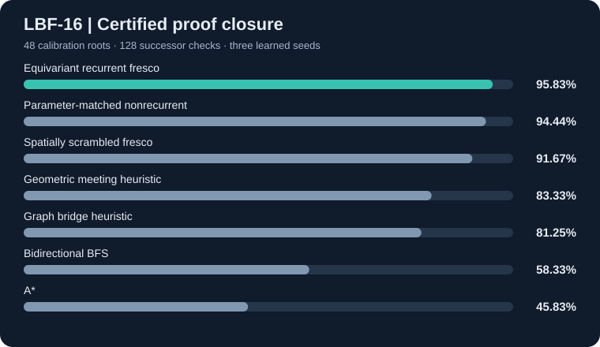
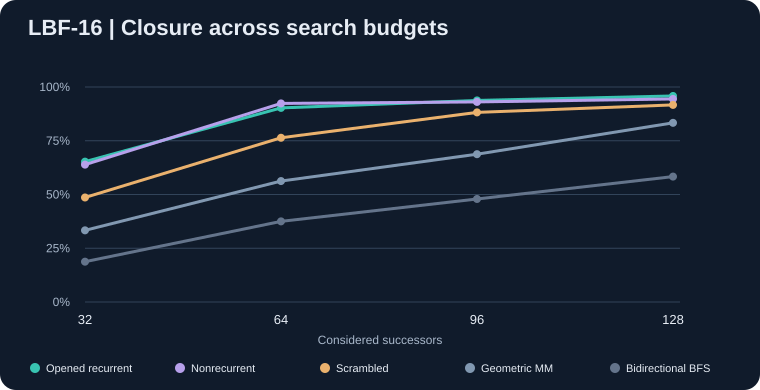
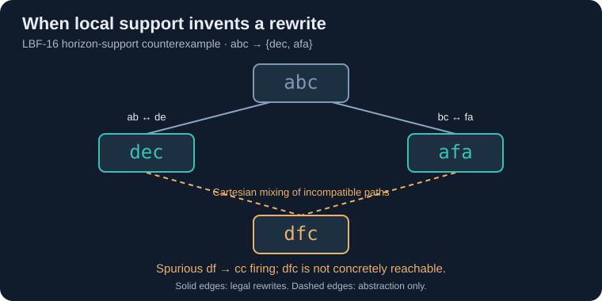

# Lite Braille Fresco: Intermediate Research Report

**24 November 2026 · LBF-16 milestone and the transition to relational abstraction**

Historical checkpoint: [LBF-16 merge 3230f1c5](https://github.com/MoralityLabAI/LoopedTransformers/commit/3230f1c50d65fdfa47c30fab789bb730c2f8c0f5). This illustrated report records the assessment made between LBF-16 and LBF-17. The latter has since been integrated; see the [postscript](#postscript).

## 1. From proof ranking to spatial computation

LBF-12 and LBF-13 established native Lean certificate custody and exact budget-conditioned supervision, but failed their utility and memory screens. LBF-13 learned A* closed 11/24 roots per seed, while symbolic bidirectional BFS closed 17/24. LBF-14 identified weak explicit message coupling and near-rank-one collapse; opening gates alone was insufficient. LBF-15 introduced learned cross-frontier meeting potentials, with spatial and memory shams exposing defects in the representation.

LBF-16 replaced symbol-specific embeddings and arbitrary planar sibling adjacency with alphabet-equivariant soft rewrite envelopes, separated one-step anchors from later novelty, and used subterm ribbons and frontier-set-equivariant axial competition. The primary model has 53,047 parameters.

All four registered development screens passed on 48 calibration roots and three training seeds. The primary controller closed 138/144 root-seed episodes (95.83%) against 40/48 for geometric MM and 28/48 for smaller-layer bidirectional BFS. Mean penalized successor work was 33.94 versus 66.94 and 85.56 respectively. The report records 1,469 standalone axiom-free Lean certificates. The 144 learned episodes are repeated observations on 48 independent roots, not 144 independent problems.

## 2. What the recurrence evidence establishes

| Comparator | Closure difference at B=128 | Mean penalized work difference |
|---|---:|---:|
| Geometric MM | +12.50 pp | -33.00 |
| Parameter-matched single pass | +1.39 pp | -0.88 |
| Zero message bank | +0.69 pp | +0.06 |
| Rolled bank | +2.08 pp | -1.84 |
| Scrambled subterm coordinates | +4.17 pp | -12.88 |
| No cross-step persistence | 0.00 pp | +0.60 |

The learned architecture has a substantial development advantage over the registered symbolic controls. The incremental recurrence effect is modest: the root-paired descriptive interval versus the single-pass controller is [-1.39,+4.86] pp. At B=32, zeroing, rolling and scrambling cost 4.86, 7.64 and 16.67 pp respectively. The no-persistence arm slightly improves average budget-curve closure and work.

The reported pass-three envelope gate increases from 0.00273 to 0.25248; the opened fresco bank effective rank reaches 2.660 and ribbon Moran's I rises from 0.3697 to 0.5795. These are measured diagnostics, not a proof that a particular tensor statistic causes the search gain. The scramble intervention jointly changes rewrite-window matching and ribbon convolution, so it cannot identify the convolutional effect in isolation. Successor counts also exclude neural and feature-computation costs; the work reductions do not establish wall-clock speedups.

## 3. The horizon-support correction

Let the initial word be abc and the reversible rules be ab ↔ de, bc ↔ fa, df ↔ cc. The concrete reachable component is {abc, dec, afa}: each noninitial word has only the inverse move back to abc. Positional marginals after one pass contain d at position zero (from dec) and f at position one (from afa). Their Cartesian concretization contains the unreachable word dfc, triggering spurious cc support at the second pass.

For a concrete word set S, let alpha(S) be its positional symbol supports and gamma(A) the Cartesian product of an abstract support A. The adjunction is alpha(S) ⊆ A iff S ⊆ gamma(A). With reflexive one-step concrete rewriting F, the best positional abstract transfer is F# = alpha ∘ F ∘ gamma. Iterating this transfer yields a conservative overapproximation, not exact concrete support. The initial singleton gives exact first-pass marginal support. Later passes can invent incompatible conjunctions.

The mathematical claim concerns Boolean supports or ideal positive arithmetic; finite-precision thresholding and intervention modes require separate validation. A positive glyph alone cannot certify that a concrete joint subterm is reachable. Independent native Lean certificates remain the proof authority.

## 4. Proposed LBF-17 research direction

The fresco can be understood as a compact abstract interpreter with a hierarchy of relational domains. Adjacent bigrams and length-three subterms preserve more joint information than individual symbol marginals; bounded provenance fibers can further reduce incompatible branch mixing. Exact reachable-state sets provide an expensive reference.

The proposed experiment freezes LBF-16, tests soundness and precision of the relational transfer, factors the causal shams (rewrite windows, ribbon convolution, axial attention, envelope bank and matrix bank), and compares parameter- and compute-matched single-pass controllers. Measure false bridge rates, glyph calibration, root-paired closure, latency, rule-window work, pairwise evaluations and memory. Charge explicit symbolic lookahead. Preserve the sealed cohorts and use new disjoint lineages.

## Postscript

At publication of this retrospective report, the repository already contains [LBF-17 theory](LBF_17_RELATIONAL_ABSTRACT_INTERPRETATION.md), [Lean formalization](lean/LBF17AbstractInterp.lean), [registration](LBF_17_REGISTRATION.md) and [results](LBF_17_RESULTS.md). These supersede the proposed experiment above; this report preserves the historical reasoning and does not re-register or rerun LBF-17.

## Evidence

- [LBF-12 rewrite results](LBF_12_REWRITE_FRESCO_RESULTS.md)
- [LBF-13 budget utility results](LBF_13_BUDGET_FRESCO_RESULTS.md)
- [LBF-14 tensor and frontier analysis](LBF_14_MECHANISTIC_AND_FRONTIER_ANALYSIS.md)
- [LBF-15 meeting potential results](LBF_15_MEETING_POTENTIAL_RESULTS.md)
- [LBF-16 specification and registration](LBF_16_EQUIVARIANT_FRESCO_REGISTRATION.md)
- [LBF-16 prospective results](LBF_16_EQUIVARIANT_FRESCO_RESULTS.md)
- [LBF-16 manifest](results/lbf16/manifest.json)
- [Original LBF-16 illuminated manuscript](results/lbf16/fresco_manuscript.svg)

Figures in this report are newly authored SVGs derived from the archived LBF-16 results and the explicit counterexample. They are explanatory figures, not additional experimental observations.
