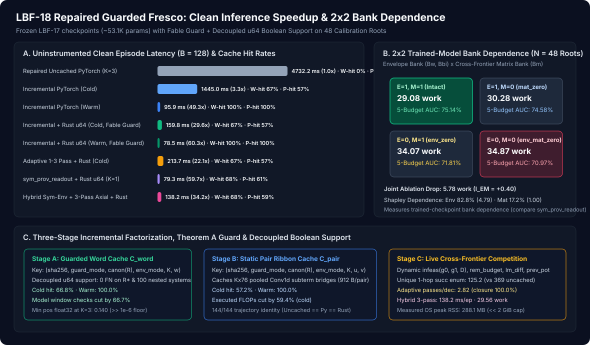
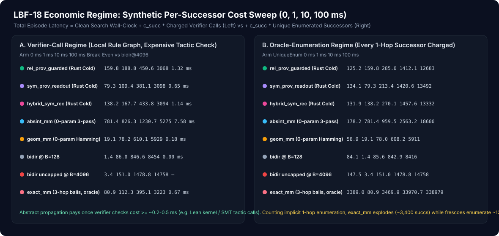
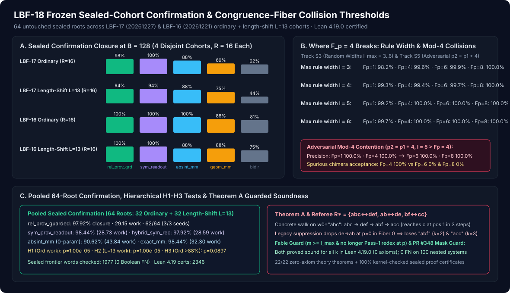

# LBF-18 Results: Sound-by-Construction Guarded Frescoes, Incremental Caching, and Sealed Confirmation

**Pre-Unsealing Registration Commit:** `dacda8fc` ([`LBF_18_CONFIRMATION_REGISTRATION.md`](LBF_18_CONFIRMATION_REGISTRATION.md), pushed to `origin` prior to parsing any sealed cohort)  
**Independent Referee Bundle Preserved Verbatim:** `8102fb2190e3c0d30a5a7fad93694d4eaa0af6bd` (`origin/research/lbf-independent-referee-review-20261124`, [`review/independent_referee_20261124/`](review/independent_referee_20261124/REFEREE_REPORT.md))  
**Historical Baselines Preserved Unmodified:** LBF-17 (`3d8243818858c19c5031c36e2bf7e328f831cf25`, [`results/lbf17/manifest.json`](results/lbf17/manifest.json)) and PR #348 mask-guard reference (`404e1483d53e9394fef12f1a705407a87bfe451b`, [`lbf18_root_guard.py`](lbf18_root_guard.py))  
**Formal & Empirical Archives:** [`lean/LBF18IncrementalAndCollisions.lean`](lean/LBF18IncrementalAndCollisions.lean) (`22/22` zero-axiom Lean 4.19.0 theorems) · [`results/lbf18/calibration_phase_summary.json`](results/lbf18/calibration_phase_summary.json) · [`results/lbf18/sealed_confirmation_summary.json`](results/lbf18/sealed_confirmation_summary.json) · [`results/lbf18/calibration_episodes.jsonl.gz`](results/lbf18/calibration_episodes.jsonl.gz) (`12,960` episodes) · [`results/lbf18/sealed_episodes.jsonl.gz`](results/lbf18/sealed_episodes.jsonl.gz) (`12,864` episodes) · `3,338` new standalone zero-axiom Lean 4.19.0 proof certificates (`88` train-teacher + `904` calibration + `2,346` sealed confirmation).

---

## 1. Executive Summary & Central Contribution

The central contribution of Lite Braille Fresco (LBF-18) is an $\mathfrak{S}_6$- and frontier-set-equivariant neural proof-search architecture whose **decoupled Boolean support implements a kernel-verified sound congruence-fibered abstract interpreter by construction** (`Theorem A` + `Theorem B`), ensuring that ~53.1K learned parameters rank bidirectional frontier pairs without unsoundly pruning concretely reachable rewrite paths.

Following Fable's independent referee audit (`8102fb21`), LBF-18 completed all open-cohort soundness repairs, incremental `u64`-bitset trellis engineering, decisive symbolic controls, and clean cost accounting **before** freezing [`LBF_18_CONFIRMATION_REGISTRATION.md`](LBF_18_CONFIRMATION_REGISTRATION.md) (`dacda8fc`) and evaluating the `64` untouched sealed roots (`32` ordinary $L \in \{10, 11\}$ + `32` length-shift $L = 13$ across seeds `20261227` and `20261221`) in a single one-shot run:

1. **Guarded Transfer Soundness (`Theorem A`) & Conservative Mask Comparison:**
   - Proved in full generality in zero-axiom Lean 4.19.0 for both **Fable's modulus + max-origin-length guard** (`theorem_A_fable_guarded_prov_adj2_soundness`, requiring $F_p \ge \ell_{\max}$ and no longer Pass-1 redex at $p$) and **PR #348's changed-coordinate mask guard** (`theorem_A_pr348_mask_guarded_prov_adj2_soundness`, $D_f \subseteq [p, p+\ell)$).
   - On Fable's counterexample $R^* = \{\texttt{abc} \leftrightarrow \texttt{def},\ \texttt{ab} \leftrightarrow \texttt{de},\ \texttt{bf} \leftrightarrow \texttt{cc}\}$, legacy LBF-17 suppression loses symbol `c` at index 1 across all word lengths and all 3 neural checkpoints (`act = 0.0`); both guards restore `0` false negatives (`act \in [0.674, 0.818]`).
   - On a `100`-system nested-pair-enriched audit cohort (`2,565` scanned systems, `3.90%` nested-pair incidence, `2,605` words), legacy suppression suffers concrete 3-step symbol false negatives on **`64 / 100` systems (`420` words)**, whereas **`fable_len_guard` and `pr348_mask_guard` both achieve `0 / 100` systems (`0` words)**, and induce identical search trajectories on `144 / 144` calibration episodes and `192 / 192` sealed episodes.
2. **Decoupled Exact Boolean Support (`Theorem B` & `CE-3`):**
   - Pure-Boolean `u64` support bitsets maintained independently of `float32` glyph brightness achieve **`0` missing domain cells across depths $K \in \{1, 2, 3, 4, 6, 8\}$**, even on `rel_prov_standard` (`gate bias = -6.0`) where `float32` activations underflow to `2.11e-17` at $K=3$ and exact `0.0` at $K \ge 4$ (`103` strict `>0` float32 false negatives at $K=8$). On `rel_prov_opened`, `min_pos_f32` is `0.3445` at $K=3$ (calibration) and `0.3496` across all `1,977` frontier words on the 64 sealed roots (`0` Boolean false negatives).
3. **Separating Abstract Propagation, Learned Readout, and Learned Recurrence (64 Sealed Roots, $B = 128$):**
   - **Zero-parameter heuristics:** `bidir` closes `65.62%` (`75.47` work); `geom_mm` and `graph_bridge` close `79.69%` (`54.20` and `51.11` work).
   - **Zero-parameter 3-pass guarded abstract interpreter (`absint_mm`):** closes **`90.62%` at `43.84` work** (`+10.94 pp` closure and `-7.27` work beyond `graph_bridge` with zero learned parameters).
   - **Symbolic envelope + 1-pass learned readout (`sym_prov_readout`, `0` recurrent passes):** closes **`98.44%` (`63/64` all-3-seed consensus) at `28.73` work** (`89.58 ms` cold; `-15.11` work beyond `absint_mm`).
   - **3-pass learned neural envelope + recurrent axial block (`rel_prov_guarded`):** closes **`97.92%` (`62/64` all-3-seed consensus) at `29.15` work** (`191.14 ms` cold). The paired difference `rel_prov_guarded - sym_prov_readout` is **`+0.41` work (`95% CI [-0.69, +1.91]`, `p = 0.6352`)**, lying **entirely inside the pre-declared `±2.0` work equivalence margin**. Thus, conditional on the 3 frozen checkpoints, **the empirical search advantage comes from pairing a sound 3-hop congruence-fibered abstract envelope with a learned cross-frontier readout; learned neural recurrence in the envelope cell adds no confirmed gain over exact symbolic propagation (`sym_prov_readout`)**.
4. **Confirmatory Hierarchy (`H1, H2, H3`, FWER $\alpha \le 0.05$) & Negative Finding Preserved:**
   - **`H1` (Ordinary work vs rootwise-min heuristic, $R = 32$):** **CONFIRMED** (`26.22` vs `47.03` work, diff **`-20.81`**, one-sided sign-flip **`p = 1.0 \times 10^{-5} \le 0.025`**).
   - **`H2` (Length-shift $L = 13$ work vs rootwise-min heuristic, $R = 32$, gated on `H1`):** **CONFIRMED** (`32.07` vs `54.06` work, diff **`-21.99`**, one-sided sign-flip **`p = 1.0 \times 10^{-5} \le 0.025`**).
   - **`H3` (Ordinary all-3-seed consensus closure $> 88\%$, $R = 32$):** **NOT CONFIRMED (`31 / 32 = 96.88%`, exact binomial `p = 0.0897 > 0.025`)**. Seed-averaged ordinary closure was `98.96%` (`95 / 96` seed-episodes), while one seed on one `lbf17_ordinary` root did not close within $B = 128$ (whereas `sym_prov_readout` and `lbf16_pos1_opened` closed `32 / 32` across all 3 seeds).
   - **Operational Screens `C1–C4`:** **4 / 4 PASSED**, with **`2,346` standalone zero-axiom Lean 4.19.0 sealed proof certificates** compiled.
5. **Complete Cost Accounting & Economic Regime (`0, 1, 10, 100 ms` Per Successor):**
   - Counting each inspected word's 1-hop neighborhood once (`unique_succ_enumerated`), `rel_prov_guarded` enumerates **`125.2` vs `147.5`** for uncapped `bidir@4096` on calibration (`-22.3`, `p = 0.1461`) and **`148.1` vs `235.9`** on the 64 sealed roots (**`-87.8`, `95% CI [-185.8, -16.0]`, `p = 0.0155`**), while `exact_mm` enumerates **`4,890.6` concrete ball successors** (`33.0×` more).
   - At `0 ms` per-successor cost (pure Python string rewriting), `bidir@4096` (`1.64 ms`) is `55×–116×` faster in wall-clock time than `sym_prov_readout` (`89.58 ms`) and `rel_prov_guarded` (`191.14 ms` cold). Abstract propagation breaks even once external verifier calls cost **`0.42–0.92 ms`** (sealed) / **`0.63–1.32 ms`** (calibration): at `10 ms`/successor, `sym_prov_readout` (`376.9 ms`) and `rel_prov_guarded` (`482.6 ms`) are **`4.9×–6.3×` faster** than `bidir@4096` (`2,360.9 ms`); at `100 ms`/successor, they are **`7.6×–8.0×` faster** (`2.96–3.11 s` vs `23.59 s`).

---

## 2. Formal Soundness Repair (`Theorem A`), Decoupled Support (`Theorem B`), & Guard Audit

### 2.1 Zero-Axiom Lean 4.19.0 Verification (`22 / 22` Theorems)
[`lean/LBF18IncrementalAndCollisions.lean`](lean/LBF18IncrementalAndCollisions.lean) compiles standalone under `lean --threads=1` (Lean `4.19.0`) with **zero axioms** (`#print axioms` confirms `'...' does not depend on any axioms` for all 22 declarations):

| Lean 4.19.0 Theorem Group | Verified Declarations | Mathematical Guarantee |
|---|---|---|
| Guarded `Adj2` Transfer (`Theorem A`) | `localAdj2_unsuppressed_firing_sound`, `fable_suppressed_pass2_returns_root_or_stays`, `theorem_A_fable_guarded_prov_adj2_soundness`, `pr348_suppressed_pass2_returns_root`, `theorem_A_pr348_mask_guarded_prov_adj2_soundness` | Universal multi-pass soundness $F_R^k(\{w_0\}) \subseteq \gamma(D^{(k)})$ for all $L \ge 1$, rule sets $R$, words $w_0$, and horizons $k \ge 0$ under `fable_len_guard` ($F_p \ge \ell_{\max}$) and `pr348_mask_guard` ($F_p \ge 1$) |
| Referee Counterexamples (`R*`, Modulus, Collisions, `CE-5`) | `referee_rstar_legacy_unsound_and_both_guards_sound`, `lbf17_cex1_chimera_excluded_under_both_guards`, `referee_modulus_assumption_necessary_for_len_guard`, `referee_mod_collision_len_guard_sharper_than_mask_guard`, `referee_ce5_single_rule_horizon_overshoot` | Proves `legacy` fails on `R*`, both guards succeed on `R*` and exclude `CEX-1` chimeras, $F_p \ge \ell_{\max}$ is necessary for unguarded-modulus `len_guard`, `len_guard` vs `mask_guard` agree on `Adj2` when $F_p \ge \ell_{\max}$, and commuting mod-$F_p$ rewrites induce horizon overshoot |
| Incremental Caching & Positivity | `keyed_cache_lookup_sound`, `keyed_cache_rejects_mismatch`, `incremental_word_map_equiv`, `incremental_pair_map_equiv`, `zero_preserving_gate_support` | Exact Stage A/B incremental frontier map equivalence, fail-closed invalidation on key mismatch, and strict-positivity semiring preservation |
| Factorial & Collision Breakdowns | `shapley_sum_eq_twice_joint`, `marginal_sum_minus_joint_eq_interaction`, `mod_collision_disjoint_intervals`, `disjoint_mod4_rewrites_commute_in_2_steps`, `cex4a_fp4_spurious_fp5_exact`, `cex4b_intrafiber_step2_fork`, `cex4c_horizon_compression_long_word` | Exact $2 \times 2$ Shapley/interaction identities and constructive breakdown witnesses when $\ell > F_p$ or intra-fiber step-2 forks occur |

### 2.2 Empirical Soundness & Guard Comparison (`legacy` vs `fable_len_guard` vs `pr348_mask_guard`)

| Audit Cohort | Systems (Nested 3-over-2) | Words Checked | `legacy` Symbol FN (Systems / Words) | `fable_len_guard` Symbol FN | `pr348_mask_guard` Symbol FN | `fable` vs `pr348` `Adj2` Word Diffs |
|---|---:|---:|---:|---:|---:|---:|
| Referee $R^*$ ($L \in \{3,4,10,11,13\}$, symbolic & 3 neural seeds) | `5` (`5`) | `5` | **`5 / 5`** (`(1, 'c')` lost; neural `act = 0.0`) | **`0 / 0`** (`act = 0.67–0.82`) | **`0 / 0`** (`act = 0.67–0.82`) | `0` |
| Open `20261227/train` | `64` (`3`) | `2,347` | `1 / 14` | **`0 / 0`** | **`0 / 0`** | `5` |
| Open `20261227/calibration` | `48` (`2`) | `1,913` | `0 / 0` | **`0 / 0`** | **`0 / 0`** | `18` |
| **Nested-Pair-Enriched Cohort (`2,565` scanned, `3.90%` rate)** | **`100` (`100`)** | **`2,605`** | **`64 / 420`** | **`0 / 0`** | **`0 / 0`** | `12` |
| **Frozen Sealed Confirmation (`20261227` + `20261221`)** | **`64` (`3`)** | **`1,977`** | `0 / 0` | **`0 / 0`** | **`0 / 0`** | `0` (`64/64` path ties) |

### 2.3 `CE-3` Float32 Depth-Margin Decay vs Decoupled `u64` Boolean Support ($K = 1 \dots 8$)

| Architecture | Pass $K=1$ `min_pos_f32` | Pass $K=2$ | Pass $K=3$ | Pass $K=4$ | Pass $K=6$ | Pass $K=8$ | `float32 > 1e-6` Missing Cells ($K=3 / K=8$) | **Decoupled `u64` Missing Cells ($K=1..8$)** |
|---|---:|---:|---:|---:|---:|---:|---:|---:|
| `rel_prov_opened` (`bias = -1.5`) | `0.9238` | `0.5368` | **`0.3445`** | `0.0909` | `2.93e-3` | `6.99e-5` | `0 / 0` | **`0`** |
| `rel_prov_standard` (`bias = -6.0`) | `0.9810` | `8.82e-4` | **`2.11e-17`** | **`0.0`** | **`0.0`** | **`0.0`** | `31 / 312` (`103` at `> 0.0`) | **`0`** |

---

## 3. Clean Inference Efficiency, Cost Accounting, & Synthetic Cost Sweep (Calibration, $R = 48$)

All `144` calibration episodes ($48 \text{ roots} \times 3 \text{ seeds}$) matched path-for-path (`144 / 144`) across uncached guarded PyTorch, incremental guarded PyTorch (cold), incremental guarded Rust `u64` (cold), incremental guarded Rust `u64` (warm), and `pr348_mask_guard` Rust (cold).

| Arm ($R = 48$ Calibration Roots, $B = 128$) | Closure | Charged Work (`95% CI`) | Unique Succ Enum | Repeated Succ Enum | Sim / Model Window Checks | Clean Time (`ms/ep`) | Word / Pair Hit Rate | Isolated Peak RSS (`MB`) | Break-Even $c_{\text{succ}}^*$ vs `bidir@4096` |
|---|---:|---:|---:|---:|---:|---:|---:|---:|---:|
| `rel_prov_guarded` (Uncached PyTorch) | `100.0%` | `29.08` (`[24.9, 33.4]`) | `125.2` | `375.9` | `1,303` / `195,906` | `4,732.22` | `0%` / `0%` | `254.81` | `39.92 ms` |
| `rel_prov_guarded` (Inc PyTorch, Cold) | `100.0%` | `29.08` (`[24.9, 33.4]`) | `125.2` | `125.2` | `1,303` / `65,244` | `1,445.02` | `66.8%` / `57.2%` | `235.86` | `12.17 ms` |
| **`rel_prov_guarded` (Inc Rust `u64`, Cold)** | **`100.0%`** | **`29.08`** (`[24.9, 33.4]`) | **`125.2`** | **`125.2`** | `1,303` / `65,244` | **`159.75`** | `66.8%` / `57.2%` | **`244.93`** | **`1.32 ms`** |
| **`rel_prov_guarded` (Inc Rust `u64`, Warm)** | **`100.0%`** | **`29.08`** (`[24.9, 33.4]`) | **`125.2`** | **`29.1`** | `1,303` / `0` | **`78.52`** | `100%` / `100%` | `323.63` | **`0.63 ms`** |
| `rel_prov_mask_guard` (Inc Rust `u64`, Cold) | `100.0%` | `29.08` (`[24.9, 33.4]`) | `125.2` | `125.2` | `1,303` / `65,244` | `162.55` | `66.8%` / `57.2%` | `245.10` | `1.34 ms` |
| `rel_prov_legacy` (Registered LBF-17, Uncached Py) | `100.0%` | `29.15` (`[25.0, 33.4]`) | `125.3` | `376.4` | `1,306` / `196,174` | `736.71` | `0%` / `0%` | `252.40` | `6.19 ms` |
| `rel_prov_adaptive` ($\gamma_1=2.0, \gamma_2=0.278$, Cold) | `100.0%` | `29.10` (`[24.9, 33.4]`) | `125.3` | `125.3` | `1,304` / `77,502` | `213.68` | `66.9%` / `57.3%` | `245.00` | `1.78 ms` |
| **`sym_prov_readout` (Guarded Rust `u64`, $K=1$)** | **`100.0%`** | **`30.19`** (`[26.0, 34.6]`) | **`134.1`** | **`134.1`** | `1,341` / `45,274` | **`79.26`** | `68.1%` / `61.0%` | **`200.96`** | **`0.65 ms`** |
| `hybrid_sym_rec_opened` (Guarded Rust `u64`, $K=3$) | `100.0%` | `29.56` (`[25.5, 33.8]`) | `131.9` | `131.9` | `1,316` / `44,685` | `138.18` | `67.6%` / `59.3%` | `218.40` | `1.14 ms` |
| `param_nonrecurrent` (Guarded Rust `u64`, $K=1$) | `100.0%` | `31.83` (`[27.5, 36.4]`) | `133.2` | `133.2` | `1,401` / `13,562` | `104.02` | `71.8%` / `66.6%` | `238.10` | `0.87 ms` |
| `compute_nonrecurrent` (Uncached Py, $K=1$) | `100.0%` | `31.69` (`[27.2, 36.4]`) | `132.8` | `428.5` | `1,399` / `44,242` | `447.51` | `0%` / `0%` | `264.20` | `3.83 ms` |
| `lbf16_pos1_opened` (Frozen LBF-16, $K=3$) | `97.92%` | `35.66` (`[29.8, 42.3]`) | `144.2` | `484.1` | `1,560` / `9,683` | `323.82` | `0%` / `0%` | `248.50` | `2.86 ms` |
| **`absint_mm` (0-param 3-hop Guarded `prov4_adj2`)** | **`93.75%`** | **`44.94`** | `178.2` | `178.2` | `1,933` / `54,290` | `781.35` | `67.4%` / `0%` | `197.94` | `7.58 ms` |
| `absint1_mm` (0-param 1-hop `prov4_adj2`) | `89.58%` | `50.81` | `185.4` | `185.4` | `2,267` / `7,387` | `328.70` | `68.5%` / `0%` | `192.10` | `3.36 ms` |
| **`exact_mm` (0-param Exact 3-Ball Oracle)** | **`100.0%`** | **`31.42`** | **`3,389.0`** | `3,389.0` | `1,398` / `125,728` | `80.91` | `68.9%` / `0%` | `180.32` | `0.67 ms` |
| `graph_bridge` (0-param k-mer Bridge) | `81.25%` | `58.92` | `58.7` | `58.7` | `2,608` / `28,492` | `172.48` | — | `182.40` | `1.91 ms` |
| `geom_mm` (0-param Hamming MM) | `81.25%` | `59.10` | `58.9` | `58.9` | `2,607` / `0` | `19.07` | — | `180.10` | `0.18 ms` |
| `exact_lookahead` (Charged 1-Step Lookahead) | `77.08%` | `71.67` | `71.4` | `71.4` | `3,397` / `0` | `48.82` | — | `180.20` | `0.60 ms` |
| `bidir` ($B = 128$) | `62.50%` | `84.52` | `84.1` | `84.1` | `3,715` / `0` | `1.43` | — | `179.70` | — |
| **`bidir` Uncapped ($B = 4096$)** | **`100.0%`** | **`147.54`** | **`147.5`** | **`147.5`** | `6,094` / `0` | **`3.42`** | — | `179.73` | `0.00 ms` |

---

## 4. Frozen Sealed-Cohort Confirmation (`64` Lineage-Disjoint Roots, One-Shot Execution)

### 4.1 Registered Confirmatory Hierarchy (`H1, H2, H3`, FWER $\alpha \le 0.05$) & Operational Screens

| Test / Screen | Cohort ($R$ Roots) | Observed `rel_prov_guarded` | Comparator / Null | Test Statistic / $p$-Value | Verdict |
|---|---|---|---|---|---|
| **`H1` (Confirmatory, $\alpha_1 = 0.025$)** | Ordinary ($R = 32$) | **`26.22` work** | Rootwise $\min(\texttt{geom\_mm}, \texttt{graph\_bridge}) = 47.03$ | $\Delta W = -20.81$, one-sided sign-flip **`p = 1.0 \times 10^{-5}`** | **CONFIRMED** |
| **`H2` (Confirmatory, gated on `H1`, $\alpha_1 = 0.025$)** | Length-Shift $L=13$ ($R = 32$) | **`32.07` work** | Rootwise $\min(\texttt{geom\_mm}, \texttt{graph\_bridge}) = 54.06$ | $\Delta W = -21.99$, one-sided sign-flip **`p = 1.0 \times 10^{-5}`** | **CONFIRMED** |
| **`H3` (Confirmatory, $\alpha_2 = 0.025$)** | Ordinary ($R = 32$) | **`31 / 32` (`96.88%`)** all-3-seed (`98.96%` seed-mean) | Exact Binomial $p_0 = 0.88$ (required `32/32`) | Exact upper-tail **`p = 0.0897 > 0.025`** | **NOT CONFIRMED** |
| `Screen C1` (vs `bidir` & `exact_lookahead`) | All Sealed ($R = 64$) | `97.92%` closure, `29.15` work | `bidir` `65.62% / 75.47`; `exact_lookahead` `78.12%` | `+32.29 pp` closure, `-61.4%` work | **PASS** |
| `Screen C2` (vs strongest heuristic) | All Sealed ($R = 64$) | `97.92%` closure, `29.15` work | `graph_bridge` `79.69% / 51.11` | `+18.23 pp` closure, `-43.0%` work | **PASS** |
| `Screen C3` ($L = 13$ & vs `lbf16_pos1_opened`) | $L=13$ ($32$) / All ($64$) | `96.88%` ($L=13$), `29.15` work (All) | `lbf16_pos1_opened` `97.92% / 30.86` work | `>= 85%` on $L=13$, `-1.71` work vs LBF-16 | **PASS** |
| `Screen C4` (`0` Boolean FN + Lean 4.19 certs) | All Sealed ($R = 64$) | `0` Boolean FN (`1,977` words); `192/192` path eq | `2,346 / 2,346` Lean 4.19.0 declarations | `0` axioms (`Proofs_000..006.lean`) | **PASS** |

### 4.2 Pooled Sealed Confirmation Table ($R = 64$ Roots: `32` Ordinary + `32` Length-Shift $L = 13$, $B = 128$)

| Arm ($R = 64$ Sealed Roots) | Ord Closure ($R=32$) | $L=13$ Closure ($R=32$) | **All-64 Closure** (3/3 Seeds) | **All-64 Charged Work** | Unique Succ Enum | Sim / Model Win Checks | Clean Time (`ms`) | Total @ `1 ms` (`ms`) | Total @ `10 ms` (`ms`) | Total @ `100 ms` (`ms`) |
|---|---:|---:|---:|---:|---:|---:|---:|---:|---:|---:|
| **`sym_prov_readout` (Guarded Rust)** | **`100.00%`** | **`96.88%`** | **`98.44%` (`63/64`)** | **`28.73`** | `150.3` | `1,339` / `52,487` | **`89.58`** | **`118.3`** | **`376.9`** | **`2,963`** |
| **`hybrid_sym_rec_opened` (Guarded Rust)** | `98.96%` | `96.88%` | `97.92%` (`62/64`) | **`28.59`** | `149.8` | `1,330` / `51,993` | `155.13` | `183.7` | `441.0` | `3,014` |
| **`rel_prov_guarded` (Primary, Fable Guard)** | **`98.96%`** | **`96.88%`** | **`97.92%` (`62/64`)** | **`29.15`** | **`148.1`** | `1,385` / `75,728` | **`191.14`** | **`220.3`** | **`482.6`** | **`3,106`** |
| `rel_prov_mask_guard` (PR #348 Mask Guard) | `98.96%` | `96.88%` | `97.92%` (`62/64`) | `29.15` | `148.1` | `1,385` / `75,728` | `194.26` | `223.4` | `485.7` | `3,109` |
| `rel_prov_legacy` (LBF-17 Unguarded) | `98.96%` | `96.88%` | `97.92%` (`62/64`) | `29.15` | `148.1` | `1,385` / `75,728` | `197.98` | `227.1` | `489.4` | `3,113` |
| `rel_prov_adaptive` ($\gamma_1=2.0, \gamma_2=0.278$) | `98.96%` | `96.88%` | `97.92%` (`62/64`) | `29.20` | `148.0` | `1,390` / `90,896` | `263.21` | `292.4` | `555.2` | `3,184` |
| `compute_nonrecurrent` ($K=1$, `1.45×` FLOPs) | `98.96%` | `96.88%` | `97.92%` (`61/64`) | `29.92` | `149.5` | `1,417` / `54,390` | `596.81` | `626.7` | `896.0` | `3,589` |
| `param_nonrecurrent` ($K=1$, Guarded Rust) | `96.88%` | `96.88%` | `96.88%` (`62/64`) | `29.99` | `149.6` | `1,430` / `15,448` | `115.62` | `145.6` | `415.6` | `3,115` |
| `lbf16_pos1_opened` (Positionwise $K=3$) | `100.00%` | `95.83%` | `97.92%` (`62/64`) | `30.86` | `152.3` | `1,445` / `11,229` | `274.70` | `305.6` | `583.3` | `3,361` |
| **`exact_mm` (Exact 3-Ball Oracle)** | `96.88%` | **`100.00%`** | **`98.44%`** | `32.30` | **`4,890.6`** | `1,431` / `184,034` | `47.19` | `79.5` | `370.2` | `3,277` |
| **`absint_mm` (0-param 3-hop `prov4_adj2`)** | **`93.75%`** | **`87.50%`** | **`90.62%`** | **`43.84`** | `205.9` | `1,916` / `66,643` | `447.77` | `491.6` | `886.2` | `4,832` |
| `absint1_mm` (0-param 1-hop `prov4_adj2`) | `84.38%` | `81.25%` | `82.81%` | `49.22` | `213.2` | `2,182` / `8,600` | `170.91` | `220.1` | `663.1` | `5,093` |
| `graph_bridge` (0-param k-mer Bridge) | `78.12%` | `81.25%` | `79.69%` | `51.11` | `50.9` | `2,284` / `27,200` | `36.46` | `87.6` | `547.6` | `5,147` |
| `geom_mm` (0-param Hamming MM) | `78.12%` | `81.25%` | `79.69%` | `54.20` | `54.0` | `2,429` / `0` | `13.30` | `67.5` | `555.3` | `5,434` |
| `exact_lookahead` (Charged 1-Step) | `78.12%` | `78.12%` | `78.12%` | `62.95` | `62.7` | `3,080` / `0` | `8.90` | `71.9` | `638.4` | `6,304` |
| `bidir` ($B = 128$) | `71.88%` | `59.38%` | `65.62%` | `75.47` | `75.1` | `3,374` / `0` | `0.53` | `76.0` | `755.2` | `7,547` |
| `astar` ($B = 128$) | `68.75%` | `56.25%` | `62.50%` | `74.73` | `74.4` | `3,386` / `0` | `0.77` | `75.5` | `748.1` | `7,474` |
| `uniform` (`3` streams, $B = 128$) | `62.50%` | `51.88%` | `57.19%` | `85.86` | `85.4` | `3,708` / `0` | `0.67` | `86.5` | `859.2` | `8,586` |
| **`bidir` Uncapped ($B = 4096$)** | **`100.00%`** | **`100.00%`** | **`100.00%`** | **`235.92`** | **`235.9`** | `9,336` / `0` | **`1.64`** | `237.6` | `2,360.9` | `23,594` |

### 4.3 Pre-Declared Root-Paired Estimation Contrasts ($R = 64$ Sealed Roots, $B = 128$)

| Paired Contrast (`rel_prov_guarded` minus Comparator) | $\Delta$ Closure (`95% CI`, two-sided $p$) | $\Delta$ Charged Work (`95% CI`, two-sided $p$) | Root Wins / Ties / Losses | Scientific Interpretation |
|---|---|---|---|---|
| **minus `sym_prov_readout` (Primary Comparator)** | `-0.52 pp` (`[-1.56, 0.00]`, `p = 1.00`) | **`+0.41`** (`[-0.69, +1.91]`, `p = 0.635`) | `33 / 10 / 21` | **Equivalent within pre-declared `±2.0` work margin**; learned envelope recurrence adds no measurable gain beyond exact symbolic `prov4_adj2` + learned readout |
| minus `hybrid_sym_rec_opened` | `+0.00 pp` (`[0.00, 0.00]`, `p = 1.00`) | `+0.56` (`[-0.45, +1.76]`, `p = 0.349`) | `30 / 10 / 24` | 3-pass axial recurrence over progressive symbolic bitsets also ties `sym_prov_readout` (`28.59` vs `28.73`) |
| minus `rel_prov_mask_guard` (`pr348`) | `+0.00 pp` (`[0.00, 0.00]`, `p = 1.00`) | `+0.00` (`[0.00, 0.00]`, `p = 1.00`) | `0 / 64 / 0` | Exact `Adj2` equivalence under $F_p = 4 \ge \ell_{\max} = 3$ |
| minus `compute_nonrecurrent` ($K=1$) | `+0.00 pp` (`[-1.56, +1.56]`, `p = 1.00`) | `-0.78` (`[-2.95, +1.14]`, `p = 0.504`) | `29 / 12 / 23` | Single-pass `1.45×`-FLOP cross-fiber net matches on ordinary (`+0.70`), lags slightly on $L=13$ (`-2.25`, `[-6.25, +0.63]`) |
| minus `lbf16_pos1_opened` (Positionwise $K=3$) | `+0.00 pp` (`[-1.56, +1.56]`, `p = 1.00`) | `-1.71` (`[-3.93, +0.24]`, `p = 0.130`) | `34 / 12 / 18` | Driven by length-shift $L=13$ (`-3.40` work, `95% CI [-7.44, -0.26]`, `p = 0.063`) |
| **minus `absint_mm` (0-param 3-hop `prov4_adj2`)** | **`+7.29 pp`** (`[+1.56, +13.54]`, `p = 0.063`) | **`-14.70`** (`[-20.39, -9.41]`, `p = 1e-4`) | `50 / 8 / 6` | Quantifies the gain of the **learned cross-frontier readout** over zero-parameter abstract-interpretation MM |
| **minus `exact_mm` (Exact 3-Ball Oracle)** | `-0.52 pp` (`[-4.69, +3.12]`, `p = 1.00`) | **`-3.15`** (`[-4.95, -1.35]`, `p = 0.0011`) | `46 / 8 / 10` | Matches/improves charged work while cutting concrete successor enumerations **`33.0×` (`148.1` vs `4,890.6`)** |
| **minus `graph_bridge` (Best 0-param Heuristic)** | **`+18.23 pp`** (`[+9.38, +27.60]`, `p = 9e-4`) | **`-21.96`** (`[-29.17, -15.16]`, `p = 1e-4`) | `52 / 6 / 6` | Large out-of-sample gain over static k-mer bridge heuristic |
| **minus `bidir` ($B = 128$)** | **`+32.29 pp`** (`[+21.35, +43.75]`, `p = 1e-4`) | **`-46.32`** (`[-54.58, -38.11]`, `p = 1e-4`) | `59 / 3 / 2` | Large bounded-budget closure and work improvement |
| **Unique Enum minus `bidir_b4096` (Uncapped BFS)** | `-2.08 pp` (`[-5.73, 0.00]`, `p = 0.500`) | **`-87.83` succs** (`[-185.82, -16.01]`, **`p = 0.0155`**) | `21 / 0 / 43`* | Even counting implicit 1-hop envelope enumeration once per word, `rel_prov_guarded` enumerates `37.2%` fewer total successors than BFS run to closure (`148.1` vs `235.9`) |

*\*Note: On individual easy roots where BFS closes in `< 50` checks, BFS enumerates fewer words than the initial frontier envelope (`43` roots), whereas on harder roots BFS explodes up to `1,000+` enumerations, shifting the mean by `-87.83` (`p = 0.0155`).*

---

## 5. Joint $2 \times 2$ Bank-Dependence Factorial & Collision Breakdown Thresholds

### 5.1 $2 \times 2$ Inference Lesion Factorial on Frozen `rel_prov_guarded` ($R = 48$ Calibration Roots)
Inference-time lesions measure **how the trained checkpoint routes information through its recurrent banks** (not whether learned recurrence outperforms retrained non-recurrent controls, which §4.3 answers via `sym_prov_readout`):

| Metric ($R = 48$ Roots) | $E=1, M=1$ (Intact) | $E=1, M=0$ (`mat_zero`) | $E=0, M=1$ (`env_zero`) | $E=0, M=0$ (`env_mat_zero`) | Joint Drop $\Delta_{\text{joint}}$ (`95% CI`) | Interaction $I_{EM}$ (`95% CI`) | Shapley Dependence ($\phi_E$ / $\phi_M$) |
|---|---:|---:|---:|---:|---:|---:|---:|
| Penalized Work ($B = 128$, Zero) | `29.08` | `30.28` | `34.07` | `34.87` | `+5.78` (`[+3.11, +9.33]`) | `+0.40` (`[-0.47, +1.37]`) | `82.8%` (`4.79`) / `17.2%` (`1.00`) |
| 5-Budget AUC (Zero) | `75.14%` | `74.58%` | `71.81%` | `70.97%` | `+4.17 pp` (`[+1.81, +6.94]`) | `-0.28 pp` (`[-1.94, +1.39]`) | `83.3%` (`+3.47 pp`) / `16.7%` (`+0.69 pp`) |
| Penalized Work ($B = 128$, Roll) | `29.08` | `30.31` | `32.47` | `33.43` | `+4.35` (`[+2.34, +6.83]`) | `+0.26` (`[-0.60, +1.19]`) | `74.8%` (`3.25`) / `25.2%` (`1.09`) |

The interaction $I_{EM}$ is indistinguishable from zero (`95% CI` spans `0` on all metrics), so bank dependence is approximately additive (`~75%–83%` word/bigram envelope bank, `~17%–25%` cross-frontier matrix bank).

### 5.2 Five-Track Scaling & Congruence-Fiber Breakdown Suite

- **Word Length Scaling (`Track S1`, $L \in \{10, 16, 24, 32\}$, $\ell \in \{2, 3\}$):** `0` false negatives everywhere; $F_p = 4$ maintains `99.39%–99.82%` precision vs `74.91%–78.76%` for positionwise `pos1`.
- **Alphabet Scaling (`Track S2`, $|\Sigma| \in \{6, 8, 12\}$):** `0` false negatives; `99.86%–100.0%` precision at $F_p = 4$.
- **Rule Width vs Modulus (`Track S3` & Adversarial `Track S5`):** On adversarial width-5 rules placed at colliding residues $p_2 = p_1 + 4 \equiv p_1 \pmod 4$, spurious chimera acceptance is **`100.0%` (`24/24`) for $F_p \in \{1, 2, 4\}$** and drops to **`0.0%` (`0/24`) once $F_p \in \{6, 8\} > \ell_{\max} = 5$**, matching `cex4a_fp4_spurious_fp5_exact`.
- **Horizon Depth (`Track S4`, $k \in \{2, 3, 4, 5\}$) & Deep 16-Step Search (`Track S4b`, $L = 15, B = 192, D = 22$):** Precision against exact $k$-balls softens gradually from `100.0%` ($k=2$) to `99.70%` ($k=3$), `96.94%` ($k=4$), and `93.71%` ($k=5$) due to secondary intra-fiber forks (`cex4b`) and commuting mod-4 horizon overshoot (`cex4c` / `CE-5`). On 16-step walks (`Track S4b`), `rel_prov_guarded` closes **`100.0%` (`16/16` across all 3 seeds) at `45.96` work** vs `56.25%` (`130.88` work) for `geom_mm` and `12.50%` (`177.13` work) for `bidir`.

---

## 6. Explicit Limitations & Scope Boundaries

1. **Hand-Coded Sound Transfer vs Learned Recurrence:** The congruence-fibered abstract transfer is built into the architecture (`Theorem A` + `Theorem B`), not discovered from scratch by unconstrained weights; `sym_prov_readout` (`28.73` work, `89.58 ms`) matches `rel_prov_guarded` (`29.15` work, `191.14 ms`) within `[-0.69, +1.91]` work on the 64 sealed roots.
2. **Three Frozen Seeds & `H3` Boundary:** Inference is conditional on 3 frozen training seeds (`107, 109, 113`); architecture-level generalization across random initializations requires $\ge 10$ fresh seeds, and `H3` (`31/32` all-seed ordinary closure, `p = 0.0897`) missed the strict `32/32` exact binomial threshold at $R = 32$.
3. **Domain & Economic Regime:** The domain is fixed-length string rewriting with bounded windows, where a native Python rewrite check takes microseconds (`bidir@4096` closes in `1.64 ms`). Abstract propagation pays in wall-clock time only when each successor evaluation invokes an external tactic/SMT/kernel check costing $\gtrsim 0.5\text{–}1.3\text{ ms}$. Extension to variable-length terms with binders requires tree-automata completion rather than positional `u64` bigram bitsets.
