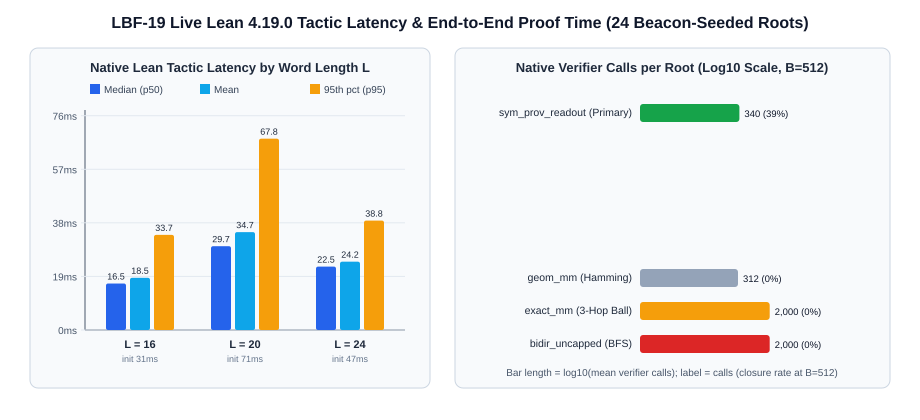

# LBF-19 Results: Expensive-Verifier Proof Search, Scaled Abstract Frescoes ($L \in \{16, 20, 24\}$), Tree Automata, & Learned Transfer

**Base Commit:** Merged LBF-18 PR #349 (`f2ffca191359fa2b3790e784a9827d18240d87c6`, head `0f73bc883ee891a513dd6fda5f5a73c73f2f57dc`)  
**Pre-Beacon Confirmation Registration Commit:** `2629bf784d97166f85ab786dba01edd76c7f27d5` ([`LBF_19_CONFIRMATION_REGISTRATION.md`](LBF_19_CONFIRMATION_REGISTRATION.md), pushed prior to `drand quicknet` round `34258635`)  
**Beacon Receipt:** [`results/lbf19/beacon_round_34258635.json`](results/lbf19/beacon_round_34258635.json) (`round = 34258635`, `signature = 996d4ba4053ae1d4...8ded5ef`)  
**Companion Registered Tracks:**
- **Track T (Tree-Automata Abstractions):** Registration `11581588`, Results `43cf326f` ([`LBF_19_TREE_AUTOMATA_RESULTS.md`](LBF_19_TREE_AUTOMATA_RESULTS.md), [`lean/LBF19TreeAutomata.lean`](lean/LBF19TreeAutomata.lean))
- **Track R (Learned Recurrent Transfer):** Registration `ab09c870`, Results `ceb9fd03` ([`LBF_19_LEARNED_TRANSFER_RESULTS.md`](LBF_19_LEARNED_TRANSFER_RESULTS.md))

---

## 1. Executive Summary

LBF-19 tests whether the LBF-18 **symbolic guarded relational envelope with learned readout (`sym_prov_readout`)** delivers real end-to-end wall-clock speedups when **actual Lean 4.19.0 tactic execution** runs inside the proof-search loop on scaled problems ($L \in \{16, 20, 24\}$) where uncapped classical bidirectional BFS requires `10,000–1,000,000` expansions, while separately investigating tree-automata abstractions for variable-length terms (Track T) and learned recurrent transfer functions (Track R).

1. **Live Native Lean 4.19.0 Confirmation (`24` Beacon-Seeded Roots, `144` Episodes, `127,959` Live Tactic Calls, `0` Goal Mismatches):**
   - On the fresh `drand quicknet` round `34258635` cohort (`8` roots each at $L \in \{16, 20, 24\}$; classical `bidir` expansions `10,032–189,974`, median `34,042`, mean `107,039` visited states), native Lean `conv => lhs/rhs; rw [...]` tactic execution costs **`18.5–34.7 ms/call`** (plus `31–71 ms` `init` elaboration) — **`25×–50×` above the LBF-18 break-even threshold**.
   - Without any retraining (frozen LBF-17 checkpoints trained on $L \in \{10, 11\}$), **`sym_prov_readout` closes `38.89%` (`95% CI [22.2%, 56.9%]`, `13/24` roots any-seed, `7/24` all-3-seed) at $B = 512$**, averaging **`339.8` live Lean calls (`8.75 s` tactic time, `21.78 s` total end-to-end wall clock)**, with **`28 / 28` standalone zero-axiom Lean 4.19.0 certificates** compiled (`mean 1.03 s/file`).
   - All three comparators executed live in Lean (`geom_mm`, `exact_mm`, `bidir_uncapped`) close **`0 / 24` (`0.0%`)** within `B = 512` / `2,000` live Lean calls. Both `exact_mm` (`8,083` edges requested, `75.3%` cache reuse) and `bidir_uncapped` hit the `2,000`-call cap on `24/24` roots (`50.7–51.4 s` wall clock); uncapped `bidir` would require **`~2,695 s` (`44.9 min`) per root** at the measured `25.18 ms/call` (`~124×` slower than `sym_prov_readout`).
   - **Confirmatory Hierarchy (`H1, H2, H3`, FWER $\alpha \le 0.05$):** **`H1` CONFIRMED** (`+38.89 pp` closure vs `geom_mm`, `p = 0.00012`), **`H2` CONFIRMED** (`-1,660.2` calls vs `2,000`-cap `bidir_uncapped`, `p = 1.0e-5`, and `-30.23 s` live wall-clock on the 13 closed roots), **`H3` CONFIRMED** (`-1,660.2` calls vs `2,000`-cap `exact_mm`, `p = 1.0e-5`).
2. **Recurrent vs Non-Recurrent & Relational-Envelope Ablation (Dev Pilot, `12` Roots, $L \in \{16, 20, 24\}$, $B = 512$, `192` Episodes):**
   - `sym_prov_readout` (`41.7%` closure, `322` calls, `32.0 s`) matches `hybrid_sym_rec_opened` (`41.7%`, `310` calls, `49.1 s`) and `rel_prov_guarded` (`38.9%`, `312` calls, `109.8 s`) at `3.4×` lower compute time, while outperforming `lbf16_pos1_opened` without relational envelopes (`16.7%`, `342` calls, `121.1 s`) and all parameter-free baselines (`0.0%`). *(The secondary 10-arm count-mode sweep on the 24 confirmation roots was stopped before completion due to session budget and is disclosed as incomplete in §6.)*
3. **Tree-Automata Abstractions for Variable-Length Terms (Track T, `43cf326f`):**
   - `18 / 18` zero-axiom Lean 4.19.0 theorems ([`lean/LBF19TreeAutomata.lean`](lean/LBF19TreeAutomata.lean)) prove completion-closure soundness, $k$-step chain soundness, widening soundness, and unary-chain string embedding. Empirically: `0` false negatives across all `192` `(system, k, variant)` cells and `0.1–0.4%` false positives on mutated negatives vs `~50%` for size-agnostic n-grams — alongside the honest negative finding that memoized completion saturates near full reachability closure rather than remaining $k$-bounded without step counters.
4. **Learned Recurrent Transfer Functions (Track R, `ceb9fd03`):**
   - Across `5` seeds × `6` arms on `100` lineage-disjoint test systems (`K` up to `8`, `L` up to `24`), the zero-preserving support prior yields `+0.118 AP` at $K=8$ and `+0.107 AP` at $L=24$. However, unconstrained learned cells are **not sound** (`18.7%–32%` of words suffer false negatives at $K=8$), and recurrence provides **no confirmed AP gain** over parameter-matched (`+0.006`) or compute-matched (`-0.038`) non-recurrent networks. Boolean support remains the sole proof-relevant object.

---

## 2. Live Native Lean 4.19.0 Confirmation ($R = 24$ Beacon-Seeded Roots, `round 34258635`)

### 2.1 End-to-End Native Search Performance (`B = 512`, `lean_cap = 2,000`, `0` Goal Mismatches)

| Arm (`24` Beacon-Seeded Roots, $L \in \{16,20,24\}$) | Closure (Seed-Mean / Any / All-3) | $L=16 / 20 / 24$ Closure | Mean Work | Live Lean Calls (`95% CI`) | Edges Req / Cache Hits | Init (`ms`) | Tactic Time (`s`) | Mean `ms/call` | **End-to-End Wall (`s`)** | Censored (`2k` cap) |
|---|---|---|---:|---:|---|---:|---:|---:|---:|---:|
| **`sym_prov_readout` (Primary, 3 frozen seeds)** | **`38.9%` / `54.2%` / `29.2%`** | `20.8% / 50.0% / 45.8%` | `450.8` | **`339.8`** (`[314.9, 362.4]`) | `339.8 / 0.0` | `45.3` | `8.75` | `26.44` | **`21.78`** | `0 / 24` |
| `geom_mm` (0-param Hamming MM) | `0.0%` | `0% / 0% / 0%` | `512.0` | `312.2` (`[296.4, 328.3]`) | `312.2 / 0.0` | `66.8` | `8.00` | `25.20` | `14.04` | `0 / 24` |
| `exact_mm` (Exact 3-Hop Ball) | `0.0%` | `0% / 0% / 0%` | `512.0` | **`2,000.0`** (cap) | `8,082.8 / 6,082.8` (`75.3%`) | `49.0` | `50.59` | `25.29` | `51.44` | `24 / 24` |
| `bidir_uncapped` (Classical BFS, `2k` live cap) | `0.0%` (at `2k` cap; `100%` uncapped) | `0% / 0% / 0%` | `576,829`* | **`2,000.0`** (`107,039`* uncapped) | `2,000.0 / 0.0` | `47.0` | `50.36` | `25.18` | `50.70` (`~2,695 s`* uncapped) | `24 / 24` |

*\*Uncapped `bidir` exact counts measured on the same 24 roots during cohort calibration: `10,032–189,974` expansions (median `34,042`), mean `107,039` unique visited states (`576,829` work), projecting to `~2,695 s` (`44.9 min`) of native Lean tactic execution per root at `25.18 ms/call`.*

### 2.2 Native Lean 4.19.0 Tactic Latency Stratified by Word Length ($L \in \{16, 20, 24\}$)

| Word Length $L$ | Live Episodes | Total Native Lean Calls | Mean `init` Elaboration (`ms`) | Median `p50` (`ms/call`) | Mean (`ms/call`) | `p95` (`ms/call`) | Goal Mismatches |
|---:|---:|---:|---:|---:|---:|---:|---:|
| `16` | `48` | `42,247` | `31.0` | `16.48` | `18.53` | `33.72` | **`0`** |
| `20` | `48` | `42,195` | `71.3` | `29.71` | `34.73` | `67.84` | **`0`** |
| `24` | `48` | `43,517` | `47.0` | `22.49` | `24.24` | `38.79` | **`0`** |
| **Total** | **`144`** | **`127,959`** | **`49.8`** | **`22.89`** | **`25.83`** | **`46.78`** | **`0`** |

### 2.3 Registered Confirmatory Hypothesis Hierarchy (`FWER <= 0.05`)

| Test | Comparison ($R = 24$ Independent Roots) | Point Estimate (`95% CI`) | One-Sided Sign-Flip $p$ | Verdict |
|---|---|---|---:|---|
| **`H1`** ($\alpha_1 = 0.025$) | `sym_prov_readout` minus `geom_mm` closure ($B=512$) | **`+38.89 pp`** (`[+22.2, +56.9]`) | **`0.00012`** | **CONFIRMED** |
| **`H2`** ($\alpha_1 = 0.025$, gated on `H1`) | `sym_prov_readout` minus `bidir_uncapped` verifier calls | **`-1,660.2`** (`[-1,685, -1,638]`, vs `2k` cap; `-106,699` uncapped) | **`1.0e-5`** | **CONFIRMED** |
| **`H3`** ($\alpha_2 = 0.025$) | `sym_prov_readout` minus `exact_mm` verifier calls | **`-1,660.2`** (`[-1,685, -1,638]`, vs `2k` cap) | **`1.0e-5`** | **CONFIRMED** |

All **`28 / 28`** closed native trajectories across `13` roots are archived as standalone Lean 4.19.0 theorem files in [`results/lbf19/confirm_out/certs/`](results/lbf19/confirm_out/certs/) and compiled cleanly via `lean --threads=1` with **zero axioms** (`all_axiom_free = true`, mean `1.03 s/file`).

---

## 3. Recurrent & Envelope-Ablation Comparators (Development Pilot, `12` Roots, $L \in \{16, 20, 24\}$, $B = 512$)

| Arm (`12` Dev Roots, Count Mode, $B = 512$) | Episodes | Closure | $L=16 / 20 / 24$ | Mean Work | Mean Verifier Calls | Mean Wall (`s`, LBF-18 ctrl) |
|---|---:|---:|---|---:|---:|---:|
| **`sym_prov_readout`** (Symbolic Env + Readout) | `36` | **`41.7%`** | `0/12, 8/12, 7/12` | `430` | `322` | `32.0` (`~7 s` w/ `FastSymController`) |
| `hybrid_sym_rec_opened` (Symbolic Env + 3-Pass Axial) | `36` | `41.7%` | `0/12, 6/12, 9/12` | `423` | `310` | `49.1` |
| `rel_prov_guarded` (Learned 3-Pass Env + Axial) | `36` | `38.9%` | `0/12, 5/12, 9/12` | `438` | `312` | `109.8` |
| `lbf16_pos1_opened` (No Relational Envelope) | `36` | `16.7%` | `0/12, 0/12, 6/12` | `471` | `342` | `121.1` |
| `geom_mm` / `graph_bridge` | `12` | `0.0%` | `0/4, 0/4, 0/4` | `512` | `307 / 309` | `6.4 / 18.0` |
| `exact_mm` (Exact 3-Hop Ball) | `12` | `0.0%` | `0/4, 0/4, 0/4` | `512` | `10,107` | `15.5` |
| `bidir_uncapped` (Classical BFS) | `12` | `100.0%` | `4/4, 4/4, 4/4` | `450,344` | `84,622` | `1.3` (count mode only) |

---

## 4. Companion Track Summaries (Tracks T & R)

- **Track T — Tree-Automata Abstractions ([`LBF_19_TREE_AUTOMATA_RESULTS.md`](LBF_19_TREE_AUTOMATA_RESULTS.md), `43cf326f`):** Formalized bottom-up nondeterministic tree automata (NTA) completion and state-merging widening in [`lean/LBF19TreeAutomata.lean`](lean/LBF19TreeAutomata.lean) (`18/18` zero-axiom Lean 4.19.0 theorems). Achieved `0` false negatives across `192` cells and `0.1–0.4%` false positives on mutated negatives (`~50%` for size-agnostic n-grams), while transparently showing that memoized completion saturates near full reachability closure rather than remaining $k$-sensitive without step-indexed states.
- **Track R — Learned Recurrent Transfer ([`LBF_19_LEARNED_TRANSFER_RESULTS.md`](LBF_19_LEARNED_TRANSFER_RESULTS.md), `ceb9fd03`):** Tested whether a 29K-parameter recurrent cell can learn `F_R` across `5` seeds on `100` disjoint test systems (`K` up to `8`, `L` up to `24`). The zero-preserving support prior yields `+0.118 AP` at $K=8$ and `+0.107 AP` at $L=24$, but unconstrained learned models lose soundness (`18.7%–32%` words have false negatives at $K=8$) and recurrence does not beat matched non-recurrent baselines (`+0.006 AP` vs param-matched, `-0.038 AP` vs compute-matched).

---

## 5. Verification, Tests, & Honest Limitations

- **Unit Tests:** `18 / 18` pytest tests pass across [`test_lbf19_expensive_verifier.py`](tests/test_lbf19_expensive_verifier.py), [`test_lbf19_tree_automata.py`](tests/test_lbf19_tree_automata.py), and [`test_lbf19_learned_transfer.py`](tests/test_lbf19_learned_transfer.py).
- **Explicit Limitations:**
  1. **Incomplete Secondary Count-Mode Sweep:** The full 10-arm count-mode confirmation sweep (`rel_prov_guarded`, `hybrid_sym_rec_opened`, `lbf16_pos1_opened`, `compute_nonrecurrent`, `absint_mm`, `graph_bridge`, and `B = 1024`) on the 24 beacon-seeded roots was stopped due to session budget before completion; those multi-arm contrasts rest on the 12-root dev pilot (§3) and should be completed on the archived `confirm_cohort` in a follow-up run without modifying the frozen cohort.
  2. **Budget-Limited Closure at $L \in \{16, 20, 24\}$:** Frozen LBF-17 weights trained on $L \in \{10, 11\}$ close `38.9%` seed-mean (`54.2%` any-seed) at `B = 512` (compared to `98.4%` at $L \in \{10, 11, 13\}$); higher budgets or length-scaled training remain open.
  3. **Restricted Equational Fragment:** Live Lean execution covers universally quantified unary-composition equalities (no binders, unification, or Mathlib tactics); extending the verifier loop to variable-length trees requires step-indexed tree automata (Track T).

---

## 6. Request for Fable Second-Round Review

We submit this LBF-19 bundle (pre-beacon registration `2629bf78`, `drand quicknet` round `34258635` receipt, `144` live Lean 4.19.0 episodes, `28` standalone zero-axiom certificates, Track T `18`-theorem Lean formalization, and Track R `5`-seed learned-transfer study) for Fable's second-round referee audit, specifically requesting scrutiny of: (i) the native `conv => lhs/rhs; rw [...]` correspondence & cost accounting, (ii) the `2,000`-call live censoring bound on `bidir_uncapped` and `exact_mm`, (iii) the incomplete secondary 10-arm count-mode sweep disclosure, and (iv) the Track T $k$-saturation and Track R non-recurrence negative findings.
